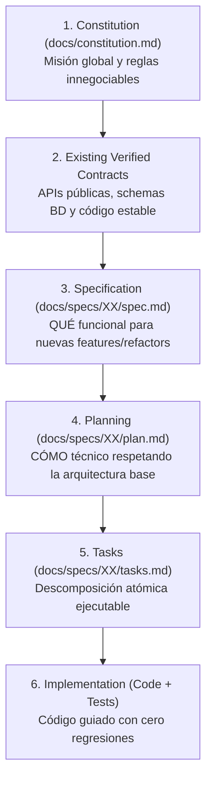

# SDD-Adopt: Adopción e Ingeniería Inversa de SDD en Proyectos Existentes (Brownfield)

Este workflow es el **motor de onboarding e ingeniería inversa** del framework SDD. Su propósito es incorporar formalmente la metodología **Spec-Driven Development** en **proyectos existentes, avanzados o heredados (*legacy*)** que fueron construidos sin especificaciones previas, protegiendo el código en producción, respetando los contratos vigentes y estableciendo una línea base documental sólida.

`/sdd-adopt` ejecuta:

* la inspección pasiva, no destructiva y exhaustiva del código fuente real;
* la extracción de la **Constitución De Facto** (`docs/constitution.md`);
* la generación y calibración del archivo maestro `AGENTS.md` con los comandos reales del proyecto;
* la creación del **Inventario de Módulos y Línea Base** (`docs/specs/00-baseline/inventory.md`);
* el mapeo de contratos públicos existentes (endpoints, schemas de BD, eventos);
* la definición de la estrategia de coexistencia entre código legado y nuevo desarrollo bajo SDD.

---

# 0. REGLA SUPREMA — CODEBASE IS KING & CERO DESTRUCCIÓN

Esta regla tiene **precedencia absoluta dentro de este workflow**.

1. **La Verdad Reside en el Código Real**: En proyectos existentes, el código fuente ya materializó cientos de decisiones funcionales y técnicas. La IA **NO DEBE INVENTAR** un stack idealizado, ni asumir librerías que no están instaladas, ni imponer arquitecturas incompatibles con lo que ya corre.
2. **Prohibición Total de Edición o Borrado de Código**: `/sdd-adopt` es un proceso puramente documental, analítico y de gobernanza. **ESTÁ TERMINANTEMENTE PROHIBIDO** crear, modificar o eliminar archivos de código de producción (`src/`, `lib/`, `backend/`, `frontend/`, etc.) durante este comando.
3. **Preservación Incondicional de Contratos Vigentes**: Todo endpoint expuesto, interfaz pública, modelo de persistencia o contrato de integración ya existente se considera un compromiso activo con clientes o servicios externos y no puede alterarse arbitrariamente.
4. **Detección sin Suposiciones Silenciosas**: Ante dudas sobre módulos muertos (*dead code*), librerías en desuso o intención de negocio, la IA **DEBE PREGUNTAR** al usuario en lugar de asumir.

---

# 1. Jerarquía de Precedencia Adaptada para Proyectos Brownfield

Para proyectos existentes bajo adopción SDD, la jerarquía de verdad y precedencia se calibra de la siguiente manera:



### Principio de No Regresión
> Ningún nuevo desarrollo, refactorización o corrección puede romper los contratos preexistentes catalogados en la Línea Base, a menos que exista una especificación formal aprobada (`/sdd-spec-anchored`) que documente explícitamente el cambio de contrato y su migración.

---

# 2. Las 5 Fases Operativas de `/sdd-adopt`

El asistente debe ejecutar ordenadamente las siguientes fases:

```text
[FASE 1: Deep Scan Pasivo]
        ↓
[FASE 2: Calibración de AGENTS.md]
        ↓
[FASE 3: Constitución De Facto (docs/constitution.md)]
        ↓
[FASE 4: Inventario y Línea Base (docs/specs/00-baseline/)]
        ↓
[FASE 5: Hoja de Ruta de Transición]
```

---

## FASE 1: Deep Scan e Inspección Pasiva del Repositorio

El asistente debe inspeccionar el repositorio mediante herramientas de lectura (`view_file`, `list_dir`, `grep_search`), recolectando evidencia física sobre:

### 1.1 Manifests de Dependencias y Stack Tecnológico
* **JavaScript / TypeScript**: Inspeccionar `package.json`, `pnpm-lock.yaml`, `package-lock.json`, `tsconfig.json`.
* **Java / Kotlin**: Inspeccionar `pom.xml` o `build.gradle`, detectando versión de Spring Boot / Quarkus / etc.
* **Python**: Inspeccionar `requirements.txt`, `pyproject.toml`, `Pipfile`, `setup.py`.
* **Dart / Flutter**: Inspeccionar `pubspec.yaml`.
* **C# / .NET**: Inspeccionar archivos `.csproj`, `.sln`.
* **Go / Rust / PHP**: Inspeccionar `go.mod`, `Cargo.toml`, `composer.json`.

### 1.2 Persistencia y Modelos de Datos
* Localizar esquemas y migraciones: `prisma/schema.prisma`, entidades TypeORM, migraciones Flyway/Liquibase, modelos JPA `@Entity`, migraciones Alembic, schemas SQL puros o scripts de inicialización.
* Identificar motor de base de datos objetivo: PostgreSQL, MySQL, SQLite, MongoDB, Redis, etc.

### 1.3 Infraestructura, Entorno y Configuración
* Inspeccionar `docker-compose.yml`, `Dockerfile`, `.env.example`, variables de entorno requeridas, puertos configurados y servicios auxiliares.

### 1.4 Comandos de Verificación Reales (Tooling)
* Identificar los scripts reales del proyecto:
  * **Test Runner**: runner configurado (ej: `npm test`, `./mvnw test`, `pytest`, `flutter test`).
  * **Linter / Formatter**: (ej: `eslint`, `prettier`, `checkstyle`, `flake8`).
  * **Typecheck / Compiler**: (ej: `tsc --noEmit`, `./mvnw compile`).
  * **Build**: (ej: `npm run build`, `./mvnw package`).

### 1.5 Arquitectura Física Existente
* Mapear el árbol de carpetas para identificar el patrón de diseño actual:
  * *Clean Architecture / Hexagonal* (dominio, aplicación, infraestructura).
  * *MVC Tradicional* (controllers, services, models/entities).
  * *Feature-First / Vertical Slice* (carpetas por módulo funcional).
  * *Fullstack Monorepo* (carpetas separadas `client`/`server` o `frontend`/`backend`).

---

## FASE 2: Generación del Archivo Maestro `AGENTS.md`

El asistente genera el archivo maestro **`AGENTS.md`** en la raíz del repositorio, adaptado a la realidad descubierta:

### Estructura de `AGENTS.md` para Proyectos Brownfield:

```markdown
# AGENTS.md — Reglas Operativas y Gobernanza SDD (Adopción Brownfield)

## 1. Identidad y Contexto del Proyecto
* **Proyecto**: [Nombre del Proyecto detectado]
* **Modalidad**: Adopción SDD en Código Existente (Brownfield)
* **Stack Principal**: [Lenguajes, Frameworks y BD detectados]
* **Arquitectura Base**: [Patrón arquitectónico identificado]

## 2. Comandos Operativos Verificados
El asistente DEBE utilizar estrictamente los comandos reales configurados en este proyecto:
* **Ejecutar Pruebas**: `[comando real detectado, ej: npm test / ./mvnw test]`
* **Verificación de Tipos / Compilación**: `[comando real, ej: npx tsc --noEmit / ./mvnw compile]`
* **Linter**: `[comando real, ej: npm run lint]`
* **Build de Producción**: `[comando real, ej: npm run build]`

## 3. Reglas Innegociables para Proyectos Existentes
1. **Regla de No Regresión**: Cualquier nueva feature o corrección debe garantizar que la suite de pruebas existente continúe pasando al 100%.
2. **Prohibición de Refactorización Silenciosa**: No se deben modificar módulos marcados como `SEALED` a menos que exista una tarea formal en `tasks.md`.
3. **Respeto a las Convenciones Vigentes**: Todo nuevo código debe adherirse a los estilos de nombres, patrones de carpetas y prácticas ya presentes en el proyecto.
4. **Ciclo de Vida Documental**:
   * Nuevas Features: `/sdd-spec-high` ➔ `/sdd-planning` ➔ `/sdd-task` ➔ `/sdd-execution`
   * Refactors y Corrección de Bugs en Código Existente: `/sdd-spec-anchored`
   * Despliegue y Ops: `/doc-deploy`
```

---

## FASE 3: Redacción de la Constitución De Facto (`docs/constitution.md`)

El asistente crea el documento supremo **`docs/constitution.md`**. En lugar de formular preguntas sobre preferencias futuras, este documento extrae y consolida las reglas que ya gobiernan el sistema:

### Contenido obligatorio de `docs/constitution.md`:
1. **Misión y Visión del Sistema**: Qué problema resuelve la plataforma según las rutas, controladores y modelos ya construidos.
2. **Actores y Roles Detectados**: Roles identificados en middlewares de autenticación/autorización, tablas de base de datos o interfaces de usuario.
3. **Stack y Dependencias Aprobadas**: Catálogo de tecnologías activas en el repositorio. Queda prohibido añadir librerías redundantes sin justificación técnica.
4. **Invariantes Técnicas y de Entorno**:
   * Puertos por defecto y variables de entorno críticas.
   * Reglas de conectividad y dependencias externas (pasarelas de pago, APIs externas, servicios de correo).
5. **Principios de Calidad y Concurrencia**:
   * Manejo de transacciones en base de datos.
   * Tratamiento de errores y respuestas HTTP estándar.
6. **Límites Operativos y Deuda Técnica Conocida**:
   * Aspectos identificados durante la auditoría que requieren atención posterior.

---

## FASE 4: Inventario de Dominios y Línea Base (`docs/specs/00-baseline/`)

El asistente crea la carpeta `docs/specs/00-baseline/` y genera el archivo **`inventory.md`**, el cual establece el estado de madurez de cada parte del sistema:

### Estructura de `docs/specs/00-baseline/inventory.md`:

```markdown
# Línea Base del Sistema e Inventario de Módulos

## 1. Matriz de Estado de Módulos

| Módulo / Dominio | Directorio Físico | Estado | Cobertura de Tests | Descripción / Contrato Principal | Próxima Acción SDD |
| :--- | :--- | :--- | :--- | :--- | :--- |
| [Ej: Auth] | `src/auth/` o similar | SEALED | [Alta / Media / Nula] | JWT, Login, Registro, Refresh Token | Mantenimiento pasivo |
| [Ej: Catálogo] | `src/products/` | STABLE | [Alta / Media / Nula] | CRUD de productos y categorías | Respetar contratos |
| [Ej: Facturación] | `src/billing/` | IN_PROGRESS | [Nula] | Lógica a medio terminar, sin tests | Formalizar con spec |
| [Ej: Reportes] | N/A | PENDING | N/A | No implementado en código | Diseñar con /sdd-spec-high |

### Definición de Estados:
* **`SEALED`**: Módulo en producción o completamente funcional. Se considera una "caja negra" con contratos fijos. Solo se interviene mediante `/sdd-spec-anchored`.
* **`STABLE`**: Módulo con funcionalidad básica operativa pero sujeto a posibles extensiones menores.
* **`IN_PROGRESS`**: Código detectado pero incompleto, con stubs, mocks o falta de integración.
* **`PENDING`**: Módulo que el equipo planea construir pero no tiene presencia en el código.

---

## 2. Catálogo de Contratos Públicos Existentes

### 2.1 Endpoints de API / Rutas Expuestas
* Listar los endpoints detectados en controladores/routers con método HTTP y propósito.

### 2.2 Modelos de Persistencia (Entidades Principales)
* Listar las tablas o colecciones existentes y sus relaciones cardinales observadas.

### 2.3 Eventos / WebSockets / Mensajería (si aplica)
* Tópicos o canales utilizados por la aplicación.
```

---

## FASE 5: Hoja de Ruta de Transición Operativa

El asistente define y explica al usuario el protocolo para continuar el desarrollo a partir de este momento:

```text
                                   ¿Qué deseas hacer ahora?
                                              │
               ┌──────────────────────────────┼──────────────────────────────┐
               ▼                              ▼                              ▼
    [Desarrollar Feature Nueva]   [Completar Código Incompleto]   [Auditar Despliegue]
               │                              │                              │
               ▼                              ▼                              ▼
        /sdd-spec-high                /sdd-spec-anchored                /doc-deploy
               │                              │                              │
        Flujo SDD puro               Alineación con tests            Docker / Cloud / Ops
```

1. **Para implementar nuevas funcionalidades (Módulos `PENDING`)**:
   * Usar `/sdd-spec-high [nombre de la feature]`
   * El asistente diseñará la especificación y el plan garantizando no colisionar con la Línea Base.
2. **Para completar código existente o corregir bugs (Módulos `IN_PROGRESS` o `SEALED`)**:
   * Usar `/sdd-spec-anchored 00. [descripción de la corrección o feature a culminar]`
   * Esto creará la spec retrospectiva, el plan de acoplamiento y las tareas guiadas.
3. **Para ejecutar tareas**:
   * Usar `/sdd-execution` para validar código y tests con verificación física en consola.

---

# 3. Entrevista de Calibración Rápida (Opcional - Grill-Me Mínimo)

Si durante la Fase 1 el asistente detecta ambigüedades críticas que no se pueden inferir del código (ej. módulos duplicados, código muerto o dos configuraciones contradictorias), formulará **máximo 3 preguntas cerradas** al usuario:

```text
❓ Calibración Brownfield:
1. Detecté dos módulos de persistencia: [A] y [B]. ¿Cuál es el actualmente activo en producción?
2. ¿Hay alguna sección de código en [carpeta] que deba ser considerada obsoleta (deprecated)?
3. ¿Cuál es el comando preferido para ejecutar la suite completa de pruebas?
```

---

# 4. Salida Esperada: Reporte de Adopción

Al finalizar, el asistente DEBE presentar un informe estructurado como este:

```text
================================================================================
🎉 ADOPCIÓN SDD COMPLETADA EXITOSAMENTE (LÍNEA BASE CONSOLIDADA)
================================================================================
✔ Repositorio Auditado: [Nombre o ruta del proyecto]
✔ Stack Detectado: [Lenguaje/Framework backend, frontend, BD, ORM]
✔ Test Runner Configurado: [Comando verificado]
✔ Gobernanza Establecida:
  ├── AGENTS.md                               (Instrucciones de gobernanza y comandos)
  └── docs/
      ├── constitution.md                     (Constitución De Facto del proyecto)
      └── specs/00-baseline/
          └── inventory.md                    (Inventario de módulos y contratos)

--------------------------------------------------------------------------------
📊 Resumen de Módulos Catalogados:
- [N] Módulos SEALED (Estables)
- [N] Módulos IN_PROGRESS (Requieren alineación)
- [N] Módulos PENDING (Futuros desarrollos)
--------------------------------------------------------------------------------
🚀 Próximos pasos recomendados:
- Para nueva funcionalidad: `/sdd-spec-high [descripción]`
- Para completar o arreglar un módulo legado: `/sdd-spec-anchored 00. [detalle]`
- Para desplegar: `/doc-deploy`
================================================================================
```
