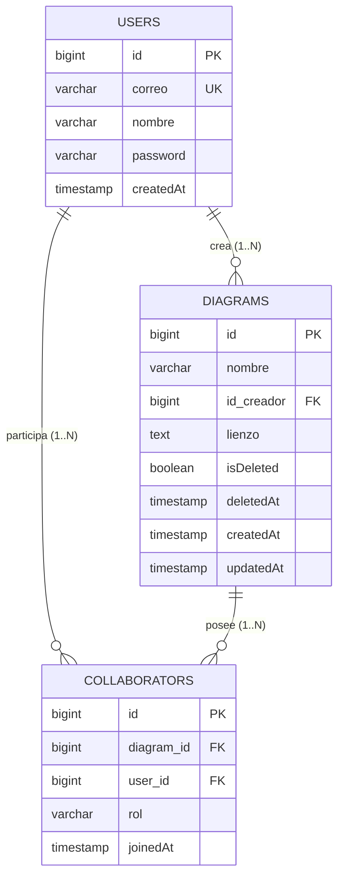

# Línea Base del Sistema e Inventario de Módulos

Este documento establece el **inventario técnico oficial, el catálogo de contratos públicos y la línea base de estabilidad** del proyecto al momento de la adopción formal de Spec-Driven Development (SDD).

---

## 1. Matriz de Estado de Módulos

| Módulo / Dominio | Directorio Físico Principal | Estado | Cobertura de Tests | Descripción / Contrato Principal | Próxima Acción SDD |
| :--- | :--- | :--- | :--- | :--- | :--- |
| **Autenticación y Cuentas** | `back_diagramador/.../controller/AuthController.java`<br>`front_diag_clases/app/login/`, `register/` | **SEALED** | Media (Prueba de contexto en backend) | Registro, login con BCrypt, seeders de prueba y health check. | Mantenimiento pasivo; no modificar sin spec anclada. |
| **Gestión de Diagramas y Colaboradores** | `back_diagramador/.../controller/DiagramController.java`<br>`back_diagramador/.../service/DiagramService.java` | **SEALED** | Media | CRUD completo con soft delete, control de creador, invitaciones y retiro de colaboradores. | Respetar contratos existentes de `/api/diagrams`. |
| **Lienzo UML Interactivo (Canvas)** | `front_diag_clases/components/canvas/`<br>`front_diag_clases/app/(dashboard)/diagrams/[id]/` | **STABLE** | Manual / E2E visual | Modelado UML 2.5: clases con 3 compartimentos, estereotipos, notas adhesivas, 7 tipos de aristas y controles de zoom/pan. | Mantener compatibilidad con esquema JSON de lienzo. |
| **Sincronización en Tiempo Real (STOMP)** | `back_diagramador/.../controller/CanvasWebSocketController.java`<br>`front_diag_clases/services/websocket.ts` | **STABLE** | Nula (Verificado en ejecución) | Retransmisión multiusuario vía WebSockets STOMP (`/topic/diagram/{id}`) con cursores colaborativos y presencia en vivo. | Estabilizar reconexión automática si se interrumpe la red. |
| **Generador de Código Spring Boot** | `front_diag_clases/services/springBootGenerator.ts`<br>`front_diag_clases/components/canvas/SpringBootExportModal.tsx` | **STABLE** | Nula | Genera proyecto completo Maven en ZIP con entidades JPA, DTOs, Controllers, Services y repositorios. | Diseñar suite de pruebas unitarias para el generador. |
| **Generador de Código Flutter** | `front_diag_clases/services/flutterGenerator.ts`<br>`front_diag_clases/components/canvas/FlutterExportModal.tsx` | **STABLE** | Nula | Genera arquitectura limpia en Dart/Flutter con modelos serializables, servicios HTTP y vistas UI en ZIP. | Diseñar suite de pruebas unitarias para el generador. |
| **Interoperabilidad XMI (UML Estándar)** | `front_diag_clases/services/xmiExporter.ts`<br>`front_diag_clases/services/xmiImporter.ts` | **STABLE** | Nula | Exportación e importación de especificaciones XML según metamodelo OMG UML 2.5. | Validar compatibilidad cruzada con Enterprise Architect y StarUML. |
| **Asistencia con Inteligencia Artificial** | `front_diag_clases/services/geminiDiagramService.ts`<br>`front_diag_clases/components/canvas/ImageImportModal.tsx`<br>`front_diag_clases/components/canvas/CanvasAiPromptBar.tsx` | **STABLE** | Nula | Reconocimiento multimodal de imágenes de pizarras/bocetos y generación de diagramas por texto vía Gemini API. | Optimizar manejo de cuotas y fallbacks a gemini-2.0-flash. |
| **Infraestructura y Reverse Proxy** | `docker-compose.yml`<br>`nginx/nginx.conf`<br>`DESPLIEGUE_AWS/` | **SEALED** | Operativo verificado | Enrutamiento perimetral unificado en puerto 80, multiplexación HTTP/WebSocket y scripts AWS EC2. | Gestión mediante comando `/doc-deploy`. |
| **Historial y Control de Versiones de Diagrama** | N/A | **PENDING** | N/A | Funcionalidad futura: auditoría de versiones anteriores y rollback visual del lienzo. | Diseñar mediante `/sdd-spec-high versioning`. |

### Definición de Estados:
* **`SEALED`**: Módulo en funcionamiento probado y estable. Es tratado como "caja negra". Solo puede intervenirse mediante especificaciones ancladas (`/sdd-spec-anchored`).
* **`STABLE`**: Módulo con funcionalidad operativa completa, listo para uso pero con potencial de optimización o extensión controlada.
* **`IN_PROGRESS`**: Código detectado pero incompleto, con stubs o falta de integración probada.
* **`PENDING`**: Módulo identificado en la visión del producto pero que aún no cuenta con implementación física en el código.

---

## 2. Catálogo de Contratos Públicos Existentes

### 2.1 Endpoints de API REST (Backend Spring Boot)

| Método | Endpoint | Parámetros / Payload | Respuestas HTTP | Propósito |
| :--- | :--- | :--- | :--- | :--- |
| `POST` | `/api/auth/register` | Body: `{ correo, nombre, password }` | `201 CREATED`, `400 BAD REQUEST`, `500 ERROR` | Registra un nuevo usuario con contraseña cifrada en BCrypt. |
| `POST` | `/api/auth/login` | Body: `{ correo, password }` | `200 OK` (AuthResponse), `401 UNAUTHORIZED`, `500 ERROR` | Autentica un usuario y devuelve su información de perfil. |
| `GET` | `/api/auth/health` | Ninguno | `200 OK` (`{"status": "UP"}`) | Endpoint de diagnóstico y conectividad backend. |
| `GET` | `/api/auth/quick-users` | Ninguno | `200 OK` (Lista de `User`) | Devuelve usuarios de prueba sembrados para acceso rápido en demo. |
| `GET` | `/api/diagrams` | Query: `?userId=X` (opcional) | `200 OK` (Lista de `DiagramResponse`) | Obtiene los diagramas donde el usuario es creador o colaborador. |
| `GET` | `/api/diagrams/{id}` | Path: `id`, Query: `?userId=X` | `200 OK` (`DiagramResponse`), `404 NOT FOUND` | Obtiene el detalle y el estado del lienzo de un diagrama específico. |
| `POST` | `/api/diagrams` | Body: `{ nombre, idCreador, lienzo }` | `201 CREATED` (`DiagramResponse`), `400 BAD REQUEST` | Crea un nuevo diagrama y registra automáticamente al creador. |
| `PUT` | `/api/diagrams/{id}` | Path: `id`, Body: `{ nombre, lienzo, usuarioId }` | `200 OK` (`DiagramResponse`), `404 NOT FOUND` | Actualiza el nombre o el contenido del lienzo (`nodes`/`edges`). |
| `DELETE`| `/api/diagrams/{id}` | Path: `id`, Query: `?userId=X` | `200 OK` (`{"message": "..."}`), `403 FORBIDDEN`, `404 NOT FOUND` | Realiza el borrado lógico (*soft delete*) del diagrama (solo creador). |
| `POST` | `/api/diagrams/{id}/invite` | Path: `id`, Body: `{ correo }` | `201 CREATED` (`CollaboratorDTO`), `400 BAD REQUEST` | Invita a un usuario registrado al diagrama con rol `COLABORADOR`. |
| `DELETE`| `/api/diagrams/{id}/collaborators/{userId}` | Path: `id`, `userId`, Query: `?requesterId=X` | `200 OK`, `400 BAD REQUEST`, `403 FORBIDDEN` | Retira a un colaborador del diagrama (autorizado por creador o auto-retiro). |

---

### 2.2 Modelos de Persistencia y Estructura de Datos (JPA / PostgreSQL)



* **Restricción de unicidad en `collaborators`**: `UNIQUE(diagram_id, user_id)`.
* **Regla de integridad**: Un usuario con rol `CREADOR` no puede ser eliminado de la tabla `collaborators` mediante el endpoint de retiro.

---

### 2.3 Canales y Contratos WebSocket (STOMP)

* **Endpoints de Conexión**:
  * `/ws` (con fallback transparente SockJS).
  * `/ws-raw` (para clientes WebSocket nativos).
* **Canal de Suscripción (Difusión)**:
  * `/topic/diagram/{id}`
* **Canal de Envío de Mensajes (Cliente hacia Servidor)**:
  * `/app/diagram/{id}/sync`
* **Esquema de Payload `WebSocketMessage`**:
  ```typescript
  {
    type: "JOIN" | "LEAVE" | "SYNC_CANVAS" | "NODE_CHANGE" | "PRESENCE" | "CURSOR_MOVE" | "NODE_MOVE";
    diagramId: number;
    userId: number;
    userName: string;
    userRole: "CREADOR" | "COLABORADOR";
    payload: string; // JSON serializado de coordenadas, nodos o cursores
    timestamp?: number;
  }
  ```

---

## 3. Resumen de Calidad y Estrategia de Coexistencia

1. **Protección de Código Legado**: El backend y frontend actuales están completamente operativos y probados funcionalmente. Las siguientes iteraciones deben resguardar los 11 endpoints REST y el protocolo STOMP.
2. **Desarrollo Guiado por Especificaciones**: Toda nueva funcionalidad se diseñará primero en `docs/specs/` antes de tocar código fuente.
