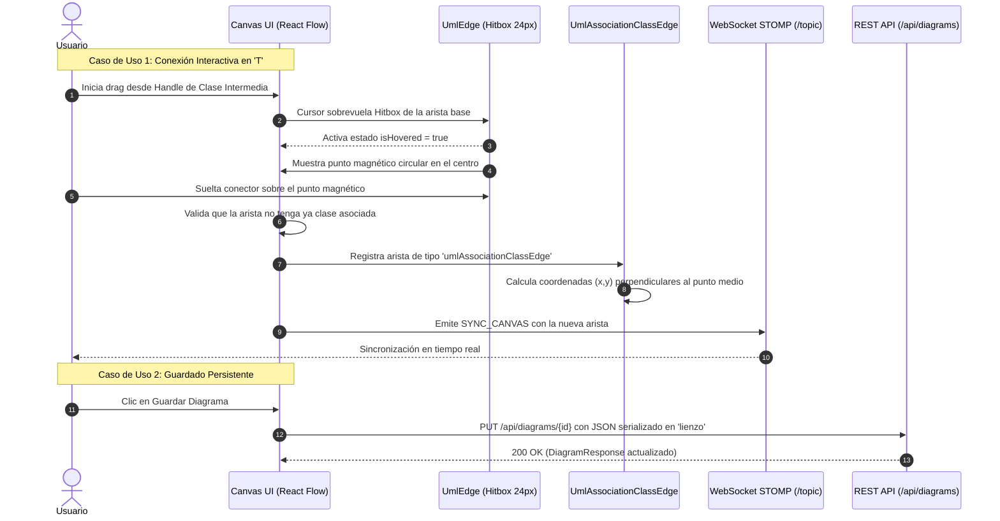

# Plan Técnico: Clases de Asociación en 'T' e Importación de Imagen en Lienzo Activo

> Módulo: `docs/specs/01-clase-asociacion-e-importacion-lienzo/` | Especificación Base: `spec.md` | Estado: Diseñado | Metodología: SDD-Planning

---

## 1. Resumen Arquitectónico y Matriz de Componentes

- **Objetivo Técnico**: 
  1. Implementar la arista personalizada `umlAssociationClassEdge` en `@xyflow/react` para renderizar y recalcular dinámicamente el conector perpendicular discontinuo en "T" anclado al baricentro de aristas existentes, con hitbox magnético expandido de 24px para captura de eventos *drag & drop*.
  2. Implementar el componente de importación en el lienzo activo `CanvasImageImportModal` conectado a `CanvasToolbar`, habilitando los modos `"REPLACE"` y `"MERGE"` con cálculo de desplazamiento espacial armónico.
  3. Extender los generadores `xmiExporter.ts`, `springBootGenerator.ts` y `flutterGenerator.ts` para procesar la semántica de la clase de asociación.
  4. Mantener la resiliencia de persistencia y compatibilidad 100% con los contratos existentes de PostgreSQL (`lienzo: TEXT`) y STOMP WebSockets sin requerir alteraciones al esquema DDL del backend.
- **Patrón Arquitectónico**: Arquitectura por Componentes React con Custom Edges y Servicios Funcionales Desacoplados (Next.js 16 App Router + Spring Boot MVC).
- **Capas Involucradas**:
  - `Presentación / UI (Lienzo & Modales)`:
    - Componente de arista `UmlAssociationClassEdge.tsx` para trazado en 'T'.
    - Componente `UmlEdge.tsx` extendido con hitbox magnético invisible y eventos de conexión.
    - Componente `CanvasToolbar.tsx` actualizado con el botón de importación directa.
    - Modal `CanvasImageImportModal.tsx` con opciones duales "Reemplazar" vs "Fusionar".
  - `Dominio & Tipos`:
    - `types/index.ts`: Definición de interfaces tipadas para `UmlAssociationEdgeData`, `UmlAssociationClassConnection` y `ImportCanvasMode`.
  - `Infraestructura & Servicios`:
    - `services/geminiDiagramService.ts`: Extensión de prompts de sistema y funciones de normalización para reconocer y emitir clases de asociación en 'T'.
    - `services/springBootGenerator.ts`: Generación de entidades con doble `@ManyToOne`.
    - `services/flutterGenerator.ts`: Generación de modelo Dart referenciado.
    - `services/xmiExporter.ts`: Generación de tag `<packagedElement xmi:type="uml:AssociationClass">`.
    - `services/websocket.ts`: Transmisión en tiempo real de eventos de aristas asociativas.

---

## 2. Estructura Física de Archivos del Proyecto / Módulo

```text
front_diag_clases/
├── app/
│   └── (dashboard)/
│       └── diagrams/
│           └── [id]/
│               └── page.tsx                         # Integración de arista personalizada y modal de importación
├── components/
│   └── canvas/
│       ├── CanvasImageImportModal.tsx               # NUEVO: Modal de importación dentro del lienzo (Reemplazar vs Fusionar)
│       ├── CanvasToolbar.tsx                        # MODIFICADO: Agrega botón "Importar Imagen"
│       ├── UmlAssociationClassEdge.tsx              # NUEVO: Custom Edge de React Flow para trazado en 'T'
│       ├── UmlEdge.tsx                              # MODIFICADO: Hitbox de 24px y punto magnético central para anclaje
│       └── UmlEdgeMarkers.tsx                       # MODIFICADO: Marcadores SVG específicos para clase de asociación
├── services/
│   ├── geminiDiagramService.ts                      # MODIFICADO: Soporte de Association Class en visión y prompts
│   ├── springBootGenerator.ts                       # MODIFICADO: Generación de 2x @ManyToOne para clase asociativa
│   ├── flutterGenerator.ts                          # MODIFICADO: Modelo Dart con referencias a clases padre
│   └── xmiExporter.ts                               # MODIFICADO: Serialización <uml:AssociationClass>
├── types/
│   └── index.ts                                     # MODIFICADO: Interfaces UmlAssociationEdgeData y CanvasImportOptions
└── tests/
    ├── e2e/
    │   └── association-class-canvas.spec.ts         # NUEVO: Test BDD de conexión interactiva en T y merge de imagen
    └── unit/
        ├── associationClassMath.test.ts             # NUEVO: Test unitario de cálculo de punto medio y perpendicularidad
        └── springBootAssociationGenerator.test.ts   # NUEVO: Test unitario del generador JPA para clases intermedias
```

---

## 3. Diagrama de Secuencia Técnico



---

## 4. Contratos de Código e Interfaces Tipadas

### 4.1 Modelos de Dominio e Interfaces de Aristas en `types/index.ts`

```typescript
export type UmlRelationType =
  | "ASSOCIATION"
  | "DIRECTED_ASSOCIATION"
  | "GENERALIZATION"
  | "REALIZATION"
  | "AGGREGATION"
  | "COMPOSITION"
  | "DEPENDENCY"
  | "ASSOCIATION_CLASS"; // Tipo semántico de la clase asociativa

export interface UmlAssociationEdgeData {
  isAssociationClass: boolean;
  targetEdgeId: string;       // ID de la arista base entre Clase A y Clase B
  sourceClassId: string;      // ID de la Clase A
  targetClassId: string;      // ID de la Clase B
  intermediateNodeId: string; // ID de la Clase Intermedia (Colaborador)
  name?: string;
}

export type ImportCanvasMode = "REPLACE" | "MERGE";

export interface CanvasImageImportResult {
  mode: ImportCanvasMode;
  nodes: Node[];
  edges: Edge[];
}
```

### 4.2 Algoritmo de Cálculo Perpendicular del Conector en 'T'

```typescript
/**
 * Calcula el punto medio geométrico de la arista base y las coordenadas de la arista en T.
 */
export function getAssociationClassEdgeParams(
  sourcePos: { x: number; y: number }, // Posición del puerto de la clase intermedia
  edgeMidpoint: { x: number; y: number } // Centro de la arista base
): {
  path: string;
  labelX: number;
  labelY: number;
} {
  const path = `M ${sourcePos.x} ${sourcePos.y} L ${edgeMidpoint.x} ${edgeMidpoint.y}`;
  return {
    path,
    labelX: (sourcePos.x + edgeMidpoint.x) / 2,
    labelY: (sourcePos.y + edgeMidpoint.y) / 2,
  };
}
```

### 4.3 Generador Spring Boot: Mapeo JPA de la Clase Asociativa

```java
// Estructura generada para la entidad intermedia en springBootGenerator.ts
package com.example.project.model;

import jakarta.persistence.*;
import lombok.*;
import java.time.LocalDateTime;

@Entity
@Table(name = "collaborators")
@Data
@NoArgsConstructor
@AllArgsConstructor
@Builder
public class Collaborator {

    @Id
    @GeneratedValue(strategy = GenerationType.IDENTITY)
    private Long id;

    // Relación 1: Clase A (Extremo izquierdo)
    @ManyToOne(fetch = FetchType.EAGER)
    @JoinColumn(name = "user_id", nullable = false)
    private User user;

    // Relación 2: Clase B (Extremo derecho)
    @ManyToOne(fetch = FetchType.EAGER)
    @JoinColumn(name = "diagram_id", nullable = false)
    private Diagram diagram;

    // Atributos propios de la clase asociativa
    @Column(nullable = false)
    private String rol;

    @Builder.Default
    private LocalDateTime createdAt = LocalDateTime.now();
}
```

---

## 5. Garantías de Runtime, Persistencia e Integridad Relacional

1. **Integridad del Grafo de Entidades**:
   - Si una arista base es eliminada por el usuario, el conector `umlAssociationClassEdge` se elimina automáticamente sin afectar la existencia de la clase intermedia en el lienzo.
   - Si la clase intermedia es eliminada, la arista en 'T' se destruye pero la arista base entre `ClaseA` y `ClaseB` permanece 100% intacta, preservando multiplicidades y nombres.
2. **Patrón de Selección Tridimensional (The 3-Way Selector Pattern) en Importación**:
   - *Modo Reemplazar*: Limpieza limpia del lienzo con reinicialización de estados.
   - *Modo Fusionar*: Cálculo de coordenadas con `offset` espacial (`x + 350`, `y + 200`) para ubicar las nuevas clases en cuadrantes no ocupados, evitando superposiciones.
   - *Fallback ante fallo de IA*: Si la imagen no contiene figuras detectables, el lienzo permanece inalterado y el usuario recibe notificación de reintento sin pérdida de trabajo.
3. **Resistencia de Persistencia (Zero Schema Mutation)**:
   - La estructura de persistencia en PostgreSQL (`lienzo: TEXT`) se conserva sin modificaciones en las tablas `diagrams` ni `collaborators`.
   - La información de la arista en 'T' viaja dentro del array `edges` de React Flow con el discriminador `type: "umlAssociationClassEdge"`.
4. **Hitbox SVG y Rendimiento en Render**:
   - Uso de una ruta SVG invisible (`pointerEvents: all`, `strokeWidth: 24`) que delega el cálculo de detección al motor gráfico nativo del navegador, eliminando la necesidad de cálculos trigonométricos costosos en el hilo principal de JavaScript.

---

## 6. Estrategia de Testing y Flujo Funcional

- **Validación Dual**:
  - **Prueba BDD / E2E (Playwright / Cypress / React Testing Library)**:
    - Escenario 1: Arrastrar puerto de clase hacia una arista base activa, verificar la aparición del punto magnético central y confirmar la creación de la arista discontinua en 'T'.
    - Escenario 2: Intentar conectar una segunda clase a la misma arista y verificar la alerta de restricción.
    - Escenario 3: Importar imagen con modal dual y verificar el comportamiento de "Fusionar".
  - **Pruebas Unitarias (Jest / Vitest)**:
    - Test 1: `associationClassMath.test.ts`: Verificar el cálculo de coordenadas perpendiculares entre nodos y aristas con orientaciones horizontal, vertical y diagonal.
    - Test 2: `springBootAssociationGenerator.test.ts`: Comprobar que el archivo Java emitido contenga exactamente dos anotaciones `@ManyToOne` y las importaciones correctas.
- **Implementación por Flujo**:
  1. Definición de tipos y utilidades geométricas.
  2. Implementación de `UmlAssociationClassEdge` y actualización de `UmlEdge`.
  3. Creación de `CanvasImageImportModal` y conexión con `CanvasToolbar`.
  4. Actualización de generadores (Spring Boot, Flutter, XMI) y Gemini API.
  5. Batería de pruebas automatizadas y cierre.
