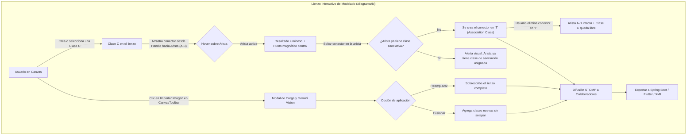

# Specification: Clases de Asociación en 'T' e Importación de Imagen en Lienzo Activo

Status: APPROVED

## 1. Context
El sistema cuenta con un modelador visual interactivo de diagramas de clases UML 2.5 (`@xyflow/react`), sincronización en tiempo real vía STOMP WebSockets, reconocimiento multimodal con Google Gemini API y generadores automáticos de código para Spring Boot, Flutter y metadatos XMI (Enterprise Architect). 

Actualmente, las relaciones entre clases se modelan de manera binaria directa (nodo a nodo). Cuando existe una entidad asociativa intermedia con atributos propios (como una relación muchos a muchos con datos adicionales, ej: `Usuario` y `Diagrama` mediados por `Colaborador`), el lienzo y la IA fuerzan una secuencia lineal encadenada (`ClaseA` -> `ClaseIntermedia` -> `ClaseB`), impidiendo la representación visual y semántica estándar en "T" propia de las **Clases de Asociación** (*Association Class* UML 2.5). 

Asimismo, los usuarios requerían la capacidad de conectar de manera intuitiva en el lienzo una clase nueva creada hacia una relación ya existente entre dos clases (mediante arrastre directo del conector sobre la línea de asociación), y poder importar imágenes con IA directamente desde la barra de herramientas del lienzo (`CanvasToolbar`) sin abandonar el trabajo en curso.

---

## 2. Objective
1. Incorporar el soporte funcional integral para **Clases de Asociación UML 2.5 en forma de "T"**:
   - Permitir conectar interactivamente una nueva clase creada hacia una relación existente entre dos clases arrastrando desde un puerto (*Handle*) hacia la línea de la arista, con detección de paso de ratón (*hover*), resaltado luminoso y anclaje magnético central en 'T'.
   - Mantener la integridad de la relación principal entre las dos clases base si la clase intermedia se desvincula.
   - Reflejar la semántica en la interpretación con IA (prompts y visión), en la exportación XMI (`uml:AssociationClass`), y en la generación de código para Spring Boot (entidad asociativa con claves foráneas `@ManyToOne`) y Flutter (modelo con referencias asociadas).
2. Habilitar la acción de **Importar Imagen con IA directamente en la barra de herramientas del lienzo (`CanvasToolbar`)**: permitir al usuario cargar una imagen (boceto, foto de pizarra o diagrama digital) mientras edita un diagrama activo y brindarle la opción observable de **"Reemplazar todo el lienzo"** o **"Fusionar / Agregar al diagrama"** sin perder el trabajo previo.

---

## 3. Scope

### 3.1 In Scope
- **Interacción y Modelado en Lienzo de Clases de Asociación en "T"**:
  - **Gesto de Conexión por Drag & Drop**: Arrastrar un conector desde cualquier puerto (*Handle*) de una clase hacia el trazo de una arista de asociación activa entre dos clases.
  - **Retroalimentación Visual (*Hover & Snap*)**: Al sobrevolar la línea de la relación durante el arrastre, la arista se resalta en color de acento luminoso (azul/índigo) y muestra un punto magnético circular central indicando el punto exacto de inserción de la 'T'.
  - **Conector Discontinuo Perpendicular**: Renderizado de la arista discontinua (*dashed*) estándar de clase de asociación que une el puerto de la clase intermedia con el punto medio de la arista base.
  - **Dinamismo Espacial**: Arrastrar cualquiera de los tres nodos (las dos clases base o la clase asociativa) recalcula continuamente la geometría del conector en 'T'.
  - **Regla de Desvinculación Limpia**: Si se elimina el conector en 'T', la relación principal entre las dos clases base conserva su tipo y multiplicidades intactas, y la clase intermedia vuelve a ser una clase independiente.
  - **Restricción Unívoca**: Máximo una clase de asociación por arista; si se intenta vincular una segunda clase a la misma arista, el sistema emite una alerta visual e impide la acción.
- **Interpretación Multimodal con IA (Gemini)**:
  - Detección precisa de clases de asociación en imágenes (reconociendo la figura en 'T' y asignando la semántica asociativa).
  - Interpretación por prompts de texto/voz en `CanvasAiPromptBar` (ej: *"Convierte Colaborador en una clase de asociación entre Usuario y Diagrama"*).
- **Exportación Multiplataforma**:
  - Exportación XMI OMG: serialización mediante `<packagedElement xmi:type="uml:AssociationClass">` vinculando los extremos correspondientes.
  - Exportación Spring Boot: generación de la clase intermedia como entidad JPA con dos campos `@ManyToOne` (uno hacia cada clase extrema), clave primaria y atributos propios.
  - Exportación Flutter: generación de clase asociativa Dart con instancias o identificadores de ambas clases asociadas y serialización JSON.
- **Importación de Imagen en Lienzo Activo (`CanvasToolbar`)**:
  - Nuevo botón accesible e intuitivo "Importar Imagen" en la barra de herramientas del editor `/diagrams/[id]`.
  - Modal de carga con vista previa de imagen y selección de modo de aplicación:
    - **Modo Reemplazar**: sustituye completamente los nodos y aristas del diagrama actual.
    - **Modo Fusionar / Agregar**: preserva los nodos existentes e incorpora los nuevos detectados evitando colisiones espaciales.
  - Difusión automática de los cambios a los colaboradores conectados mediante STOMP WebSockets.

### 3.2 Out of Scope
- Clases de asociación n-arias de más de dos clases extremas (asociaciones ternarias/cuaternarias).
- Historial de transacciones infinito en base de datos.
- Modificación de relaciones reflexivas (asociaciones de una clase sobre sí misma) como clases de asociación.

---

## 4. Actors
1. **👑 Creador del Diagrama**: Permisos completos para importar imágenes (reemplazar/fusionar), crear conectores en 'T' y exportar.
2. **👥 Colaborador del Diagrama**: Puede importar imágenes, trazar conectores en 'T' arrastrando sobre aristas y exportar el código.
3. **🤖 Asistente de IA (Google Gemini)**: Interpreta y genera clases de asociación respetando la estructura en 'T'.

---

## 5. Global Flow Context



---

## 6. User Stories

### HU-01: Conexión Interactiva de Clase de Asociación en 'T' en el Lienzo
**Como** modelador de software,  
**quiero** arrastrar un conector desde una clase hacia la línea de una relación existente entre dos clases,  
**para** vincularla como clase intermedia en forma de 'T' de manera fluida y visual con asistencia de anclaje magnético.

### HU-02: Preservación de la Relación Principal ante Desvinculación
**Como** diseñador de arquitectura,  
**quiero** que al desconectar o eliminar una clase intermedia en 'T', la relación principal entre las clases base permanezca inalterada,  
**para** no romper el flujo ni las multiplicidades del modelo original.

### HU-03: Interpretación Inteligente de Clases de Asociación con IA
**Como** usuario del diagramador,  
**quiero** que el reconocimiento por imagen y la barra de prompt identifiquen y generen clases de asociación en 'T',  
**para** digitalizar bocetos y comandos naturales con precisión UML 2.5.

### HU-04: Importación de Imagen en el Lienzo Activo con Opción de Fusión
**Como** usuario que edita un diagrama,  
**quiero** importar imágenes directamente desde la barra de herramientas del lienzo pudiendo elegir entre fusionar o reemplazar,  
**para** expandir mi diagrama en curso sin perder el trabajo ya modelado.

### HU-05: Exportación Coherente a Spring Boot, Flutter y XMI
**Como** desarrollador de software,  
**quiero** que las clases de asociación en 'T' generen entidades con doble `@ManyToOne` en Spring Boot, modelos referenciados en Flutter y tags `uml:AssociationClass` en XMI,  
**para** disponer de código fuente listo para producción.

---

## 7. Business Rules

### RB-01: Exclusividad de la Clase de Asociación por Arista
Una arista de asociación entre dos clases sólo puede tener **una única** clase de asociación vinculada en 'T'. El intento de conectar una segunda clase intermedia a la misma relación debe ser rechazado de forma no destructiva con una notificación al usuario.

### RB-02: Independencia de la Relación Base
La relación directa entre las dos clases participantes es la portadora de la semántica asociativa principal. La eliminación de la clase intermedia o de su conector en 'T' nunca debe suprimir la arista base entre las clases padre.

### RB-03: Retroalimentación Magnética Obligatoria
Al iniciar el arrastre de un conector hacia el lienzo, si el puntero se posiciona dentro del radio de tolerancia de una arista existente, el sistema debe activar el resaltado visual y fijar el punto de destino en el centro matemático del trazo de dicha arista.

### RB-04: Contrato de Exportación JPA de la Clase Asociativa
Toda clase de asociación exportada a Spring Boot debe generarse como una entidad `@Entity` con dos anotaciones `@ManyToOne` obligatorias hacia las clases de los extremos, conservando los atributos propios de la relación (fechas, roles, identificadores compuestos).

---

## 8. Functional Requirements

### RF-01.1: Gesto de Arrastre hacia la Arista (Drag & Drop to Edge)
*Cuando* el usuario inicie una conexión desde cualquier puerto de una clase y desplace el puntero sobre una arista de relación existente, *el sistema deberá* detectar la colisión con la arista.

### RF-01.2: Resaltado Luminoso y Punto Magnético Central
*Mientras* el conector en arrastre sobrevuele la arista objetivo, *el sistema deberá* pintar la arista en color de acento luminoso (azul/índigo) y mostrar un punto circular magnético en su punto medio.

### RF-01.3: Creación del Conector en 'T' (Association Class Edge)
*Cuando* el usuario suelte el conector sobre la arista resaltada, *el sistema deberá* registrar la clase como clase de asociación y dibujar la línea discontinua perpendicular estándar que conecta el puerto de la clase al centro de la arista.

### RF-01.4: Validación de Unicidad de Clase Intermedia
*Si* el usuario intenta soltar un conector sobre una arista que ya posee una clase de asociación asignada, *el sistema deberá* cancelar la acción, mantener el estado previo y mostrar una alerta informativa: *"Esta relación ya cuenta con una clase de asociación vinculada"*.

### RF-02.1: Desvinculación de Clase Intermedia
*Cuando* el usuario suprima el conector en 'T' de una clase de asociación, *el sistema deberá* eliminar únicamente dicho conector, conservando intacta la arista principal entre las dos clases base y dejando la clase intermedia como nodo independiente en el lienzo.

### RF-03.1: Detección Multimodal de Clases de Asociación con Gemini
*Cuando* la IA interprete una imagen o un comando en la barra de prompts que describa una clase intermedia entre dos entidades, *el sistema deberá* construir la estructura JSON con el nodo de clase intermedia y la arista objetivo vinculada.

### RF-04.1: Botón de Importación en `CanvasToolbar`
*El sistema deberá* proveer en la barra de herramientas del lienzo (`CanvasToolbar`) un botón con icono de imagen y rótulo "Importar Imagen", accesible en todo momento durante la edición de `/diagrams/[id]`.

### RF-04.2: Modal Dual de Importación (Reemplazar vs Fusionar)
*Cuando* la IA digitalice con éxito la imagen cargada desde el lienzo, *el sistema deberá* solicitar confirmación de estrategia:
1. **Reemplazar todo el lienzo**: Borra el lienzo actual e inserta los elementos de la imagen.
2. **Fusionar / Agregar al diagrama**: Añade los elementos de la imagen en zonas libres sin alterar ni solapar las clases existentes.

### RF-05.1: Exportación XMI Enterprise Architect
*El sistema deberá* exportar el elemento XML `<packagedElement xmi:type="uml:AssociationClass">` enlazando los identificadores de ambas clases base y sus multiplicidades.

### RF-05.2: Exportación Spring Boot
*El sistema deberá* generar el archivo Java de la clase asociativa con `@Entity`, campos `@ManyToOne` hacia ambas clases base, repositorio y controlador REST.

### RF-05.3: Exportación Flutter
*El sistema deberá* generar el modelo Dart de la clase asociativa conteniendo los campos propios y referencias a ambas clases, junto con serialización JSON.

---

## 9. Functional Data

```typescript
// Datos funcionales de la relación de clase de asociación
interface UmlAssociationClassConnection {
  associationEdgeId: string;    // ID de la arista principal entre Clase A y Clase B
  intermediateClassId: string;  // ID de la clase intermedia anclada
  handlePosition: "top" | "bottom" | "left" | "right";
  sourceClassId: string;        // ID de Clase A
  targetClassId: string;        // ID de Clase B
}
```

---

## 10. Preconditions
1. Diagrama abierto y sincronizado en el cliente web (`/diagrams/[id]`).
2. Existencia de al menos dos clases conectadas por una arista para poder anclar una clase de asociación.

---

## 11. Postconditions
1. El conector en 'T' se renderiza perpendicularmente entre la arista y la clase intermedia.
2. El movimiento de cualquiera de las clases recalculará en tiempo real el anclaje de la 'T'.
3. Los colaboradores concurrentes reciben la actualización vía STOMP y visualizan la clase de asociación sin divergencias.

---

## 12. Errors and Exceptional Behavior
- **E-01 (Intento de duplicación de clase asociativa)**: Si la arista ya tiene una clase intermedia, el sistema impide la conexión y notifica al usuario.
- **E-02 (Eliminación de una clase base)**: Si se elimina una de las dos clases base, la arista principal desaparece y la clase de asociación se convierte en clase regular autónoma.

---

## 13. Acceptance Criteria
- [ ] Arrastrar desde el puerto de una clase hacia una arista existente resalta la arista y muestra el punto magnético central.
- [ ] Soltar el conector en la arista crea la línea discontinua en 'T'.
- [ ] Intentar conectar una segunda clase intermedia a la misma arista es bloqueado con una alerta clara.
- [ ] Al borrar el conector en 'T', la relación entre las dos clases base queda intacta.
- [ ] Mover las clases por el lienzo adapta fluidamente la perpendicularidad del conector en 'T'.
- [ ] El botón "Importar Imagen" en `CanvasToolbar` permite elegir entre "Reemplazar" y "Fusionar".
- [ ] La exportación Spring Boot contiene los dos `@ManyToOne`.
- [ ] La exportación Flutter contiene las dos referencias del modelo.
- [ ] La exportación XMI genera `<packagedElement xmi:type="uml:AssociationClass">`.

---

## 14. BDD Scenarios

### SC-01.1.1: Conexión interactiva con arrastre y anclaje magnético
```gherkin
Feature: Conexión interactiva de clase intermedia a relación existente

  Scenario: Usuario arrastra conector de clase hacia arista entre dos clases
    Given un diagrama con las clases "Usuario" y "Diagrama" unidas por una arista "rel-1"
    And una clase recién creada "Colaborador"
    When el usuario arrastra desde el puerto de "Colaborador" hacia la arista "rel-1"
    Then la arista "rel-1" se resalta en azul luminoso y muestra un punto magnético en su centro
    When el usuario suelta el conector sobre el punto magnético
    Then se crea el conector en 'T' vinculando "Colaborador" como clase de asociación de "rel-1"
```

### SC-01.1.2: Bloqueo de segunda clase intermedia en la misma relación
```gherkin
Feature: Restricción de única clase de asociación por arista

  Scenario: Usuario intenta conectar una segunda clase a una arista ya asociada
    Given que la arista "rel-1" ya tiene a "Colaborador" como clase de asociación
    And existe otra clase "Invitado"
    When el usuario intenta conectar "Invitado" a la arista "rel-1"
    Then el sistema cancela la conexión
    And muestra una alerta indicando que la relación ya tiene una clase de asociación
```

### SC-02.1.1: Desvinculación limpia de la clase intermedia
```gherkin
Feature: Desvinculación de clase intermedia

  Scenario: Usuario elimina el conector en 'T'
    Given una arista "rel-1" entre "Usuario" y "Diagrama" con la clase de asociación "Colaborador"
    When el usuario elimina el conector en 'T'
    Then la arista "rel-1" entre "Usuario" y "Diagrama" permanece intacta con sus multiplicidades
    And la clase "Colaborador" permanece en el lienzo como clase independiente
```

### SC-04.1.1: Importación de Imagen con Fusión en Lienzo Activo
```gherkin
Feature: Importar imagen dentro del lienzo en modo fusión

  Scenario: Usuario añade clases desde una foto de pizarra conservando su diagrama actual
    Given un diagrama en edición con las clases "Usuario" y "Diagrama"
    When el usuario hace clic en "Importar Imagen" en la CanvasToolbar
    And carga una foto y selecciona "Fusionar / Agregar al diagrama"
    Then las clases detectadas en la foto se suman al lienzo en posiciones libres
    And "Usuario" y "Diagrama" se conservan sin alteraciones
```

---

## 15. Traceability
- **HU-01** (Conexión interactiva en lienzo) ➔ **RF-01.1, RF-01.2, RF-01.3** ➔ **SC-01.1.1**
- **HU-02** (Preservación y Desvinculación) ➔ **RF-01.4, RF-02.1** ➔ **SC-01.1.2, SC-02.1.1**
- **HU-03** (IA Prompt y Visión) ➔ **RF-03.1** ➔ **SC-01.1.1**
- **HU-04** (Importar en CanvasToolbar) ➔ **RF-04.1, RF-04.2** ➔ **SC-04.1.1**
- **HU-05** (Exportación Coherente) ➔ **RF-05.1, RF-05.2, RF-05.3** ➔ **SC-01.1.1**

---

## 16. Assumptions
- **ASSUMPTION-01**: El punto medio geométrico de la arista es el punto óptimo de anclaje de la 'T' para trayectorias de tipo curva o escalonada (*smoothstep* / *bezier*). Impacto: Bajo.
- **ASSUMPTION-02**: Las clases asociativas se aplican sobre aristas binarias (entre 2 clases distintas). Impacto: Bajo.

---

## 17. Pending Decisions
- Ninguna decisión funcional pendiente. Se ha completado la entrevista de clarificación `/grill-me` y el documento cumple con todos los criterios de aceptación para pasar a `/sdd-planning`.
