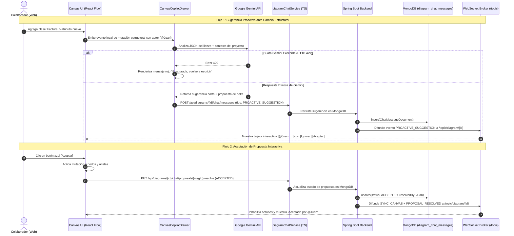
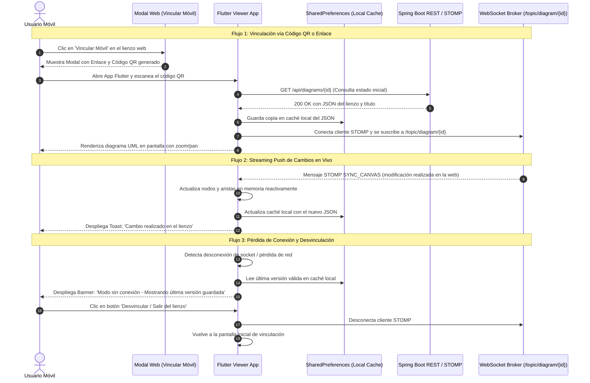

# Plan Técnico: Asistente Copilot IA de Diagramación Colaborativa con MongoDB y Visor Companion Flutter en Tiempo Real

> Módulo: `docs/specs/02-copilot-ia-chat-y-visor-flutter/` | Especificación Base: `spec.md` | Estado: Diseñado | Metodología: SDD-Planning

---

## 1. Resumen Arquitectónico y Matriz de Componentes

- **Objetivo Técnico**: 
  1. Diseñar e implementar el **Panel Lateral de Chat Inteligente (Copilot Drawer)** en Next.js 16 con selector de `Modo Chat` / `Modo Editor`, integración con Google Gemini API y sugerencias proactivas ante mutaciones del lienzo con etiquetado `@usuario` y botones interactivos `[Ignorar]` / `[Aceptar]`.
  2. Integrar **MongoDB 7** en la infraestructura existente (Docker Compose) y habilitar la persistencia multi-base de datos en **Spring Boot** mediante `spring-boot-starter-data-mongodb` para el resguardo de mensajes, propuestas y auditoría de eventos de IA.
  3. Desplegar un modal interactivo en la web para generación dinámica de enlaces y códigos QR de vinculación móvil.
  4. Desarrollar la aplicación móvil autónoma en **Flutter** (`flutter_viewer/`) para la visualización en tiempo real del diagrama (solo lectura), con soporte de streaming push reactivo vía WebSockets/STOMP, resiliencia fuera de línea (*offline*) con almacenamiento local en caché y botón de desvinculación voluntaria.
- **Patrón Arquitectónico**: Monorepo Desacoplado Multi-Servicio:
  - Frontend Web: Clean Component-Driven Architecture con React 19, Tailwind v4 y React Flow.
  - Backend API: Arquitectura en Capas (Controller, Service, Document, Repository) con soporte Multi-DataSource (PostgreSQL para entidades de negocio JPA + MongoDB para colecciones documentales de chat y auditoría).
  - Mobile: Feature-First Architecture en Flutter con gestión reactiva mediante `ChangeNotifier` y cliente de red desacoplado (REST + STOMP).
- **Capas Involucradas**:
  - `Presentación / UI (Web Next.js)`:
    - Componente `CanvasCopilotDrawer.tsx`: Panel lateral deslizante con historial, avatares, transcripción por voz Web Speech API y selector de modo.
    - Componente `CanvasCopilotBubble.tsx`: Botón flotante inferior derecho con badge de notificaciones y disparador de apertura.
    - Componente `CanvasMobileLinkModal.tsx`: Diálogo modal con renderizado de QR y enlace compartible.
    - Componente `ProactiveSuggestionCard.tsx`: Tarjeta interactiva de sugerencia con botones `[Ignorar]` (gris) y `[Aceptar]` (azul).
  - `Servicios & Dominio (Web Next.js)`:
    - `services/diagramChatService.ts`: Cliente REST y suscripción WebSocket para sincronización síncrona del chat y propuestas.
    - `services/geminiDiagramService.ts`: Extensión de prompts de sistema para análisis proactivo de deltas JSON y clasificación de intención.
    - `types/index.ts`: Definición de interfaces tipadas para mensajes, propuestas y deltas de diagrama.
  - `Infraestructura & Backend (Spring Boot & Docker)`:
    - `document/ChatMessageDocument.java`: Documento MongoDB para mensajes y propuestas.
    - `repository/mongo/ChatMessageMongoRepository.java`: Interfaz `MongoRepository` para consultas cronológicas por `diagramId`.
    - `service/DiagramChatService.java`: Lógica de negocio de persistencia, resolución de propuestas y auditoría.
    - `controller/DiagramChatController.java`: Endpoints REST para historial y resolución de sugerencias.
    - `controller/CanvasWebSocketController.java`: Retransmisión de eventos de chat (`CHAT_MESSAGE`, `PROACTIVE_SUGGESTION`, `PROPOSAL_RESOLVED`).
    - `docker-compose.yml`: Adición del servicio `mongodb` en red `diag_network`.
  - `Aplicación Móvil Companion (Flutter)`:
    - `lib/screens/link_entry_screen.dart`: Pantalla de bienvenida con input de enlace/ID y escáner QR.
    - `lib/screens/canvas_viewer_screen.dart`: Lienzo móvil de solo lectura con soporte de gestos táctiles y botón de desvinculación.
    - `lib/services/stomp_socket_service.dart`: Conexión STOMP móvil a `/topic/diagram/{id}`.
    - `lib/services/local_storage_service.dart`: Caché local JSON con `SharedPreferences`.

---

## 2. Estructura Física de Archivos del Proyecto / Módulo

```text
SW1-P1-DiagramadorClases-2026-2/
├── docker-compose.yml                                # MODIFICADO: Agrega servicio mongodb (mongo:7) y volumen mongo_data
│
├── back_diagramador/
│   ├── pom.xml                                       # MODIFICADO: Agrega spring-boot-starter-data-mongodb
│   ├── src/main/java/com/example/back_diagramador/
│   │   ├── document/
│   │   │   └── ChatMessageDocument.java              # NUEVO: Documento MongoDB (@Document) para mensajes y propuestas
│   │   ├── dto/
│   │   │   ├── ChatMessageDto.java                   # NUEVO: DTO de transferencia de mensajes de chat
│   │   │   └── ChatProposalResolutionDto.java        # NUEVO: DTO de resolución de propuestas ([Aceptar]/[Ignorar])
│   │   ├── repository/mongo/
│   │   │   └── ChatMessageMongoRepository.java       # NUEVO: Repositorio Spring Data MongoDB por diagramId
│   │   ├── service/
│   │   │   └── DiagramChatService.java               # NUEVO: Servicio de persistencia y resolución de chat
│   │   └── controller/
│   │       ├── DiagramChatController.java            # NUEVO: Endpoints REST /api/diagrams/{id}/chat
│   │       └── CanvasWebSocketController.java        # MODIFICADO: Retransmisión de eventos de chat en tiempo real
│   └── src/test/java/com/example/back_diagramador/
│       └── service/
│           └── DiagramChatServiceTest.java           # NUEVO: Pruebas unitarias de persistencia y resolución de propuestas
│
├── front_diag_clases/
│   ├── app/(dashboard)/diagrams/[id]/
│   │   └── page.tsx                                  # MODIFICADO: Reemplaza CanvasAiPromptBar por Copilot Drawer + Modal Móvil
│   ├── components/canvas/
│   │   ├── CanvasCopilotDrawer.tsx                   # NUEVO: Panel lateral derecho con chat, selector de modo y voz
│   │   ├── CanvasCopilotBubble.tsx                   # NUEVO: Burbuja flotante inferior derecha para abrir/cerrar drawer
│   │   ├── ProactiveSuggestionCard.tsx               # NUEVO: Tarjeta de sugerencia con botones [Ignorar] / [Aceptar]
│   │   ├── CanvasMobileLinkModal.tsx                 # NUEVO: Modal con QR y enlace para vincular visor móvil
│   │   └── CanvasToolbar.tsx                         # MODIFICADO: Agrega botón "Vincular Móvil"
│   ├── services/
│   │   ├── diagramChatService.ts                     # NUEVO: Cliente REST y WebSocket para chat e historial
│   │   └── geminiDiagramService.ts                   # MODIFICADO: Funciones para sugerencia proactiva y clasificación dual
│   ├── types/
│   │   └── index.ts                                  # MODIFICADO: Interfaces ChatMessage, ChatProposal, SuggestionAction
│   └── tests/
│       ├── e2e/
│       │   └── copilot-chat-drawer.spec.ts           # NUEVO: Test BDD de flujo de chat, sugerencia proactiva y aceptación
│       └── unit/
│           └── geminiProactiveClassifier.test.ts     # NUEVO: Test unitario de clasificación de modo chat vs editor
│
└── flutter_viewer/                                   # NUEVO PROYECTO AUTÓNOMO FLUTTER
    ├── pubspec.yaml                                  # NUEVO: Configuración Flutter y dependencias (stomp, qr, shared_preferences)
    ├── lib/
    │   ├── main.dart                                 # NUEVO: Entrypoint de la aplicación Flutter
    │   ├── models/
    │   │   └── diagram_model.dart                    # NUEVO: Modelos Dart para nodos UML, aristas y mensajes WebSocket
    │   ├── services/
    │   │   ├── diagram_api_service.dart              # NUEVO: Consulta REST del diagrama inicial
    │   │   ├── stomp_socket_service.dart             # NUEVO: Cliente STOMP para suscripción a eventos en tiempo real
    │   │   └── local_storage_service.dart            # NUEVO: Caché local offline con SharedPreferences
    │   ├── state/
    │   │   └── diagram_viewer_controller.dart        # NUEVO: ChangeNotifier para reactividad del lienzo y alertas
    │   ├── widgets/
    │   │   ├── mobile_canvas_painter.dart            # NUEVO: Renderizador visual de clases UML y conectores
    │   │   ├── connection_status_banner.dart         # NUEVO: Banner observable de estado online / offline
    │   │   └── collaborator_toast.dart               # NUEVO: Notificación flotante de autor de modificaciones
    │   └── screens/
    │       ├── link_entry_screen.dart                # NUEVO: Pantalla inicial para escaneo QR o ingreso de URL/ID
    │       └── canvas_viewer_screen.dart             # NUEVO: Visor principal con gestos táctiles y botón Desvincular
    └── test/
        └── diagram_parser_test.dart                  # NUEVO: Test unitario de parseo de JSON y caché local
```

---

## 3. Diagramas de Secuencia Técnicos

### 3.1 Flujo Web: Chat Dual, Sugerencias Proactivas y Persistencia en MongoDB



### 3.2 Flujo Móvil: Vinculación, Streaming Push y Resiliencia Offline en Flutter



---

## 4. Contratos de Código e Interfaces Tipadas

### 4.1 Contratos TypeScript Frontend (`front_diag_clases/types/index.ts`)

```typescript
// Modos de operación del Copilot
export type CopilotMode = "CHAT" | "EDITOR";

// Tipos de remitentes en el historial
export type ChatSenderType = "USER" | "COPILOT" | "SYSTEM";

// Tipos de mensajes en el chat
export type ChatMessageType = 
  | "CHAT_MESSAGE" 
  | "EDITOR_PROPOSAL" 
  | "PROACTIVE_SUGGESTION" 
  | "ERROR_ALERT";

// Estado de resolución de una propuesta interactiva
export type ProposalStatus = "PENDING" | "ACCEPTED" | "IGNORED" | "EXPIRED";

// Detalle de propuesta de mutación de diagrama
export interface ChatProposalPayload {
  summary: string;
  nodesDelta: Array<{
    id: string;
    type: "umlClass" | "umlNote";
    position?: { x: number; y: number };
    data: Record<string, any>;
  }>;
  edgesDelta: Array<{
    id: string;
    source: string;
    target: string;
    data: Record<string, any>;
  }>;
  status: ProposalStatus;
  resolvedByUserId?: number | null;
  resolvedByUserName?: string | null;
  resolvedAt?: string | null;
}

// Mensaje completo de chat registrado en MongoDB
export interface ChatMessage {
  id?: string;
  diagramId: number;
  senderType: ChatSenderType;
  userId?: number | null;
  userName: string;
  mode: CopilotMode;
  messageType: ChatMessageType;
  content: string;
  taggedUserName?: string | null;
  proposal?: ChatProposalPayload | null;
  isError: boolean;
  errorMessage?: string | null;
  createdAt: string;
}

// Payload para el modal de vinculación móvil
export interface MobileLinkPayload {
  diagramId: number;
  accessUrl: string;
  wsEndpoint: string;
  qrPayload: string;
}
```

### 4.2 Documentos y DTOs Backend Java (`back_diagramador`)

#### Documento MongoDB (`ChatMessageDocument.java`)
```java
package com.example.back_diagramador.document;

import lombok.AllArgsConstructor;
import lombok.Builder;
import lombok.Data;
import lombok.NoArgsConstructor;
import org.springframework.data.annotation.Id;
import org.springframework.data.mongodb.core.index.Indexed;
import org.springframework.data.mongodb.core.mapping.Document;

import java.time.Instant;

@Data
@NoArgsConstructor
@AllArgsConstructor
@Builder
@Document(collection = "diagram_chat_messages")
public class ChatMessageDocument {

    @Id
    private String id;

    @Indexed
    private Long diagramId;

    private String senderType; // "USER", "COPILOT", "SYSTEM"
    private Long userId;
    private String userName;
    private String mode; // "CHAT", "EDITOR"
    private String messageType; // "CHAT_MESSAGE", "EDITOR_PROPOSAL", "PROACTIVE_SUGGESTION", "ERROR_ALERT"
    private String content;
    private String taggedUserName;

    // Propuesta de mutación serializada en JSON
    private String proposalJson;
    private String proposalStatus; // "PENDING", "ACCEPTED", "IGNORED", "EXPIRED"
    private Long resolvedByUserId;
    private String resolvedByUserName;
    private Instant resolvedAt;

    private Boolean isError;
    private String errorMessage;

    @Indexed
    private Instant createdAt;
}
```

#### DTO de Resolución de Propuesta (`ChatProposalResolutionDto.java`)
```java
package com.example.back_diagramador.dto;

import lombok.AllArgsConstructor;
import lombok.Builder;
import lombok.Data;
import lombok.NoArgsConstructor;

@Data
@NoArgsConstructor
@AllArgsConstructor
@Builder
public class ChatProposalResolutionDto {
    private String status; // "ACCEPTED" | "IGNORED"
    private Long resolvedByUserId;
    private String resolvedByUserName;
}
```

### 4.3 Modelos de Dominio Dart (`flutter_viewer/lib/models/diagram_model.dart`)

```dart
class UmlClassNode {
  final String id;
  final String name;
  final String stereotype;
  final List<String> attributes;
  final List<String> methods;
  final double x;
  final double y;

  UmlClassNode({
    required this.id,
    required this.name,
    this.stereotype = '',
    required this.attributes,
    required this.methods,
    required this.x,
    required this.y,
  });

  factory UmlClassNode.fromJson(Map<String, dynamic> json) {
    final data = json['data'] as Map<String, dynamic>? ?? {};
    final pos = json['position'] as Map<String, dynamic>? ?? {'x': 0.0, 'y': 0.0};
    return UmlClassNode(
      id: json['id'] ?? '',
      name: data['name'] ?? 'Clase',
      stereotype: data['stereotype'] ?? '',
      attributes: List<String>.from(data['attributes'] ?? []),
      methods: List<String>.from(data['methods'] ?? []),
      x: (pos['x'] as num).toDouble(),
      y: (pos['y'] as num).toDouble(),
    );
  }
}

class UmlEdge {
  final String id;
  final String source;
  final String target;
  final String relationType;
  final String sourceMultiplicity;
  final String targetMultiplicity;

  UmlEdge({
    required this.id,
    required this.source,
    required this.target,
    required this.relationType,
    this.sourceMultiplicity = '',
    this.targetMultiplicity = '',
  });

  factory UmlEdge.fromJson(Map<String, dynamic> json) {
    final data = json['data'] as Map<String, dynamic>? ?? {};
    return UmlEdge(
      id: json['id'] ?? '',
      source: json['source'] ?? '',
      target: json['target'] ?? '',
      relationType: data['relationType'] ?? 'ASSOCIATION',
      sourceMultiplicity: data['sourceMultiplicity'] ?? '',
      targetMultiplicity: data['targetMultiplicity'] ?? '',
    );
  }
}

class DiagramCanvasData {
  final List<UmlClassNode> nodes;
  final List<UmlEdge> edges;
  final String diagramName;

  DiagramCanvasData({
    required this.nodes,
    required this.edges,
    required this.diagramName,
  });

  factory DiagramCanvasData.fromJson(Map<String, dynamic> json, String name) {
    final nodesList = (json['nodes'] as List<dynamic>? ?? [])
        .where((n) => n['type'] == 'umlClass')
        .map((n) => UmlClassNode.fromJson(n))
        .toList();
    final edgesList = (json['edges'] as List<dynamic>? ?? [])
        .map((e) => UmlEdge.fromJson(e))
        .toList();

    return DiagramCanvasData(
      nodes: nodesList,
      edges: edgesList,
      diagramName: name,
    );
  }
}
```

### 4.4 Endpoints REST y Tópicos STOMP

| Método / Canal | Ruta / Destino | Descripción | Autenticación / Alcance |
| :--- | :--- | :--- | :--- |
| `GET` | `/api/diagrams/{id}/chat/messages` | Consulta el historial cronológico completo de chat en MongoDB | Colaboradores del diagrama |
| `POST` | `/api/diagrams/{id}/chat/messages` | Persiste un nuevo mensaje de usuario o sugerencia de Copilot | Colaboradores del diagrama |
| `PUT` | `/api/diagrams/{id}/chat/proposals/{msgId}/resolve` | Resuelve una tarjeta interactiva (`ACCEPTED` o `IGNORED`) | Colaboradores del diagrama |
| `STOMP Pub` | `/app/diagram/{id}/chat` | Difusión de mensajes y sugerencias a los clientes conectados | `/topic/diagram/{id}` |
| `STOMP Sub` | `/topic/diagram/{id}` | Recepción unificada de deltas de lienzo y eventos de chat | Clientes Web y App Flutter |

---

## 5. Garantías de Runtime, Persistencia e Integridad Relacional

1. **Aislamiento Multi-Base de Datos (PostgreSQL vs MongoDB)**:
   - PostgreSQL retiene de forma exclusiva las tablas maestras relacionales (`users`, `diagrams`, `collaborators`) y el campo `lienzo` consolidado.
   - MongoDB opera en el puerto `27017` mediante el contenedor `diag_mongodb` vinculado a la red interna `diag_network`. La base de datos `sw1_diag_chat` almacena la colección `diagram_chat_messages` con índices sobre `{diagramId: 1, createdAt: 1}` para lecturas cronológicas de sub-milisegundo.
   - Clave foránea lógica: `diagramId` vincula los documentos en MongoDB con la entidad relacional `Diagram` en PostgreSQL.
   - Política de Auditoría: Ante un *soft-delete* (`isDeleted = true`) de un diagrama en PostgreSQL, los mensajes en MongoDB se conservan inmutables como bitácora forense de arquitectura.
2. **Patrón de Selección Tridimensional del Chat (The 3-Way Selector Pattern)**:
   - *Selección Automática por IA*: Gemini evalúa el prompt del usuario mediante expresiones semánticas y clasifica la intención (si solicita crear/mutar entidades genera una propuesta estructurada; si realiza preguntas teóricas o de diseño responde en texto Markdown explicativo).
   - *Selección Manual en Caliente*: El usuario dispone de un selector tipo *Toggle Badge* en la caja de entrada para fijar explícitamente `Modo Chat` o `Modo Editor`, anulando la auto-clasificación sin perder el texto ingresado.
   - *Estado Neutro / Fallback*: Ante prompts ambiguos o sin clasificación concluyente, el Copilot adopta por defecto `Modo Chat`, protegiendo el lienzo contra mutaciones accidentales no deseadas.
3. **Manejo de Cuota de Gemini API (Fail-Fast sin Bloqueo)**:
   - Si la llamada a Google Gemini devuelve un código `HTTP 429` (límite de cuota o tasa alcanzada), el frontend captura la excepción y renderiza directamente un mensaje de error observable en texto rojo: `"IA saturada, vuelve a escribir"`.
   - Se evita la reejecución en bucles que agote los hilos de renderizado y se mantiene la disponibilidad operativa del lienzo.
4. **Resiliencia de Red y Ciclo Offline en Flutter**:
   - En cada recepción exitosa de datos (vía REST o WebSocket `SYNC_CANVAS`), el serializador vuelca el estado en `SharedPreferences` bajo la clave `cached_diagram_{id}`.
   - Si la conexión STOMP o HTTP falla, el controlador conmuta inmediatamente al estado `offlineCached`, manteniendo el renderizado del lienzo táctil y desplegando el banner amarillo superior `"Modo sin conexión - Mostrando última versión guardada"`.
   - Al restaurarse la conectividad (`connectivity_plus`), el socket ejecuta un `reconnect()` automático, solicita la versión más reciente del diagrama y conmuta al estado `onlineSynced`.

---

## 6. Estrategia de Testing y Flujo Funcional

### 6.1 Validación Dual (Black-Box BDD + White-Box Unit)

- **Pruebas de Caja Negra (E2E / Integración BDD)**:
  - `copilot-chat-drawer.spec.ts`: Verifica la apertura del drawer mediante la burbuja inferior, el envío de consultas conceptuales sin alteración del lienzo, y la emisión de sugerencias proactivas con botones `[Ignorar]` y `[Aceptar]` que mutan el lienzo y persisten en MongoDB.
  - `mobile-viewer-sync.spec.ts`: Verifica que un cambio originado en la web emita el delta STOMP y sea renderizado por el cliente móvil, validando la transición a modo sin conexión.
- **Pruebas de Caja Blanca (Unit Tests Críticos)**:
  - `DiagramChatServiceTest.java`: Valida el repositorio MongoDB, la persistencia de mensajes y el cambio de estado atómico de propuestas (`ACCEPTED` / `IGNORED`).
  - `geminiProactiveClassifier.test.ts`: Valida que los deltas de JSON activen sugerencias breves con formato `@usuario`.
  - `diagram_parser_test.dart`: Valida la deserialización segura del JSON de React Flow a los modelos inmutables Dart de Flutter.

### 6.2 Implementación por Flujo en 4 Fases

1. **Fase 1: Infraestructura y Persistencia MongoDB**:
   - Configurar servicio `mongodb` en `docker-compose.yml`.
   - Añadir `spring-boot-starter-data-mongodb` en `back_diagramador/pom.xml`.
   - Implementar `ChatMessageDocument`, `ChatMessageMongoRepository`, `DiagramChatService` y `DiagramChatController`.
2. **Fase 2: Frontend Web - Panel Copilot Drawer y Modo Dual**:
   - Construir `CanvasCopilotBubble.tsx`, `CanvasCopilotDrawer.tsx` y `ProactiveSuggestionCard.tsx`.
   - Migrar la funcionalidad de micrófono/voz de `CanvasAiPromptBar` e integrar el nuevo drawer en `page.tsx`.
   - Conectar con `diagramChatService.ts` y extender `geminiDiagramService.ts` con manejo del error rojo `"IA saturada, vuelve a escribir"`.
3. **Fase 3: Vinculación Móvil (Modal QR y Enlace en Web)**:
   - Implementar `CanvasMobileLinkModal.tsx` con generador de códigos QR dinámicos.
   - Añadir botón "Vincular Móvil" en `CanvasToolbar.tsx`.
4. **Fase 4: Proyecto Autónomo Flutter Companion (`flutter_viewer/`)**:
   - Inicializar el proyecto Flutter en la raíz del repositorio.
   - Implementar modelos Dart, servicios de red (REST + STOMP) y persistencia local (`SharedPreferences`).
   - Construir pantallas `link_entry_screen.dart` (escáner QR / enlace) y `canvas_viewer_screen.dart` (lienzo táctil, banner offline y botón Desvincular).
   - Validar suite de pruebas completas.
