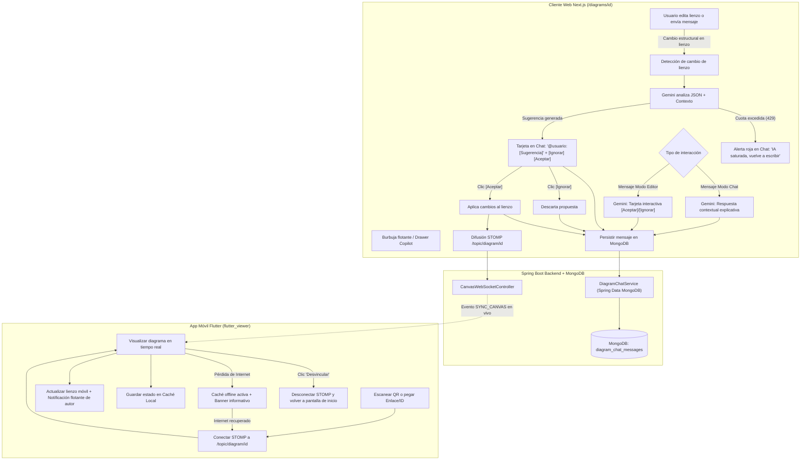
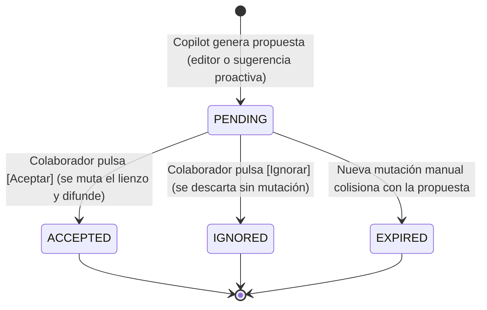
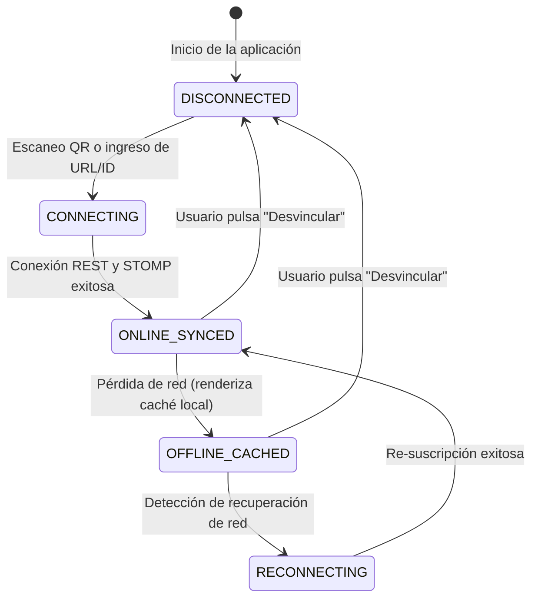

# Specification: Asistente Copilot IA de Diagramación Colaborativa con MongoDB y Visor Companion Flutter en Tiempo Real

Status: IN_REVIEW

---

## 1. Context

El sistema actual de diagramación de clases UML 2.5 (`SW1-P1-DiagramadorClases-2026-2`) cuenta con un lienzo interactivo basado en `@xyflow/react`, sincronización colaborativa síncrona mediante STOMP WebSockets, y una barra de comandos por voz y texto (`CanvasAiPromptBar`) que invoca a la API de Google Gemini en ejecuciones atómicas de una sola vía (*single-turn*).

A pesar de estas capacidades, se identifican las siguientes carencias funcionales y colaborativas:
1. **Ausencia de un Asistente Continuo y Proactivo**: La IA actúa exclusivamente bajo demanda manual del usuario y carece de memoria conversacional continua. No detecta los cambios que los colaboradores realizan en vivo en el lienzo para sugerir normalizaciones, relaciones faltantes o atributos coherentes.
2. **Falta de Contextualización para Nuevos Desarrolladores**: Cuando un nuevo colaborador o revisor se une al proyecto, no dispone de un asistente que le explique la arquitectura del diagrama, las intenciones de modelado o las decisiones de diseño previas.
3. **Inexistencia de un Historial de Conversación y Eventos**: No se conservan los intercambios, explicaciones o sugerencias generadas durante la sesión colaborativa, perdiéndose la trazabilidad del proceso creativo y las justificaciones del diseño.
4. **Carencia de un Visor Móvil Complementario (Companion)**: No existe un mecanismo ligero e independiente para que desarrolladores o supervisores visualicen el diagrama en dispositivos móviles en tiempo real, con resiliencia fuera de línea (*offline*) y recepción de alertas reactivas (*push streaming*) ante cambios en el lienzo.

---

## 2. Objective

1. **Módulo A — Asistente Copilot IA y Persistencia en MongoDB (Web)**:
   - Sustituir la barra flotante inferior actual e integrar un **Panel Lateral de Chat Inteligente (Copilot Drawer)** accesible mediante un botón flotante tipo burbuja en la esquina inferior derecha del lienzo.
   - Proveer un **Modo Dual Inteligente**:
     - *Modo Chat (Consulta y Contexto)*: Explicación arquitectónica del diagrama, bienvenida a nuevos desarrolladores, sugerencias de normalización de clases y respuestas a dudas técnicas.
     - *Modo Editor (Mutación Asistida)*: Recepción de instrucciones naturales por texto o reconocimiento de voz para modificar el diagrama, generando propuestas con visualización de impacto y control interactivo.
   - Implementar **Sugerencias Proactivas con Detección de Cambios**: Ante mutaciones estructurales del lienzo (creación o edición de clases, atributos, métodos o relaciones), la IA analiza el JSON del diagrama, el título del proyecto y el contexto previo, emitiendo una sugerencia concisa etiquetando al autor (`@usuario`) con dos botones de acción: `[Ignorar]` (gris) y `[Aceptar]` (azul). Al aceptar, los cambios se aplican automáticamente al lienzo y se difunden a todos los colaboradores conectados.
   - Garantizar resiliencia ante saturación de cuota de Gemini API mediante un mensaje observable en rojo: `"IA saturada, vuelve a escribir"`.
   - Persistir el historial de chat, eventos de auditoría y estados de propuestas en una nueva base de datos **MongoDB**, orquestada nativamente junto a Spring Boot y Docker Compose.

2. **Módulo B — Visor Companion Flutter en Tiempo Real (Mobile)**:
   - Crear un proyecto independiente en Flutter en la raíz del repositorio (`flutter_viewer/`) dedicado exclusivamente a la visualización móvil del diagrama en tiempo real.
   - Proveer un flujo de **Vinculación Rápida**: Modal en la web con enlace compartible y código QR dinámico; en Flutter, opción de escanear QR o pegar el enlace/ID.
   - Implementar **Push Streaming en Tiempo Real**: Recepción síncrona de cambios vía WebSockets/STOMP con notificaciones visuales reactivas (*in-app toasts/banners*) indicando el autor y la modificación.
   - Asegurar **Resiliencia Offline y Reconexión Automática**: Almacenamiento en caché local del último estado del diagrama para navegación sin conexión; auto-reconexión y actualización inmediata al recuperar señal.
   - Incluir un botón manual de **Desvinculación / Salir del Lienzo** que cierre la sesión en vivo y detenga la recepción de eventos.

---

## 3. Scope

### 3.1 In Scope

#### Módulo A: Asistente Copilot IA y Persistencia MongoDB
- **Interfaz del Chat**:
  - Burbuja flotante persistente en la esquina inferior derecha del lienzo (`/diagrams/[id]`) con indicador de apertura/cierre y contador de mensajes no leídos.
  - Panel lateral deslizante (*drawer*) a la derecha con área de mensajes scrollable, separadores cronológicos y avatares diferenciados (Usuario, Colaboradores, Copilot IA).
  - Caja de entrada multifuncional con soporte para texto, atajo de teclado (`Enter`), botón de reconocimiento de voz por micrófono (migrado desde `CanvasAiPromptBar`) y selector visual de modo (`Modo Chat` vs `Modo Editor`).
- **Comportamiento Dual Inteligente**:
  - Clasificación automática de intención (consulta conceptual vs instrucción de mutación del lienzo) con anulación manual mediante el selector del input.
  - En *Modo Chat*: Respuestas formatadas en Markdown enriquecido con explicaciones sobre patrones de diseño, normalización, relaciones recomendadas y orientación para nuevos integrantes.
  - En *Modo Editor*: Respuestas con tarjeta de propuesta interactiva detallando el resumen de cambios (ej. clases añadidas, atributos mutados) y botones `[Ignorar]` / `[Aceptar]`.
- **Sugerencias Proactivas en Tiempo Real**:
  - Monitoreo de eventos de sincronización del lienzo por WebSocket.
  - Generación de tarjetas de sugerencia proactiva etiquetando al autor del cambio (ej. `"@juan: Noté que creaste la clase 'Factura'. ¿Deseas agregar la relación de composición hacia 'DetalleFactura' y atributos de fecha e importe total?"`).
  - Botón `[Ignorar]` (estilo plomo/gris neutro) que descarta la propuesta y deshabilita la tarjeta para todos los colaboradores.
  - Botón `[Aceptar]` (estilo azul destacado) que ejecuta la mutación en el lienzo, difunde el nuevo estado vía WebSocket a todos los usuarios conectados y marca la propuesta como `Aceptado por @usuario`.
- **Tratamiento Observable de Errores de IA**:
  - Detección de fallos de cuota, límite de tasa (*Rate Limit 429*) o indisponibilidad de Gemini API, emitiendo un mensaje visible en color rojo dentro del chat: `"IA saturada, vuelve a escribir"`.
- **Persistencia en MongoDB**:
  - Registro de mensajes de texto, sugerencias proactivas, estados de aceptación/rechazo y eventos del lienzo.
  - Al ingresar cualquier usuario a la sesión colaborativa, carga automática del historial cronológico completo de la sala.

#### Módulo B: Visor Companion en Flutter
- **Estructura del Proyecto**:
  - Repositorio móvil autónomo en la raíz (`flutter_viewer/`) con configuración lista para Android e iOS.
- **Mecanismo de Enlace Web-Móvil**:
  - Botón en la barra de herramientas web "Vincular Móvil" que despliega un modal con URL directa (`http://<host>/diagrams/<id>/view`) y código QR renderizado dinámicamente.
  - Pantalla inicial en Flutter con dos opciones de acceso: escanear código QR con la cámara del dispositivo o ingresar/pegar la URL/ID manualmente.
- **Visualizador del Diagrama en Móvil**:
  - Renderizado visual interactivo del diagrama de clases (nodos de clases, estereotipos, atributos, métodos y conectores UML) con soporte táctil para paneo y zoom (*pinch-to-zoom*).
  - Modo estricto de solo lectura (sin capacidades de edición ni alteración de contratos).
- **Streaming Push y Alertas en Vivo**:
  - Conexión vía cliente STOMP WebSocket al tópico del diagrama (`/topic/diagram/{id}`).
  - Actualización reactiva instantánea del lienzo al recibir eventos `SYNC_CANVAS`.
  - Banner o toast visual flotante en la app móvil que notifica: `"[Usuario] ha modificado el diagrama"`.
- **Tolerancia a Desconexión y Desvinculación**:
  - Caché local persistente en el dispositivo móvil (guardando el último JSON recibido).
  - Banner informativo en caso de pérdida de red: `"Modo sin conexión - Mostrando última versión guardada"`.
  - Reconexión en segundo plano ante restablecimiento de conectividad con sincronización inmediata del último estado desde la API REST.
  - Botón accesible de "Desvincular / Salir del lienzo" que limpia la sesión activa, desconecta el socket STOMP y detiene la recepción de alertas en vivo.

### 3.2 Out of Scope
- Edición interactiva de diagramas desde la aplicación móvil Flutter (el visor es estrictamente de solo lectura).
- Notificaciones push nativas del sistema operativo en segundo plano mediante Firebase Cloud Messaging (FCM) con la aplicación cerrada (se utiliza push streaming reactivo en vivo vía WebSockets dentro de la app).
- Modificación del esquema relacional central de PostgreSQL para diagramas o usuarios (PostgreSQL permanece intacto como fuente de verdad del negocio; MongoDB asume exclusivamente el dominio documental de chat y eventos).
- Asistente de IA por audio bidireccional hablado continuo (se mantiene entrada de voz Web Speech API y salida en texto estructurado).

---

## 4. Actors

1. **👑 Creador del Diagrama**:
   - Accede al lienzo web, interactúa con el Copilot IA en ambos modos, aprueba/descarta sugerencias, abre el modal de vinculación móvil y visualiza el historial en MongoDB.
2. **👥 Colaborador del Diagrama**:
   - Edita el lienzo web, recibe menciones automáticas (`@usuario`) en sugerencias proactivas generadas por sus cambios, interactúa en el chat y puede aceptar/ignorar sugerencias.
3. **📱 Usuario del Visor Companion (Mobile Viewer)**:
   - Vincula su dispositivo mediante QR o enlace, visualiza el diagrama en tiempo real, consulta el diagrama sin conexión y desvincula su dispositivo cuando lo desee.
4. **🤖 Copilot IA (Google Gemini)**:
   - Analiza el estado del lienzo, contextualiza las consultas, genera sugerencias proactivas breves, formula tarjetas interactivas de mutación y notifica errores de saturación.

---

## 5. Global Flow Context



---

## 6. User Stories

### HU-02.01: Panel Lateral de Chat Copilot y Burbuja Flotante
**Como** usuario del diagramador web,  
**quiero** disponer de una burbuja flotante en la esquina inferior derecha que abra y cierre un panel lateral de chat,  
**para** interactuar fluidamente con el asistente inteligente sin obstaculizar la vista del lienzo ni depender de una barra fija inferior.

### HU-02.02: Modo Dual Inteligente (Chat Conceptual vs Editor de Lienzo)
**Como** modelador de software,  
**quiero** que el chat entienda si le solicito explicaciones conceptuales o modificaciones sobre el diagrama y me permita forzar el modo con un selector,  
**para** obtener análisis arquitectónicos sin alterar el lienzo o generar órdenes de edición precisas con confirmación.

### HU-02.03: Sugerencias Proactivas con Etiquetado `@usuario` y Acciones Ignorar/Aceptar
**Como** colaborador que realiza cambios en el lienzo,  
**quiero** que la IA analice mis mutaciones y me responda en el chat etiquetándome con sugerencias concisas y botones de `[Ignorar]` y `[Aceptar]`,  
**para** recibir asesoramiento de diseño en vivo y aplicar mejoras automáticas con un solo clic.

### HU-02.04: Manejo Observable de Saturación de Gemini API
**Como** usuario que interactúa con la IA,  
**quiero** visualizar un mensaje de advertencia claro en color rojo que indique `"IA saturada, vuelve a escribir"` cuando se supere la cuota de la API,  
**para** saber con precisión por qué la IA no respondió y cuándo puedo reintentar mi instrucción.

### HU-02.05: Historial Colaborativo Persistente en MongoDB
**Como** miembro de un equipo colaborativo,  
**quiero** que todos los mensajes, sugerencias y decisiones tomadas en el chat se guarden en MongoDB y se carguen al entrar al diagrama,  
**para** revisar el historial cronológico de decisiones arquitectónicas tomadas por los colaboradores.

### HU-02.06: Vinculación Móvil por Enlace y Código QR
**Como** usuario con un dispositivo móvil,  
**quiero** abrir un modal en la web que me muestre un enlace y un código QR para escanearlo o ingresarlo en la app Flutter,  
**para** conectar inmediatamente el visualizador móvil al lienzo activo sin configuraciones complejas.

### HU-02.07: Visualización y Streaming Push en Tiempo Real en Flutter
**Como** revisor o desarrollador en movilidad,  
**quiero** ver las clases y relaciones del diagrama actualizándose síncronamente en mi teléfono junto a avisos de quién modificó el lienzo,  
**para** seguir el avance del modelado sin necesidad de usar una computadora de escritorio.

### HU-02.08: Operatividad Offline, Reconexión y Desvinculación en Flutter
**Como** usuario de la app móvil,  
**quiero** poder consultar el último diagrama guardado si pierdo conexión, que la app se actualice sola al volver a tener red y tener un botón para desvincularme del lienzo,  
**para** trabajar en condiciones de conectividad inestable y detener las actualizaciones cuando ya no las requiera.

---

## 7. Functional Requirements (EARS)

### Módulo A: Copilot IA y MongoDB (Web)

- **RF-02.01**: *Cuando* el usuario se encuentre en la página del lienzo `/diagrams/[id]`, el sistema *debe* renderizar una burbuja flotante interactiva en la esquina inferior derecha con icono alusivo al Copilot y un indicador visual de estado.
- **RF-02.02**: *Al* hacer clic sobre la burbuja flotante, el sistema *debe* alternar la visibilidad de un panel lateral deslizante (*drawer*) fijado a la derecha, preservando las dimensiones interactivas del lienzo.
- **RF-02.03**: *El sistema debe* trasladar las funcionalidades de reconocimiento de voz y entrada de prompts de `CanvasAiPromptBar` al interior de la caja de entrada del nuevo panel de chat lateral, eliminando la barra flotante inferior.
- **RF-02.04**: *Mientras* el usuario redacta en la caja de entrada del chat, el sistema *debe* permitir alternar entre `Modo Chat` y `Modo Editor` mediante un control selector interactivo, detectando adicionalmente de forma automática la intención del prompt.
- **RF-02.05**: *Si* el mensaje procesado corresponde a una consulta conceptual en `Modo Chat`, el Copilot *debe* responder en formato Markdown con explicaciones, contexto del proyecto o recomendaciones de normalización sin alterar el lienzo.
- **RF-02.06**: *Si* el mensaje procesado corresponde a una instrucción en `Modo Editor`, el Copilot *debe* generar una tarjeta interactiva de propuesta con el resumen de cambios previstos y los botones `[Ignorar]` y `[Aceptar]`.
- **RF-02.07**: *Cuando* ocurra una sincronización estructural del lienzo generada por un colaborador (creación/edición de clases, atributos, métodos o relaciones), el Copilot *debe* evaluar el nuevo JSON junto con el título del proyecto y generar una sugerencia de contexto breve en el chat.
- **RF-02.08**: *Al* emitir una sugerencia proactiva, el sistema *debe* etiquetar explícitamente al colaborador autor del cambio mediante la sintaxis `@NombreUsuario` al inicio del mensaje.
- **RF-02.09**: *Cuando* cualquier colaborador activo presione el botón `[Aceptar]` en una tarjeta de sugerencia o propuesta, el sistema *debe* aplicar inmediatamente la mutación sobre los nodos y aristas del lienzo, difundir el estado actualizado mediante STOMP (`SYNC_CANVAS`), deshabilitar los botones de la tarjeta y registrar el estado `Aceptado por @usuario`.
- **RF-02.10**: *Cuando* un colaborador presione el botón `[Ignorar]`, el sistema *debe* descartar la propuesta, inhabilitar la tarjeta para todos los participantes y registrar el estado `Ignorado por @usuario`.
- **RF-02.11**: *Si* una invocación a la API de Google Gemini resulta en error de cuota agotada, límite de tasa (*HTTP 429*) o indisponibilidad, el sistema *debe* mostrar en el chat un mensaje de alerta en texto rojo con el contenido literal: `"IA saturada, vuelve a escribir"`.
- **RF-02.12**: *El sistema debe* almacenar cada mensaje, respuesta de IA, sugerencia proactiva y cambio de estado de tarjetas en la base de datos MongoDB asociada al identificador del diagrama (`diagramId`).
- **RF-02.13**: *Al* abrirse la sesión del diagrama o unirse un nuevo colaborador, el sistema *debe* consultar y renderizar en el panel lateral el historial cronológico completo de mensajes y eventos registrados en MongoDB para ese diagrama.

### Módulo B: Visor Companion en Flutter (Mobile)

- **RF-02.14**: *Cuando* el usuario en la web presione el botón "Vincular Móvil", el sistema *debe* presentar un diálogo modal con la URL directa de visualización y un código QR generado a partir de dicha URL.
- **RF-02.15**: *El sistema debe* proveer una aplicación móvil Flutter independiente en el directorio raíz `flutter_viewer/` capaz de ejecutarse en dispositivos móviles.
- **RF-02.16**: *Al* iniciar la aplicación Flutter, el sistema *debe* presentar una pantalla de bienvenida que permita escanear el código QR con la cámara o ingresar manualmente la URL o ID del diagrama.
- **RF-02.17**: *Una vez* ingresado un enlace o código válido, la aplicación Flutter *debe* consultar el estado actual del diagrama vía API REST y suscribirse al tópico STOMP `/topic/diagram/{id}` para recibir actualizaciones en tiempo real.
- **RF-02.18**: *Mientras* la aplicación Flutter esté conectada, el sistema *debe* renderizar gráficamente las clases, estereotipos, atributos, métodos y relaciones UML permitiendo gestos de zoom y paneo táctil en modo de solo lectura.
- **RF-02.19**: *Cuando* se reciba un mensaje STOMP de tipo `SYNC_CANVAS` en el tópico suscrito, la aplicación Flutter *debe* actualizar el lienzo visual de inmediato y desplegar una notificación flotante indicando qué colaborador realizó la modificación.
- **RF-02.20**: *El sistema debe* almacenar de manera persistente en almacenamiento local del dispositivo móvil (*local storage / cache*) la última versión exitosa del diagrama renderizado.
- **RF-02.21**: *Si* el dispositivo móvil pierde el acceso a Internet, la aplicación Flutter *debe* desplegar la última versión almacenada en caché local junto con un banner informativo observable: `"Modo sin conexión - Mostrando última versión guardada"`.
- **RF-02.22**: *Cuando* el dispositivo recupere la conectividad a Internet, la aplicación Flutter *debe* restablecer automáticamente la conexión STOMP, solicitar la versión más reciente del diagrama y actualizar el lienzo.
- **RF-02.23**: *Cuando* el usuario en la aplicación Flutter presione el botón "Desvincular / Salir del lienzo", la aplicación *debe* cancelar la suscripción STOMP, cerrar la conexión de red, regresar a la pantalla de bienvenida y detener la recepción de alertas.

---

## 8. Business Rules (RN)

- **RN-02.01 (Unicidad y Bloqueo de Tarjetas de Propuesta)**: Toda tarjeta interactiva de sugerencia o edición solo puede ser resuelta una única vez. Una vez pulsado `[Aceptar]` o `[Ignorar]`, los botones quedan inhabilitados para todos los colaboradores de la sesión para evitar condiciones de carrera o mutaciones duplicadas.
- **RN-02.02 (Regla de Mención y Atribución Obligatoria)**: Las sugerencias proactivas generadas tras un cambio estructural deben comenzar invariablemente con `@` seguido del nombre del colaborador activo que ejecutó la acción en el lienzo, permitiendo identificar claramente a quién se dirige la recomendación.
- **RN-02.03 (Comportamiento Ante Saturación de IA)**: Ante respuestas 429 de la API de IA, el sistema no reintentará en bucle infinito en segundo plano; emitirá de forma observable el mensaje rojo `"IA saturada, vuelve a escribir"` y permanecerá en espera de una nueva acción del usuario.
- **RN-02.04 (Segregación de Responsabilidad de Persistencia)**: PostgreSQL conserva la titularidad exclusiva de los modelos de dominio del negocio (`User`, `Diagram`, `Collaborator`, estado JSON consolidado del lienzo). MongoDB almacena exclusivamente las secuencias de chat, registros de propuestas, trazas de eventos y auditoría colaborativa.
- **RN-02.05 (Inmutabilidad del Visor Móvil Companion)**: La aplicación móvil Flutter carece de cualquier endpoint o control de mutación sobre el diagrama; toda interacción se limita a lectura, paneo, zoom y visualización de notificaciones.
- **RN-02.06 (Aislamiento de Desvinculación Móvil)**: La acción de desvincular un dispositivo móvil es local al dispositivo; no afecta la persistencia del diagrama en el servidor ni la experiencia de los demás colaboradores conectados en la web.

---

## 9. Functional Data Models

### 9.1 Entidad Documental MongoDB: Mensaje de Chat (`diagram_chat_messages`)

```json
{
  "_id": "664fa1b2c9e77b001a123456",
  "diagramId": 12,
  "senderType": "USER | COPILOT",
  "userId": 4,
  "userName": "Juan Perez",
  "mode": "CHAT | EDITOR | PROACTIVE_SUGGESTION",
  "content": "@Juan Perez: Sugiero agregar la relación de composición hacia DetallePedido.",
  "taggedUserName": "Juan Perez",
  "proposal": {
    "status": "PENDING | ACCEPTED | IGNORED | EXPIRED",
    "summary": "Agregar composición Pedido -> DetallePedido y atributos fecha, total",
    "nodesDelta": [
      {
        "id": "node-3",
        "type": "umlClass",
        "data": { "name": "DetallePedido", "attributes": ["+ cantidad: int", "+ subtotal: double"] }
      }
    ],
    "edgesDelta": [
      {
        "id": "edge-1-3",
        "source": "node-1",
        "target": "node-3",
        "data": { "relationType": "COMPOSITION", "sourceMultiplicity": "1", "targetMultiplicity": "1..*" }
      }
    ],
    "resolvedByUserId": 4,
    "resolvedByUserName": "Juan Perez",
    "resolvedAt": "2026-10-14T01:30:00Z"
  },
  "isError": false,
  "errorMessage": null,
  "createdAt": "2026-10-14T01:29:45Z"
}
```

### 9.2 Contrato de Evento WebSocket para Propuestas y Chat

```json
{
  "type": "CHAT_MESSAGE | PROACTIVE_SUGGESTION | PROPOSAL_RESOLVED",
  "diagramId": 12,
  "userId": 4,
  "userName": "Copilot IA",
  "userRole": "SISTEMA",
  "payload": "{\"messageId\": \"664fa1b2...\", \"content\": \"...\", \"proposal\": {...}}",
  "timestamp": 1776130200000
}
```

### 9.3 Contrato de Vinculación Móvil (Payload QR y Enlace)

```text
URL: http://<HOST>:3000/diagrams/12/view
Payload QR: {"diagramId": 12, "accessUrl": "http://<HOST>:3000/diagrams/12/view", "wsEndpoint": "ws://<HOST>:8080/ws"}
```

---

## 10. State Transitions

### 10.1 Ciclo de Vida de una Propuesta de Edición en el Chat



### 10.2 Estados de Conexión en la Aplicación Móvil Flutter



---

## 11. Observable Errors & Edge Cases

1. **Saturación o Agotamiento de Cuota de Gemini API**:
   - *Comportamiento*: El sistema detecta el código 429 o fallo de API y renderiza en el chat una alerta en color rojo: `"IA saturada, vuelve a escribir"`. No se rompe el estado del lienzo ni se bloquea la sesión.
2. **Colisión de Propuestas Simultáneas**:
   - *Comportamiento*: Si dos colaboradores hacen clic casi simultáneamente en `[Aceptar]` e `[Ignorar]`, el primer evento procesado por el backend define el estado terminal; el segundo recibe una actualización síncrona deshabilitando los controles e indicando la acción previamente completada.
3. **Pérdida Repentina de Conexión en Flutter**:
   - *Comportamiento*: La pantalla permanece interactiva mostrando los elementos del diagrama guardados en caché local y desplegando un banner de advertencia `"Modo sin conexión - Mostrando última versión guardada"`.
4. **Enlace o Código QR Inválido en Flutter**:
   - *Comportamiento*: La app valida el formato y la existencia del diagrama mediante llamada REST. Si no existe o no responde, muestra un diálogo de error: `"Diagrama no encontrado o inaccesible"` y regresa a la pantalla de vinculación.
5. **Diagrama Vacío o sin Clases**:
   - *Comportamiento*: Tanto en el chat web como en el visor Flutter se muestra un estado amigable indicando `"Lienzo vacío. Agrega clases o solicita al Copilot que cree una estructura inicial."`

---

## 12. Acceptance Criteria & Gherkin Scenarios

### Escenario 1: Apertura del Panel Lateral Copilot y Envío en Modo Chat
```gherkin
Scenario: SC-02.01.01 - Consulta conceptual de normalización en Modo Chat
  Given que el colaborador "Maria" se encuentra en el lienzo "/diagrams/12"
  And la burbuja flotante del Copilot está visible en la esquina inferior derecha
  When Maria hace clic en la burbuja flotante
  Then se despliega el panel lateral de chat a la derecha de la pantalla
  And se muestran los mensajes previos guardados en MongoDB
  When Maria selecciona el selector en "Modo Chat" y envía "¿Cómo puedo normalizar la clase Usuario para separar credenciales de perfil?"
  Then el Copilot responde en texto Markdown explicando la separación en dos clases con relación uno a uno
  And ningún nodo ni arista del lienzo sufre modificaciones
```

### Escenario 2: Generación y Aceptación de Propuesta en Modo Editor
```gherkin
Scenario: SC-02.02.01 - Mutación del diagrama guiada por el Copilot en Modo Editor
  Given que el colaborador "Carlos" tiene abierto el panel de chat en "/diagrams/12"
  When Carlos selecciona "Modo Editor" y escribe "Crea la clase Factura con atributo total double y conéctala a Pedido"
  Then el Copilot inserta en el chat una tarjeta de propuesta con el resumen de la mutación y los botones "[Ignorar]" y "[Aceptar]"
  When Carlos hace clic en el botón azul "[Aceptar]"
  Then se agrega la clase "Factura" y la arista hacia "Pedido" en el lienzo interactivo
  And se difunde la actualización a todos los colaboradores conectados vía WebSocket
  And la tarjeta del chat pasa a estado "Aceptado por @Carlos" con los botones deshabilitados
  And la transacción queda registrada en MongoDB
```

### Escenario 3: Sugerencia Proactiva tras Modificación Manual del Lienzo
```gherkin
Scenario: SC-02.03.01 - Sugerencia proactiva de la IA con etiquetado al autor
  Given que los colaboradores "Juan" y "Ana" están conectados al diagrama "/diagrams/12"
  When Juan agrega manualmente la clase "Curso" con atributos "+ codigo: String" en el lienzo
  Then la IA analiza el nuevo estado del lienzo
  And emite una sugerencia en el panel de chat comenzando con "@Juan: Detecté la creación de 'Curso'. ¿Deseas vincularla con 'Estudiante' mediante una relación de asociación muchos a muchos?"
  And la sugerencia incluye los botones "[Ignorar]" en gris y "[Aceptar]" en azul
  When Ana o Juan hacen clic en "[Aceptar]"
  Then la relación entre Curso y Estudiante se plasma en el lienzo
  And se propaga la sincronización a todos los clientes conectados
```

### Escenario 4: Manejo Observable de Cuota Saturada de la IA
```gherkin
Scenario: SC-02.04.01 - Notificación visual ante saturación de Gemini API
  Given que un usuario envía una consulta o modificación a través del chat
  When la API de Google Gemini responde con error de límite de cuota (HTTP 429)
  Then el panel de chat renderiza un mensaje en color rojo con el texto "IA saturada, vuelve a escribir"
  And el lienzo conserva su estado íntegro sin errores bloqueantes
```

### Escenario 5: Vinculación Móvil Flutter vía Código QR y Streaming en Vivo
```gherkin
Scenario: SC-02.05.01 - Conexión de visor Flutter mediante escaneo de QR y recepción de deltas
  Given que el creador del diagrama abre el diálogo modal "Vincular Móvil" en la web
  And se despliega en pantalla el código QR del diagrama con ID 12
  When el usuario abre la app móvil Flutter y escanea el código QR
  Then la app se suscribe al tópico STOMP "/topic/diagram/12"
  And renderiza en la pantalla táctil el diagrama de clases con capacidad de zoom y paneo
  When en la web un colaborador agrega un nuevo atributo a una clase
  Then el visor móvil Flutter actualiza inmediatamente el gráfico
  And muestra un banner flotante en la app: "Cambio realizado en el lienzo"
```

### Escenario 6: Resiliencia Offline y Desvinculación en Flutter
```gherkin
Scenario: SC-02.06.01 - Funcionamiento sin conexión y desvinculación manual en Flutter
  Given que la app Flutter está sincronizada y visualizando el diagrama 12
  When el dispositivo móvil pierde la conexión a Internet
  Then la app sigue mostrando el diagrama renderizado a partir de la caché local
  And despliega un banner superior: "Modo sin conexión - Mostrando última versión guardada"
  When el usuario presiona el botón "Desvincular / Salir del lienzo"
  Then la app cierra la sesión, detiene los oyentes de red y vuelve a la pantalla de bienvenida
```
