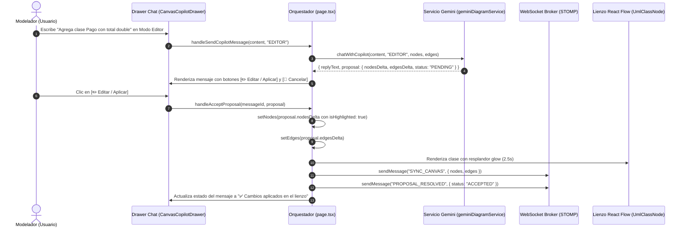
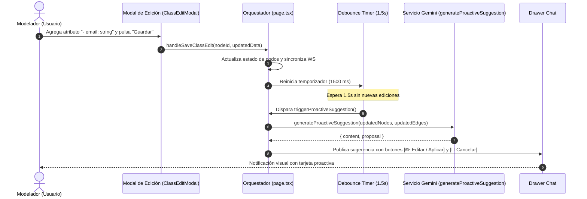

# Plan Técnico: Copilot IA - Modo Edición con Botones Interactivos, Sugerencias Proactivas y Persistencia en 'T'

> **Estado:** APPROVED  
> **Versión:** 1.0.0  
> **Módulo:** `docs/specs/03-chat-ia-edicion-sugerencias-y-clase-asociacion/`  
> **Especificación Base:** `docs/specs/03-chat-ia-edicion-sugerencias-y-clase-asociacion/spec.md`  
> **Constitución Base:** `docs/constitution.md`  
> **Metodología:** SDD-Planning  

---

## 1. Resumen Arquitectónico y Decisiones de Diseño

### 1.1 Objetivo Técnico
Materializar la especificación funcional mediante una arquitectura reactiva, fuertemente tipada y de baja latencia en Next.js 16 + React 19 + TypeScript para el Asistente IA (Copilot UML). El sistema implementará un renderizador tipográfico enriquecido para Markdown con vista previa, botones interactivos de decisión de dos vías (`[✏️ Editar / Aplicar]` y `[🚫 Cancelar]`), un motor de sugerencias proactivas con debounce de 1.5s ante cambios semánticos del canvas, feedback visual con destello luminoso (*glow effect*) en las clases actualizadas, atajos flotantes contextuales de navegación en el chat y corrección del ciclo de vida de deserialización para garantizar la persistencia de las Clases de Asociación en 'T'.

### 1.2 Decisiones Arquitectónicas Clave Adoptadas

- **Persistencia e Integridad del Lienzo**:
  - Corrección de la deserialización en el hook de carga de `page.tsx`: preservar incondicionalmente el tipo `umlAssociationClassEdge` y el payload completo de `data` (`targetEdgeId`, `sourceClassId`, `targetClassId`, `intermediateNodeId`), evitando que se degrade a `umlEdge`.
  - El lienzo completo continúa serializándose como JSON en el campo `lienzo` de la tabla `diagramas` (PostgreSQL) y sincronizándose a través del broker STOMP `/topic/diagram/{id}`.
- **Tono Ejecutivo y Directo de Gemini**:
  - Modificación del prompt del sistema (`systemPrompt`) en `geminiDiagramService.ts` aplicando directivas deterministas de cero cortesía, prohibiendo fórmulas de apertura o modestia ("Hola, soy Copilot...", "Como IA te sugiero...") e iniciando directamente con el dictamen de ingeniería o la especificación de cambios.
- **Renderizado Markdown Preview Enriquecido**:
  - Creación de un componente modular `MarkdownPreview.tsx` que procese sintaxis Markdown convirtiéndola en elementos React estilizados con Tailwind CSS v4: títulos jerárquicos, viñetas estilizadas, bloques de código monoespaciados con botón de copia, badges de visibilidad UML (`+`, `-`, `#`, `~`) y tarjetas de resumen técnico.
- **Sugerencias Proactivas con Debounce Semántico**:
  - Encapsular la detección de cambios semánticos en `page.tsx` con un temporizador `useRef` de 1500 ms. Sólo se dispara ante operaciones de mutación en modales o adición/eliminación de clases/aristas, excluyendo el simple arrastre espacial (`onNodeDrag`).
- **Resaltado Visual en Lienzo (Glow Effect)**:
  - Al pulsar `[✏️ Editar / Aplicar]`, los identificadores de los nodos creados o modificados se registran en un estado temporal `highlightedNodeIds: Set<string>` que activa una animación de pulso y resplandor índigo (`ring-4 ring-indigo-500/80 shadow-lg shadow-indigo-500/30 animate-pulse`) durante 2500 ms en `UmlClassNode.tsx`.
- **Navegación Flotante Contextual en el Chat**:
  - Monitoreo del desplazamiento vertical del contenedor de mensajes mediante scroll listeners. Si el usuario se encuentra a más de 120px de la parte inferior o no visualiza los encabezados de los últimos mensajes, se despliega una barra flotante semitransparente con accesos directos al último mensaje de la IA y al último mensaje emitido por el usuario.

---

### 1.3 Matriz de Componentes Técnicos (`PLAN-XX`)

| ID Componente | Nombre / Artefacto Técnico | Capa Arquitectónica | Responsabilidad Técnica | Requisitos que Cubre (`RF` / `RB` / `SC`) |
| :--- | :--- | :--- | :--- | :--- |
| **`PLAN-01`** | `types/index.ts` | Dominio / Tipos | Extensión de tipos de mensajes, propuestas y metadatos de aristas asociativas. | `RF-01.2`, `RF-04.1`, `RB-02` |
| **`PLAN-02`** | `MarkdownPreview.tsx` | Presentación / UI | Componente de renderizado de Markdown enriquecido con badges UML y bloques de código. | `RF-01.1`, `RB-01` |
| **`PLAN-03`** | `geminiDiagramService.ts` | Aplicación / Servicios | Actualización de prompts para tono directo y estructuración de deltas para propuestas. | `RF-01.1`, `RF-01.5`, `RB-01` |
| **`PLAN-04`** | `CanvasCopilotDrawer.tsx` | Presentación / UI | Integración de botones interactivos, cabecera de modo, tarjetas y atajos de navegación rápida. | `RF-01.2`, `RF-01.4`, `RF-03.1`, `RF-03.2`, `RB-02`, `RB-07` |
| **`PLAN-05`** | `ProactiveSuggestionCard.tsx` | Presentación / UI | Actualización de diseño con botones de acción interactivos acordes al estilo global. | `RF-01.2`, `RF-02.3`, `RB-02` |
| **`PLAN-06`** | `UmlClassNode.tsx` | Presentación / Lienzo | Soporte de destello luminoso (*glow effect*) ante aplicación de propuestas de la IA. | `RF-01.3`, `RB-04` |
| **`PLAN-07`** | `page.tsx` (Diagram Editor) | Orquestación / Presentación | Debounce de sugerencias proactivas, preservación de aristas en 'T', aplicación de propuestas y WebSockets. | `RF-01.3`, `RF-02.1`, `RF-02.2`, `RF-04.1`, `RF-04.2`, `RB-03`, `RB-05`, `RB-06` |
| **`PLAN-08`** | `tests/unit/copilotChatAndAssociation.test.ts` | Verificación / Tests | Pruebas unitarias de deserialización en 'T', debounce semántico y generación de propuestas. | `SC-01` al `SC-05` |

---

## 2. Estructura Física de Archivos del Proyecto / Módulo

```text
front_diag_clases/
├── types/
│   └── [MODIFY] index.ts                                   # (PLAN-01) Tipos ampliados para chat, propuestas y estado glow
├── services/
│   └── [MODIFY] geminiDiagramService.ts                    # (PLAN-03) System prompts directos sin modestia y deltas
├── components/
│   └── canvas/
│       ├── [CREATE] MarkdownPreview.tsx                    # (PLAN-02) Renderizador Markdown preview enriquecido
│       ├── [MODIFY] CanvasCopilotDrawer.tsx                # (PLAN-04) Botones [Editar]/[Cancelar], atajos e indicador de modo
│       ├── [MODIFY] ProactiveSuggestionCard.tsx            # (PLAN-05) Botones unificados y preview estilizado
│       ├── [MODIFY] UmlClassNode.tsx                       # (PLAN-06) Animación de resaltado glow en nodos
│       └── [MODIFY] UmlAssociationClassEdge.tsx            # (PLAN-07) Cálculo robusto y fallback geométrico
├── app/
│   └── (dashboard)/
│       └── diagrams/
│           └── [id]/
│               └── [MODIFY] page.tsx                       # (PLAN-07) Carga sin degradar 'T', debounce 1.5s y aplicación en lienzo
└── tests/
    └── unit/
        └── [CREATE] copilotChatAndAssociation.test.ts      # (PLAN-08) Suite de pruebas unitarias y de integración del flujo
```

---

## 3. Modelo Físico de Persistencia y Esquema de Datos

### 3.1 Modelo de Datos en Memoria y Persistencia JSON (`PLAN-01`, `PLAN-07`)

#### 1. Estructura de Aristas en 'T' en `data.lienzo` (PostgreSQL)
```json
{
  "id": "assoc-edge-1729290000000",
  "source": "class-intermedia-id",
  "target": "class-base-a-id",
  "type": "umlAssociationClassEdge",
  "data": {
    "relationType": "ASSOCIATION_CLASS",
    "isAssociationClass": true,
    "targetEdgeId": "edge-base-principal-id",
    "sourceClassId": "class-base-a-id",
    "targetClassId": "class-base-b-id",
    "intermediateNodeId": "class-intermedia-id",
    "name": "Detalle"
  }
}
```
* **Regla de Carga Fija**: Al parsear el JSON de `data.lienzo`, si `edge.type === "umlAssociationClassEdge"` o `edge.data?.isAssociationClass === true`, el tipo asignado a React Flow DEBE ser obligatoriamente `"umlAssociationClassEdge"`.

#### 2. Colección de Mensajes de Chat en MongoDB (`chat_messages`)
- `diagramId`: `number` (Indexado)
- `senderType`: `"USER" | "COPILOT"`
- `userName`: `string`
- `mode`: `"CHAT" | "EDITOR"`
- `messageType`: `"CHAT_MESSAGE" | "EDITOR_PROPOSAL" | "PROACTIVE_SUGGESTION"`
- `content`: `string` (Markdown enriquecido)
- `proposal`: `ChatProposalPayload` (Nodos/Aristas delta, estatus)
- `proposalStatus`: `"PENDING" | "ACCEPTED" | "IGNORED"`
- `resolvedByUserName`: `string | null`
- `createdAt`: `ISODate`

---

## 4. Contratos de Código, Interfaces Tipadas y Jerarquía de Errores

### 4.1 Tipos de Dominio Ampliados (`types/index.ts` — `PLAN-01`)

```typescript
export type CopilotMode = "CHAT" | "EDITOR";
export type ProposalStatus = "PENDING" | "ACCEPTED" | "IGNORED";

export interface ChatProposalPayload {
  summary: string;
  nodesDelta?: Node[];
  edgesDelta?: Edge[];
  status?: ProposalStatus;
  affectedNodeIds?: string[];
  resolvedByUserName?: string | null;
}

export interface ChatMessage {
  id?: string;
  diagramId: number;
  senderType: "USER" | "COPILOT";
  userName: string;
  userRole?: string;
  mode?: CopilotMode;
  messageType?: "CHAT_MESSAGE" | "EDITOR_PROPOSAL" | "PROACTIVE_SUGGESTION";
  content: string;
  taggedUserName?: string | null;
  proposal?: ChatProposalPayload | null;
  proposalStatus?: ProposalStatus;
  proposalJson?: string;
  resolvedByUserName?: string | null;
  isError?: boolean;
  createdAt?: string;
}

export interface UmlClassData {
  name: string;
  stereotype?: string;
  attributes: UmlAttribute[];
  methods: UmlMethod[];
  isHighlighted?: boolean; // Para destello luminoso (Glow Effect)
  onEdit?: (nodeId: string, data: UmlClassData) => void;
}
```

### 4.2 Contrato del Componente Markdown Preview (`MarkdownPreview.tsx` — `PLAN-02`)

```typescript
export interface MarkdownPreviewProps {
  content: string;
  className?: string;
}
// Renderiza Markdown con:
// - Títulos con tipografía destacada
// - Bloques de código con fondo slate-900, syntax highlighting básico y botón de copia
// - Badges automáticos de visibilidad: '+' (verde/público), '-' (rojo/privado), '#' (amarillo/protegido)
// - Viñetas redondeadas y tablas formateadas
```

### 4.3 Jerarquía de Errores Tipados y Manejo de Degradación

| Error Técnico | Causa Raíz | Estado Observable en UI | Estrategia de Mitigación |
| :--- | :--- | :--- | :--- |
| `AiQuotaExceededError` | Respuesta HTTP 429 / Cuota saturada de Google Gemini | Banner rojo: *"IA saturada, vuelve a escribir"* | Botón de reintento manual; degradación a `gemini-2.5-flash-lite`. |
| `MalformedProposalError` | JSON de nodos/aristas devuelto por la IA no cumple el esquema UML | Notificación Toast: *"La propuesta no pudo procesarse correctamente"* | Rechazo no destructivo; el lienzo permanece intacto. |
| `MissingBaseEdgeError` | Arista base en T fue eliminada antes de montar la clase asociativa | Conector se desancla automáticamente | Degradación limpia a clase regular sin bloquear React Flow. |

---

## 5. Diagramas Técnicos de Secuencia y Estados

### 5.1 Flujo Completo: Solicitud de Edición, Confirmación con Botón y Destello en Lienzo



### 5.2 Flujo de Sugerencia Proactiva ante Cambios en el Lienzo



---

## 6. Garantías de Runtime, Relaciones y Ciclo de Vida Operativo

### 6.1 Integridad del Conector en 'T' (Persistencia y Recarga)
- **Causa Raíz Resuelta**: Anteriormente, el mapeo de aristas en el `useEffect` de carga de `page.tsx` forzaba `type: "umlEdge"` y sobrescribía el objeto `data` descartando `targetEdgeId`.
- **Garantía Técnica**:
  ```typescript
  // Implementación determinista en la deserialización de page.tsx
  const loadedEdges = (parsed.edges || []).map((edge: Edge) => {
    const isAssoc =
      edge.type === "umlAssociationClassEdge" ||
      (edge.data as any)?.relationType === "ASSOCIATION_CLASS" ||
      !!(edge.data as any)?.targetEdgeId;

    return {
      ...edge,
      type: isAssoc ? "umlAssociationClassEdge" : "umlEdge",
      data: {
        ...edge.data,
        relationType: (edge.data as any)?.relationType || "ASSOCIATION",
        sourceMultiplicity: (edge.data as any)?.sourceMultiplicity || "",
        targetMultiplicity: (edge.data as any)?.targetMultiplicity || "",
        name: (edge.data as any)?.name || "",
        targetEdgeId: (edge.data as any)?.targetEdgeId || undefined,
        sourceClassId: (edge.data as any)?.sourceClassId || undefined,
        targetClassId: (edge.data as any)?.targetClassId || undefined,
        intermediateNodeId: (edge.data as any)?.intermediateNodeId || undefined,
      },
    };
  });
  ```

### 6.2 Resiliencia ante Cuotas y Reintentos
- Se mantendrá el pool de modelos de Gemini (`gemini-2.5-flash` $\rightarrow$ `gemini-2.5-pro` $\rightarrow$ `gemini-2.5-flash-lite`). Si todos retornan código 429, se muestra el banner de saturación en color rojo accesible con botón de reintento.

### 6.3 Prevención de Fugas de Memoria en Debounce y Timers
- Todos los temporizadores (`setTimeout` para el debounce de sugerencias y para la expiración del destello luminoso de los nodos) se almacenarán en referencias mutables (`useRef`) y se limpiarán en los efectos de desmontaje (`return () => clearTimeout(...)`).

---

## 7. Arquitectura de Vertical Slices (Hoja de Ruta para `/sdd-task`)

### Vertical Slice 1: Integridad y Persistencia de Clases de Asociación en 'T'
- **Alcance**: Corregir la deserialización y serialización del lienzo en `page.tsx` y `UmlAssociationClassEdge.tsx` para garantizar que la 'T' nunca se reconecte a otra clase ni se degrade al recargar la página o al sincronizar con WebSockets.
- **Componentes**: `PLAN-01`, `PLAN-07`.
- **Entregable**: Lienzo recargable que mantiene el conector en 'T' y sus metadatos intactos.

### Vertical Slice 2: Tono Directo de la IA y Renderizado Markdown Preview Enriquecido
- **Alcance**: Eliminar modestia y saludos en `geminiDiagramService.ts`; crear componente `MarkdownPreview.tsx` con estilizado completo de código, badges y tablas tipográficas dentro de `CanvasCopilotDrawer.tsx`.
- **Componentes**: `PLAN-02`, `PLAN-03`, `PLAN-04`.
- **Entregable**: Respuestas directas al grano y formateadas estéticamente en preview dentro del chat.

### Vertical Slice 3: Modo Editor con Botones Interactivos y Destello en Lienzo (*Glow Effect*)
- **Alcance**: Tarjeta de respuesta con botones interactivos `[✏️ Editar / Aplicar]` y `[🚫 Cancelar]`; al confirmar, aplicación de `nodesDelta`/`edgesDelta` en el canvas, difusión WebSocket y activación del resplandor luminoso (*glow*) en los nodos durante 2.5s.
- **Componentes**: `PLAN-01`, `PLAN-04`, `PLAN-06`, `PLAN-07`.
- **Entregable**: Edición de lienzo desde el chat totalmente funcional y visualmente verificable.

### Vertical Slice 4: Sugerencias Proactivas con Debounce de 1.5s ante Cambios en el Lienzo
- **Alcance**: Conectar las mutaciones manuales en modales y lienzo al temporizador de 1.5s; generar y difundir la sugerencia proactiva en el chat con los botones de acción unificados.
- **Componentes**: `PLAN-04`, `PLAN-05`, `PLAN-07`.
- **Entregable**: Sugerencias automáticas oportunas en el chat tras editar componentes en el lienzo.

### Vertical Slice 5: Observabilidad del Modo Activo y Atajos de Navegación Rápida
- **Alcance**: Indicador de estado en la cabecera del drawer ("Modo Editor" vs "Modo Chat"); botones flotantes contextuales para saltar al inicio del último mensaje de la IA y del usuario en historiales extensos.
- **Componentes**: `PLAN-04`.
- **Entregable**: Navegación fluida y certeza visual de estado del Asistente IA.

---

## 8. Estrategia de Testing y Verificación Técnica

| Nivel de Prueba | Tipo | Archivo Físico | Qué Valida Exactamente | Requisitos Asociados |
| :--- | :--- | :--- | :--- | :--- |
| **1. Unitaria** | Lógica de Dominio y Datos | `tests/unit/copilotChatAndAssociation.test.ts` | Deserialización de aristas en 'T', persistencia de `targetEdgeId` y no regresión a `umlEdge`. | `RF-04.1`, `RF-04.2`, `RB-06` |
| **2. Unitaria** | Prompt & Resiliencia | `tests/unit/copilotChatAndAssociation.test.ts` | Prompt de Gemini sin fórmulas de cortesía y fallback de saturación (429). | `RF-01.1`, `RF-01.5`, `RB-01` |
| **3. Componente / UI** | Interacción de Usuario | `tests/unit/copilotChatAndAssociation.test.ts` | Renderizado de botones `[✏️ Editar]` y `[🚫 Cancelar]`, y emisión de eventos de aceptación/descarte. | `RF-01.2`, `RF-01.3`, `RF-01.4`, `RB-02`, `RB-03` |

### Comandos de Verificación para `/sdd-execution`:
- **Verificación de Tipos TypeScript**:
  ```bash
  cd front_diag_clases && npx tsc --noEmit
  ```
- **Linter Frontend**:
  ```bash
  cd front_diag_clases && npm run lint
  ```
- **Ejecución de Pruebas Unitarias**:
  ```bash
  cd front_diag_clases && npm test
  ```

---

## 9. Matriz de Trazabilidad Técnica (`Spec` ↔ `Plan`)

| Requisito / Regla (`spec.md`) | Componente del Plan (`PLAN-XX`) | Archivo Físico Principal | Prueba que lo Verifica |
| :--- | :--- | :--- | :--- |
| `RF-01.1` (Markdown Preview y Tono Directo) | `PLAN-02`, `PLAN-03` | `MarkdownPreview.tsx`, `geminiDiagramService.ts` | `copilotChatAndAssociation.test.ts` |
| `RF-01.2` / `RB-02` (Botones Interactivos [Editar]/[Cancelar]) | `PLAN-01`, `PLAN-04`, `PLAN-05` | `CanvasCopilotDrawer.tsx`, `ProactiveSuggestionCard.tsx` | `copilotChatAndAssociation.test.ts` |
| `RF-01.3` / `RB-04` (Aplicación en Lienzo con Resplandor Glow) | `PLAN-06`, `PLAN-07` | `UmlClassNode.tsx`, `page.tsx` | Verificación en navegador y TypeScript |
| `RF-01.4` / `RB-03` (Descarte de Propuesta) | `PLAN-04`, `PLAN-07` | `CanvasCopilotDrawer.tsx`, `page.tsx` | `copilotChatAndAssociation.test.ts` |
| `RF-02.1` al `RF-02.3` / `RB-05` (Sugerencias Proactivas con Debounce) | `PLAN-05`, `PLAN-07` | `page.tsx`, `ProactiveSuggestionCard.tsx` | `copilotChatAndAssociation.test.ts` |
| `RF-03.1` (Indicador de Modo Activo) | `PLAN-04` | `CanvasCopilotDrawer.tsx` | Verificación en navegador |
| `RF-03.2` / `RB-07` (Atajos de Navegación Flotantes) | `PLAN-04` | `CanvasCopilotDrawer.tsx` | Verificación en navegador |
| `RF-04.1`, `RF-04.2` / `RB-06` (Persistencia de Aristas en 'T') | `PLAN-01`, `PLAN-07` | `page.tsx`, `UmlAssociationClassEdge.tsx` | `copilotChatAndAssociation.test.ts` |
