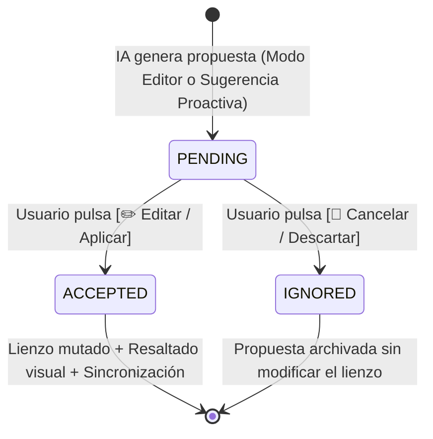

# Specification: Copilot IA - Modo Edición con Botones Interactivos, Sugerencias Proactivas y Persistencia en 'T'

> **Estado:** APPROVED  
> **Módulo:** 03-chat-ia-edicion-sugerencias-y-clase-asociacion  
> **Metodología:** SDD-Spec-Assisted  

---

## 1. Objetivo y Alcance

### 1.1 Objetivo de Negocio
Optimizar y robustecer la experiencia interactiva del Asistente de Inteligencia Artificial (Copilot UML) dentro del diagramador colaborativo, permitiendo que las respuestas sean directas, estéticamente legibles con formato preview enriquecido, con botones explícitos de acción interactiva (`[✏️ Editar / Aplicar]` y `[🚫 Cancelar]`) que modifiquen de forma observable el lienzo en tiempo real. Asimismo, automatizar sugerencias proactivas ante cada alteración estructural en el diagrama, proveer atajos de navegación para saltar entre el último mensaje de la IA y del usuario, y garantizar la persistencia e integridad incondicional de las Clases de Asociación en 'T' al recargar el lienzo y colaborar en vivo.

### 1.2 In-Scope
- **Tono Ejecutivo Directo de la IA**: Eliminación de fórmulas de cortesía, presentaciones vacías o modestias ("Hola, soy una IA...", "Espero te sirva"). Respuestas técnicas, concisas y directas a la acción.
- **Formato Preview Enriquecido de Markdown en el Chat**: Renderizado tipográfico estético con bloques de código estilizados, badges visuales de visibilidad UML (`+`, `-`, `#`, `~`), viñetas estilizadas y cuadros de impacto de la propuesta.
- **Modo Editor con Botones Interactivos**: Inclusión de botones de confirmación rápida (`[✏️ Editar / Aplicar]` y `[🚫 Cancelar]`) tanto en las órdenes del Modo Editor como en las sugerencias proactivas.
- **Aplicación Observable en el Lienzo**: Al pulsar `[✏️ Editar / Aplicar]`, el diagrama se actualiza de inmediato, se difunde a los colaboradores concurrentes y se resalta visualmente en el lienzo con un efecto de destello (*glow*) sobre los elementos afectados.
- **Sugerencias Proactivas por Cambios Estructurales**: Detección automática de alteraciones en clases, atributos, métodos o relaciones en el lienzo, disparando una evaluación con Gemini tras un debounce de 1.5s que genera una propuesta interactiva con botones en el chat.
- **Observabilidad del Modo Activo**: Indicadores visuales en la cabecera del panel ("🟢 En línea · Modo Editor" vs "💬 En línea · Modo Chat"), badges de estado en los mensajes ("Propuesta Lista para Aplicar", "✅ Aplicado", "🚫 Descartado") y placeholders contextuales.
- **Atajos de Navegación Rápida en el Chat**: Controles flotantes contextuales para saltar directamente al inicio del último mensaje emitido por la IA y del último mensaje emitido por el propio usuario, además del salto al final del historial.
- **Persistencia e Integridad de Clases de Asociación en 'T'**: Corrección del ciclo de vida de deserialización del lienzo para preservar el tipo de conector asociativo (`umlAssociationClassEdge`) y sus metadatos (`targetEdgeId`, clases participantes) al recargar el diagrama o sincronizarlo vía WebSockets.

### 1.3 Out-of-Scope
- Ejecución automática y destructiva de cambios en el lienzo sin la confirmación explícita del usuario mediante el botón interactivo.
- Generación de sugerencias proactivas ante desplazamientos espaciales puros de posición de los nodos.
- Soporte para relaciones ternarias o n-arias asociativas en forma de cruz de más de dos clases extremas.

---

## 2. Actores y Autorización

- **👑 Creador del Diagrama**:
  - Puede interactuar con la IA en Modo Chat y Modo Editor.
  - Puede aplicar o cancelar cualquier propuesta técnica generada por la IA o recibida como sugerencia proactiva.
  - Visualiza el resaltado luminoso en el lienzo y los cambios sincronizados.
- **👥 Colaborador del Diagrama**:
  - Puede consultar al Asistente IA y solicitar ediciones.
  - Puede resolver propuestas interactivas en vivo. Cuando un colaborador aplica una propuesta, esta queda registrada con su nombre y el lienzo se sincroniza para todos los participantes.
- **🤖 Copilot IA (Google Gemini)**:
  - Genera respuestas conversacionales y propuestas de mutación estructural del diagrama con botones de acción.
  - Evalúa los cambios estructurales transmitidos en el JSON del lienzo para emitir recomendaciones proactivas oportunas.

---

## 3. Modelo Funcional de Datos y Reglas de Negocio

### 3.1 Entidades y Estructuras Funcionales

#### Mensaje Interactivo de Chat y Propuesta
- `id`: Identificador único del mensaje.
- `remitente`: `USUARIO` o `COPILOT_IA`.
- `modo`: `CHAT` o `EDITOR`.
- `tipoMensaje`: `CHAT_MESSAGE`, `EDITOR_PROPOSAL` o `PROACTIVE_SUGGESTION`.
- `contenidoTexto`: Texto formateado en Markdown estructurado.
- `estadoPropuesta`: `PENDING`, `ACCEPTED` o `IGNORED`.
- `resumenImpacto`: Descripción breve de las entidades y aristas modificadas o creadas.
- `datosModificacion`: Colección de nodos y aristas resultantes a aplicar en el lienzo.
- `resueltoPor`: Nombre del usuario que aceptó o ignoró la propuesta.

#### Relación de Clase de Asociación en 'T'
- `idArista`: Identificador único del conector en 'T'.
- `idAristaBase`: Identificador de la arista principal entre las dos clases base.
- `idClaseIntermedia`: Identificador de la clase asociativa anclada.
- `tipoArista`: Conector perpendicular discontinuo de clase asociativa.

### 3.2 Reglas de Negocio (RB)

- `RB-01: Prohibición de Modestia y Respuestas Extensas`: La IA debe responder de manera ejecutiva y directa. Queda prohibido el uso de fórmulas de apertura redundantes ("¡Hola! Soy Copilot...", "Como asistente de IA..."). La respuesta debe iniciar inmediatamente con el dictamen técnico o el resumen de la modificación propuesta.
- `RB-02: Doble Acción Obligatoria en Propuestas`: Todo mensaje que plantee una modificación al diagrama (sea originado en Modo Editor o como sugerencia proactiva) debe presentar de forma mandatoria dos botones de acción: `[✏️ Editar / Aplicar]` y `[🚫 Cancelar / Descartar]`.
- `RB-03: No Destructividad sin Confirmación`: El lienzo nunca se mutará de forma unilateral. El cambio se aplicará únicamente cuando un usuario pulse el botón `[✏️ Editar / Aplicar]`.
- `RB-04: Retroalimentación Visual Inmediata (Glow Effect)`: Al confirmarse una propuesta, las clases y relaciones agregadas o modificadas deben exhibir un destello visual luminoso en el lienzo durante al menos 2.5 segundos, indicando al usuario exactamente qué cambió.
- `RB-05: Debounce de Sugerencias Proactivas`: Las sugerencias proactivas sólo se disparan ante cambios semánticos (guardar clase, añadir atributo/método, cambiar visibilidad, conectar arista) con un temporizador de espera (*debounce*) de 1.5 segundos. Los desplazamientos de arrastre de posición no disparan sugerencias.
- `RB-06: Preservación Inmutable de Conectores en 'T'`: El sistema debe preservar la tipología de clase asociativa tanto al guardar como al recargar el diagrama. Ningún proceso de serialización puede degradar un conector en 'T' a una relación binaria convencional.
- `RB-07: Visibilidad Condicional de Atajos de Navegación`: Los botones flotantes de salto rápido hacia el último mensaje de la IA o del usuario sólo se muestran cuando el área de mensajes tiene desplazamiento vertical activo y el usuario no tiene a la vista el mensaje objetivo.

---

## 4. Máquina de Estados de la Propuesta de Edición



- **Transiciones Prohibidas**:
  - Una propuesta en estado `ACCEPTED` o `IGNORED` no puede volver a `PENDING`.
  - No se permite aplicar una propuesta que ya haya sido resuelta previamente.

---

## 5. Requerimientos Funcionales (Patrón EARS)

### Módulo: Asistente IA y Modo Editor
- `HU-01`: Como modelador de software, quiero que el Copilot IA responda de forma directa y formatee sus mensajes en Markdown enriquecido con botones interactivos, para comprender rápidamente los cambios y aplicarlos con un solo clic.
  - `RF-01.1 (Ubiquitous)`: El sistema deberá renderizar las respuestas de la IA interpretando sintaxis Markdown, aplicando estilos tipográficos para títulos, viñetas, fragmentos de código destacados y badges de tipo de datos.
  - `RF-01.2 (Event-Driven)`: Cuando la IA genere una respuesta en Modo Editor o una sugerencia de modificación, el sistema deberá adjuntar en la tarjeta de respuesta los botones interactivos `[✏️ Editar / Aplicar]` y `[🚫 Cancelar]`.
  - `RF-01.3 (Event-Driven)`: Cuando el usuario pulse el botón `[✏️ Editar / Aplicar]`, el sistema deberá aplicar los nodos y aristas de la propuesta sobre el lienzo activo, persistir el nuevo estado y marcar la propuesta como aceptada.
  - `RF-01.4 (Event-Driven)`: Cuando el usuario pulse el botón `[🚫 Cancelar]`, el sistema deberá descartar la propuesta, conservar el lienzo inalterado y marcar el mensaje como descartado.
  - `RF-01.5 (Unwanted Behavior)`: Si la cuota del servicio de IA se satura (error 429), el sistema deberá presentar un aviso de saturación visible y habilitar un mecanismo de reintento sin corromper el historial de mensajes.

### Módulo: Sugerencias Proactivas ante Cambios en el Lienzo
- `HU-02`: Como arquitecto de software, quiero que la IA analice automáticamente cada cambio que realizo en el lienzo y me sugiera mejoras contextuales con botones de aplicación, para mantener el modelo normalizado y completo.
  - `RF-02.1 (Event-Driven)`: Cuando el usuario complete la edición de una clase, atributo, método o relación en el lienzo, el sistema deberá iniciar un temporizador de 1.5 segundos.
  - `RF-02.2 (Event-Driven)`: Cuando venza el temporizador sin nuevas ediciones, el sistema deberá remitir el nuevo JSON estructural a la IA para obtener una sugerencia proactiva.
  - `RF-02.3 (Event-Driven)`: Cuando la IA emita la sugerencia proactiva, el sistema deberá publicarla en el chat incorporando la tarjeta de acción con botones `[✏️ Editar / Aplicar]` y `[🚫 Cancelar]`.

### Módulo: Observabilidad y Navegación en el Chat
- `HU-03`: Como usuario del diagramador, quiero conocer con certeza si el chat está en Modo Consulta o Modo Edición y disponer de atajos para saltar entre mensajes largos, para tener control total de la interfaz.
  - `RF-03.1 (Ubiquitous)`: El sistema deberá exhibir en la cabecera del panel un indicador permanente de estado: *"🟢 En línea · Modo Editor"* cuando esté seleccionado el modo de modificación, y *"💬 En línea · Modo Chat"* cuando esté en modo consulta.
  - `RF-03.2 (Event-Driven)`: Mientras el usuario se encuentre desplazado verticalmente fuera del alcance visual del último mensaje de la IA o de su propio mensaje, el sistema deberá mostrar botones flotantes de navegación para saltar de forma instantánea al encabezado de cada uno de ellos.

### Módulo: Integridad y Persistencia de Clases de Asociación en 'T'
- `HU-04`: Como diseñador de clases UML, quiero que las clases de asociación conectadas en forma de 'T' se mantengan intactas al cerrar y volver a abrir el diagrama, para no perder la semántica asociativa de mi modelo.
  - `RF-04.1 (Event-Driven)`: Cuando el sistema cargue un diagrama desde el almacenamiento, el sistema deberá identificar las aristas de tipo clase de asociación y conservar su conector en 'T' perpendicular hacia la arista base.
  - `RF-04.2 (Ubiquitous)`: El sistema deberá impedir que la deserialización de aristas fuerce el tipo de arista binaria común sobre conectores de clases de asociación.

---

## 6. Comportamiento Observable y Criterios de Aceptación (Gherkin)

### Escenario 1: Solicitud de Edición por Chat y Aplicación con Botón (Happy Path)
```gherkin
Given que el usuario tiene abierto el diagrama "SistemaVentas" en el lienzo
And el panel de Copilot IA se encuentra abierto en "Modo Editor"
When el usuario escribe y envía "Agrega la clase Pago con atributo monto double y estado string"
Then la IA responde directamente sin saludos de cortesía describiendo la clase creada
And la tarjeta de respuesta muestra los botones interactivos "[✏️ Editar / Aplicar]" y "[🚫 Cancelar]"
When el usuario hace clic en el botón "[✏️ Editar / Aplicar]"
Then la nueva clase "Pago" aparece de forma visible en el lienzo
And la clase "Pago" emite una animación de resaltado luminoso durante 2.5 segundos
And la tarjeta del mensaje cambia su estado a "✅ Cambios aplicados en el lienzo"
And los colaboradores conectados reciben la actualización de inmediato
```

### Escenario 2: Descarte de Propuesta de Edición
```gherkin
Given que el usuario recibe una propuesta de edición de la IA con botones interactivos
When el usuario hace clic en el botón "[🚫 Cancelar]"
Then el lienzo no sufre ninguna alteración en sus clases ni aristas
And la tarjeta del mensaje actualiza su estado a "🚫 Propuesta descartada"
And los botones de acción quedan deshabilitados
```

### Escenario 3: Sugerencia Proactiva tras Modificación Manual de Atributo
```gherkin
Given que el usuario edita la clase "Cliente" en el lienzo agregando el atributo "- email: String"
When el usuario pulsa "Guardar" en el modal de edición de clase
Then transcurren 1.5 segundos de inactividad de edición
And el sistema envía el JSON actualizado del diagrama a la IA
And aparece en el chat una sugerencia proactiva etiquetando al usuario
And la sugerencia contiene los botones interactivos "[✏️ Editar / Aplicar]" y "[🚫 Cancelar]" para incorporar las recomendaciones
```

### Escenario 4: Navegación Rápida con Atajo al Último Mensaje
```gherkin
Given que el chat contiene un historial extenso con más de 10 mensajes
And el usuario se ha desplazado hacia arriba visualizando mensajes antiguos
When los botones flotantes de navegación rápida aparecen sobre el chat
And el usuario pulsa el atajo "Ir al último mensaje IA"
Then la vista del chat se desplaza suavemente hasta el inicio del último mensaje generado por la IA
```

### Escenario 5: Carga del Diagrama con Clase de Asociación en 'T' Persistida
```gherkin
Given que el diagrama contiene una clase de asociación "DetallePedido" vinculada en 'T' entre "Pedido" y "Producto"
When el usuario recarga el navegador o vuelve a abrir el diagrama desde el listado
Then la clase "DetallePedido" se renderiza en el lienzo anclada perpendicularmente al centro de la arista entre "Pedido" y "Producto"
And el conector conserva la línea discontinua característica en 'T'
And la arista no se transforma en una relación binaria convencional
```

---

## 7. Efectos Secundarios e Integraciones

- **Sincronización WebSockets (STOMP)**:
  - Al pulsar `[✏️ Editar / Aplicar]`, se envía un mensaje `SYNC_CANVAS` con la nueva topología de nodos y aristas, y un mensaje `PROPOSAL_RESOLVED` con el estado `ACCEPTED`.
- **Persistencia en MongoDB y PostgreSQL**:
  - El historial de mensajes y resoluciones se almacena en las colecciones de chat de MongoDB.
  - La estructura del diagrama (`data.lienzo`) con la definición completa de nodos y conectores en 'T' se persiste en PostgreSQL.
- **Exportadores de Código**:
  - Las clases de asociación en 'T' se exportan a Spring Boot como entidades JPA con doble `@ManyToOne` y a Flutter como modelos relacionados.
