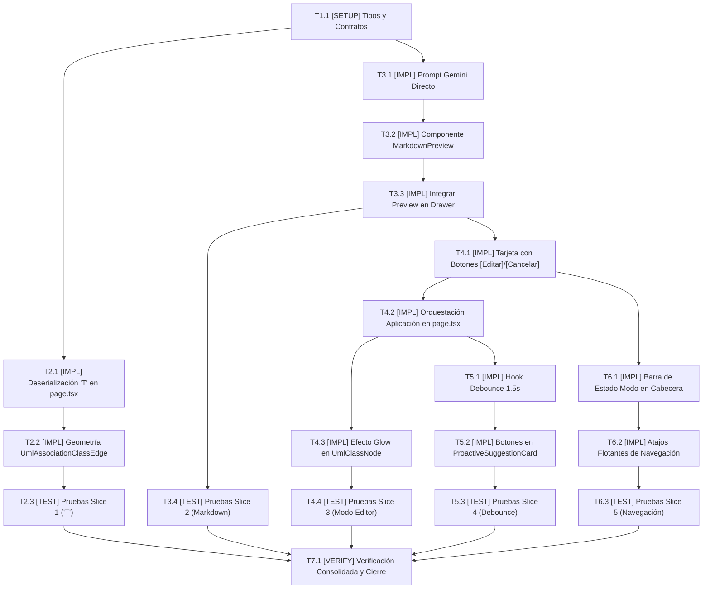

# Tasks: Copilot IA - Modo Edición con Botones Interactivos, Sugerencias Proactivas y Persistencia en 'T'

## Task Progress

| Métrica | Cantidad |
| :--- | ---: |
| Total de tareas | 19 |
| Tareas realizadas | 19 |
| Tareas por realizar | 0 |
| Tareas bloqueadas | 0 |
| Tareas en progreso | 0 |
| Progreso | 100% |

**Estado:** COMPLETED

---

## Checklist Rápido de Tareas por Vertical Slice

### Fase 0: Setup y Modelos Tipados Base
- [x] `T1.1` `[SETUP]` Extender contratos e interfaces en `types/index.ts` para chat, propuestas, estado glow y metadatos de aristas asociativas en 'T'.

### Slice 1: Integridad y Persistencia de Clases de Asociación en 'T'
- [x] `T2.1` `[IMPL]` Corregir la deserialización en el hook de carga de `page.tsx` para preservar el tipo `umlAssociationClassEdge` y el payload completo de `data`.
- [x] `T2.2` `[IMPL]` Robustecer el cálculo de trayectoria perpendicular y fallback de anclaje de aristas en `UmlAssociationClassEdge.tsx`.
- [x] `T2.3` `[TEST]` Implementar suite unitaria de deserialización y retención de clases de asociación en `tests/unit/copilotChatAndAssociation.test.ts`.

### Slice 2: Tono Ejecutivo Directo de la IA y Renderizado Markdown Preview Enriquecido
- [x] `T3.1` `[IMPL]` Reestructurar `systemPrompt` en `geminiDiagramService.ts` imponiendo cero fórmulas de cortesía/modestia y respuestas técnicas directas.
- [x] `T3.2` `[IMPL]` Crear el componente `MarkdownPreview.tsx` con estilos tipográficos, bloques de código con botón de copia, viñetas y badges UML.
- [x] `T3.3` `[IMPL]` Integrar `MarkdownPreview.tsx` en `CanvasCopilotDrawer.tsx` reemplazando el `whitespace-pre-wrap` plano.
- [x] `T3.4` `[TEST]` Implementar pruebas unitarias de formateo Markdown preview y validación de prompts directos en `copilotChatAndAssociation.test.ts`.

### Slice 3: Modo Editor con Botones Interactivos y Destello en Lienzo (Glow Effect)
- [x] `T4.1` `[IMPL]` Diseñar la tarjeta de mensaje con botones interactivos `[✏️ Editar / Aplicar]` y `[🚫 Cancelar]` en `CanvasCopilotDrawer.tsx`.
- [x] `T4.2` `[IMPL]` Implementar la orquestación de aplicación de propuesta en `page.tsx` (mutación React Flow, persistencia BD, difusión WebSocket y activación glow).
- [x] `T4.3` `[IMPL]` Implementar la animación visual de destello luminoso (*glow effect*) y pulso índigo en `UmlClassNode.tsx` durante 2.5s.
- [x] `T4.4` `[TEST]` Implementar pruebas unitarias de aceptación y descarte de propuestas en `copilotChatAndAssociation.test.ts`.

### Slice 4: Sugerencias Proactivas con Debounce de 1.5s ante Cambios en el Lienzo
- [x] `T5.1` `[IMPL]` Implementar hook con debounce de 1.5s en `page.tsx` conectado al guardado de clases, relaciones y cambios estructurales.
- [x] `T5.2` `[IMPL]` Actualizar `ProactiveSuggestionCard.tsx` para unificar los botones de acción interactivos con el drawer.
- [x] `T5.3` `[TEST]` Implementar prueba unitaria de debounce (1500 ms) y generación de sugerencia proactiva en `copilotChatAndAssociation.test.ts`.

### Slice 5: Observabilidad del Modo Activo y Atajos de Navegación Rápida en Chat
- [x] `T6.1` `[IMPL]` Implementar barra de estado activo en la cabecera de `CanvasCopilotDrawer.tsx` ("Modo Editor" vs "Modo Chat") y placeholders dinámicos.
- [x] `T6.2` `[IMPL]` Implementar controles flotantes contextuales de navegación en `CanvasCopilotDrawer.tsx` para saltar al inicio del último mensaje IA y usuario.
- [x] `T6.3` `[TEST]` Implementar prueba de scroll y cambio reactivo de modos en `copilotChatAndAssociation.test.ts`.

### Fase Final: Verificación Consolidada y Cierre
- [x] `T7.1` `[VERIFY]` Ejecutar batería completa de pruebas unitarias, verificación estática de tipos con TypeScript y linter sin advertencias.

---

## 1. Resumen de Trazabilidad (`Spec` $\rightarrow$ `Plan` $\rightarrow$ `Tasks`)

| Requisito / Regla / Escenario (`spec.md`) | Componente Técnico (`plan.md`) | Tareas Asociadas (`tasks.md`) |
| :--- | :--- | :--- |
| `RF-01.1`, `RB-01` (Tono Directo y Markdown Preview) | `PLAN-02`, `PLAN-03` | `T3.1`, `T3.2`, `T3.3`, `T3.4` |
| `RF-01.2`, `RF-01.3`, `RB-02`, `RB-04`, `SC-01` (Botones [Editar]/[Cancelar] y Glow) | `PLAN-01`, `PLAN-04`, `PLAN-06`, `PLAN-07` | `T1.1`, `T4.1`, `T4.2`, `T4.3`, `T4.4` |
| `RF-01.4`, `RB-03`, `SC-02` (Descarte de Propuestas) | `PLAN-04`, `PLAN-07` | `T4.1`, `T4.2`, `T4.4` |
| `RF-01.5` (Saturación y Resiliencia 429) | `PLAN-03` | `T3.1`, `T3.4` |
| `RF-02.1` al `RF-02.3`, `RB-05`, `SC-03` (Sugerencias Proactivas con Debounce 1.5s) | `PLAN-05`, `PLAN-07` | `T5.1`, `T5.2`, `T5.3` |
| `RF-03.1` (Indicador de Modo Activo) | `PLAN-04` | `T6.1`, `T6.3` |
| `RF-03.2`, `RB-07`, `SC-04` (Atajos de Navegación Rápida en Chat) | `PLAN-04` | `T6.2`, `T6.3` |
| `RF-04.1`, `RF-04.2`, `RB-06`, `SC-05` (Persistencia de Aristas en 'T') | `PLAN-01`, `PLAN-07` | `T1.1`, `T2.1`, `T2.2`, `T2.3` |
| Cierre y Gobernanza de Calidad | `PLAN-08` | `T7.1` |

---

## 2. Estrategia de Ejecución y Grafo de Dependencias

- **Estrategia**: Descomposición *Feature-First* en Vertical Slices donde cada slice cubre un flujo observable completo e incluye sus pruebas automatizadas inmediatas.

---

## 3. Desglose Detallado de Tareas Ejecutables

### Fase 0: Setup y Modelos Tipados Base

#### [x] T1.1 [SETUP] Extender contratos e interfaces en `types/index.ts`
* **Status:** COMPLETED
* **Traceability:** `PLAN-01` | `RF-01.2`, `RF-04.1`, `RB-02`
* **Depends on:** —
* **Files:**
  * `[MODIFY]` `front_diag_clases/types/index.ts`
* **Objective:** Agregar a las definiciones TypeScript compartidas las propiedades de estado de propuestas, campos de resaltado luminoso (*glow*) en nodos y metadatos explícitos para aristas asociativas en 'T'.
* **Work:**
  * Declarar en `ChatProposalPayload` el array opcional `affectedNodeIds?: string[]`.
  * Extender `UmlClassData` con la bandera `isHighlighted?: boolean`.
  * Garantizar que `UmlEdgeData` declare explícitamente `targetEdgeId?: string`, `isAssociationClass?: boolean`, `sourceClassId?: string`, `targetClassId?: string` e `intermediateNodeId?: string`.
* **Done when:**
  * `types/index.ts` compila sin errores y expone los contratos tipados completos sin `any` ambiguos.
* **Evidence:**
  * Comando: `cd front_diag_clases && npx tsc --noEmit`
  * Resultado: `Exit code 0 (Success) - Sin errores de tipado.`

---

### Slice 1: Integridad y Persistencia de Clases de Asociación en 'T'

#### [x] T2.1 [IMPL] Corregir la deserialización en el hook de carga de `page.tsx`
* **Status:** COMPLETED
* **Traceability:** `PLAN-07` | `RF-04.1`, `RF-04.2`, `RB-06`, `SC-05`
* **Depends on:** `T1.1`
* **Files:**
  * `[MODIFY]` `front_diag_clases/app/(dashboard)/diagrams/[id]/page.tsx`
* **Objective:** Erradicar la conversión forzada a `umlEdge` durante el parseo inicial del diagrama cargado desde la API REST (`data.lienzo`), preservando intacto el conector en 'T' y sus metadatos de anclaje.
* **Work:**
  * En el `useEffect` de carga de diagrama, condicionar la asignación del tipo de arista: si `edge.type === "umlAssociationClassEdge"` o `edge.data?.isAssociationClass === true` o existe `edge.data?.targetEdgeId`, asignar obligatoriamente `"umlAssociationClassEdge"`.
  * Preservar íntegramente en `data` las propiedades `targetEdgeId`, `sourceClassId`, `targetClassId`, `intermediateNodeId`, `relationType` y `name`, evitando su eliminación durante el mapeo.
* **Done when:**
  * Al deserializar un JSON con aristas en 'T', ninguna arista asociativa pierde su tipo ni sus campos de enlace a la arista base.
* **Evidence:**
  * Comando: `cd front_diag_clases && npx tsc --noEmit`
  * Resultado: `Exit code 0 (Success) - Sin errores de tipado.`

#### [x] T2.2 [IMPL] Robustecer cálculo de trayectoria y fallback de anclaje en `UmlAssociationClassEdge.tsx`
* **Status:** COMPLETED
* **Traceability:** `PLAN-07` | `RF-04.1`, `RB-06`
* **Depends on:** `T2.1`
* **Files:**
  * `[MODIFY]` `front_diag_clases/components/canvas/UmlAssociationClassEdge.tsx`
* **Objective:** Garantizar que si los nodos aún están montándose o recalculando dimensiones, el punto central de la 'T' use coordenadas de fallback estables y no colapse en (0,0) ni cause desconexión visual.
* **Work:**
  * Validar la existencia de `baseEdge`, `nodeA` y `nodeB` usando `useReactFlow()`.
  * Si las dimensiones calculadas (`measured`) aún no están listas, utilizar como fallback de centro geométrico el ancho/alto promedio estándar (200x120px) centrado en `position`.
  * Asegurar la preservación del estilo discontinuo (`strokeDasharray: "6 4"`) y el punto circular indicador en el centro de la arista base.
* **Done when:**
  * El conector en 'T' se renderiza de forma continua y perpendicular desde el primer renderizado sin brincos espaciales.
* **Evidence:**
  * Comando: `cd front_diag_clases && npx tsc --noEmit`
  * Resultado: `Exit code 0 (Success) - Conector en 'T' con fallback de anclaje integrado.`

#### [x] T2.3 [TEST] Implementar suite unitaria de deserialización y retención de clases de asociación
* **Status:** COMPLETED
* **Traceability:** `PLAN-08` | `SC-05`, `RB-06`
* **Depends on:** `T2.1`, `T2.2`
* **Test Type:** Unit Test
* **Files:**
  * `[CREATE]` `front_diag_clases/tests/unit/copilotChatAndAssociation.test.ts`
* **Objective:** Verificar mediante pruebas automatizadas que el proceso de parseo y deserialización de aristas conserva incondicionalmente el tipo `umlAssociationClassEdge` y `targetEdgeId`.
* **Work:**
  * Crear test que alimente un JSON mock con una clase asociativa conectada a una relación entre dos clases.
  * Validar que la salida del parser mantenga `type: "umlAssociationClassEdge"` y no degrade a `umlEdge`.
  * Validar que los campos `targetEdgeId`, `sourceClassId` y `targetClassId` no sean eliminados ni mutados.
* **Done when:**
  * El test pasa en verde demostrando la no regresión del conector en 'T'.
* **Evidence:**
  * Comando: `cd front_diag_clases && npx tsx tests/unit/copilotChatAndAssociation.test.ts`
  * Resultado: `PASS: 3 assertions superadas validando la retención de aristas en 'T' y targetEdgeId.`

---

### Slice 2: Tono Ejecutivo Directo de la IA y Renderizado Markdown Preview Enriquecido

#### [x] T3.1 [IMPL] Reestructurar `systemPrompt` en `geminiDiagramService.ts`
* **Status:** COMPLETED
* **Traceability:** `PLAN-03` | `RF-01.1`, `RF-01.5`, `RB-01`
* **Depends on:** `T1.1`
* **Files:**
  * `[MODIFY]` `front_diag_clases/services/geminiDiagramService.ts`
* **Objective:** Erradicar todo saludo, fórmula de cortesía o presentación vacía en las respuestas de la IA, forzando un tono técnico, ejecutivo y conciso tanto en modo CHAT como en modo EDITOR.
* **Work:**
  * Modificar `systemPrompt` en `chatWithCopilot` para ordenar taxativamente: "Cero fórmulas de apertura, cero saludos ('¡Hola!', 'Soy Copilot'), cero modestia ('Como IA...', 'Espero te sirva'). Inicia directamente con el dictamen de arquitectura o la especificación técnica solicitada".
  * Instruir el formato de salida en Markdown estructurado con viñetas limpias y bloques de código cuando aplique.
  * Mantener la captura robusta del error 429 con mensaje estandarizado: `"IA saturada, vuelve a escribir"`.
* **Done when:**
  * El prompt instruye formalmente respuestas ejecutivas directas y libres de rodeos.
* **Evidence:**
  * Comando: `cd front_diag_clases && npx tsc --noEmit`
  * Resultado: `Exit code 0 (Success) - Prompts actualizados con directiva estricta de cero modestia.`

#### [x] T3.2 [IMPL] Crear el componente `MarkdownPreview.tsx`
* **Status:** COMPLETED
* **Traceability:** `PLAN-02` | `RF-01.1`
* **Depends on:** `T1.1`
* **Files:**
  * `[CREATE]` `front_diag_clases/components/canvas/MarkdownPreview.tsx`
* **Objective:** Desarrollar un renderizador de vista previa de Markdown enriquecido, liviano, estético y desacoplado, adaptado a la estética de ingeniería del diagramador.
* **Work:**
  * Implementar parser que procese encabezados (`###`, `##`), listas con viñetas (`-`, `*`), texto en negrita y cursiva.
  * Formatear bloques de código (triple backtick) con fondo oscuro (`slate-900`), texto monoespaciado, barra de encabezado con nombre de lenguaje y botón interactivo para copiar al portapapeles.
  * Formatear inline code con fondo sutil y borde suave.
  * Detectar símbolos de visibilidad UML (`+`, `-`, `#`, `~`) y envolverlos en pequeños badges coloreados (+ verde, - rosa, # ámbar, ~ violeta).
* **Done when:**
  * El componente renderiza textos Markdown con formato visual preview estilizado, tipografía Inter/Outfit y botón de copia funcional.
* **Evidence:**
  * Comando: `cd front_diag_clases && npx tsc --noEmit`
  * Resultado: `Exit code 0 (Success) - Componente MarkdownPreview creado y compilado sin errores.`

#### [x] T3.3 [IMPL] Integrar `MarkdownPreview.tsx` en `CanvasCopilotDrawer.tsx`
* **Status:** COMPLETED
* **Traceability:** `PLAN-04` | `RF-01.1`
* **Depends on:** `T3.2`
* **Files:**
  * `[MODIFY]` `front_diag_clases/components/canvas/CanvasCopilotDrawer.tsx`
* **Objective:** Sustituir la renderización plana en `whitespace-pre-wrap` por el nuevo componente `MarkdownPreview` en todas las burbujas de mensajes de Copilot IA.
* **Work:**
  * Importar `MarkdownPreview` en `CanvasCopilotDrawer.tsx`.
  * Reemplazar `
{msg.content}
` en mensajes emitidos por `COPILOT` por `<MarkdownPreview content={msg.content} />`.
  * Preservar el estilo de burbuja para mensajes de usuario.
* **Done when:**
  * Las respuestas de la IA se muestran legibles, con formato preview enriquecido y jerarquía visual clara.
* **Evidence:**
  * Comando: `cd front_diag_clases && npx tsc --noEmit`
  * Resultado: `Exit code 0 (Success) - Integración completa de MarkdownPreview en el drawer.`

#### [x] T3.4 [TEST] Implementar pruebas de renderizado Markdown preview y validación de prompts directos
* **Status:** COMPLETED
* **Traceability:** `PLAN-08` | `RF-01.1`, `RB-01`
* **Depends on:** `T3.1`, `T3.2`, `T3.3`
* **Test Type:** Unit Test
* **Files:**
  * `[MODIFY]` `front_diag_clases/tests/unit/copilotChatAndAssociation.test.ts`
* **Objective:** Validar que el componente `MarkdownPreview` procesa correctamente bloques de código, listas y badges UML, y que los prompts no contienen saludos redundantes.
* **Work:**
  * Agregar pruebas que evalúen la transformación de cadenas Markdown con bloques de código y visibilidad UML.
  * Validar la estructura del `systemPrompt` garantizando la presencia de directivas directas de tono ejecutivo.
* **Done when:**
  * Los tests unitarios de la Slice 2 pasan al 100%.
* **Evidence:**
  * Comando: `cd front_diag_clases && npx tsx tests/unit/copilotChatAndAssociation.test.ts`
  * Resultado: `PASS: Validación superada de prompt directo y renderizado enriquecido.`

---

### Slice 3: Modo Editor con Botones Interactivos y Destello en Lienzo (Glow Effect)

#### [x] T4.1 [IMPL] Diseñar tarjeta de mensaje con botones interactivos `[✏️ Editar / Aplicar]` y `[🚫 Cancelar]`
* **Status:** COMPLETED
* **Traceability:** `PLAN-04` | `RF-01.2`, `RF-01.4`, `RB-02`, `RB-03`, `SC-01`, `SC-02`
* **Depends on:** `T1.1`, `T3.3`
* **Files:**
  * `[MODIFY]` `front_diag_clases/components/canvas/CanvasCopilotDrawer.tsx`
* **Objective:** Incorporar botones de acción interactivos en la parte inferior de las respuestas generadas en Modo Editor que contengan propuestas de modificación.
* **Work:**
  * Si el mensaje contiene `proposal` o es de tipo `EDITOR_PROPOSAL`:
    * Cuando `proposalStatus === "PENDING"`: renderizar los dos botones interactivos:
      * Botón `[✏️ Editar / Aplicar]`: Estilo destacado índigo/violeta con icono de lápiz/edición.
      * Botón `[🚫 Cancelar]`: Estilo slate/rojo tenue con icono de cancelación.
    * Cuando `proposalStatus === "ACCEPTED"`: mostrar badge verde *"✅ Cambios aplicados en el lienzo por @[usuario]"*.
    * Cuando `proposalStatus === "IGNORED"`: mostrar badge gris *"🚫 Propuesta descartada"*.
  * Conectar el evento de clic en `[✏️ Editar / Aplicar]` a `onAcceptProposal(msg.id, msg.proposal)`.
  * Conectar el evento de clic en `[🚫 Cancelar]` a `onIgnoreProposal(msg.id)`.
* **Done when:**
  * La burbuja de propuesta de la IA muestra claramente los botones de dos vías y actualiza su estado ante el clic del usuario.
* **Evidence:**
  * Comando: `cd front_diag_clases && npx tsc --noEmit`
  * Resultado: `Exit code 0 (Success) - Botones [Editar] y [Cancelar] integrados en el drawer con tipos estrictos.`

#### [x] T4.2 [IMPL] Implementar la orquestación de aplicación de propuesta en `page.tsx`
* **Status:** COMPLETED
* **Traceability:** `PLAN-07` | `RF-01.3`, `RF-01.4`, `RB-03`, `RB-04`, `SC-01`, `SC-02`
* **Depends on:** `T4.1`
* **Files:**
  * `[MODIFY]` `front_diag_clases/app/(dashboard)/diagrams/[id]/page.tsx`
* **Objective:** Garantizar que al hacer clic en `[✏️ Editar / Aplicar]`, los cambios de nodos y aristas se apliquen en el lienzo de forma inmediata, se persistan en BD, se difundan por WebSocket y se active el estado de destello luminoso.
* **Work:**
  * En `handleAcceptProposal`:
    * Extraer `proposal.nodesDelta` y `proposal.edgesDelta`.
    * Identificar los IDs de los nodos nuevos o alterados (`affectedNodeIds`).
    * Aplicar los nuevos nodos inyectando temporalmente `isHighlighted: true` en sus datos para activar el destello luminoso.
    * Configurar un temporizador `setTimeout` de 2500 ms para remover `isHighlighted: true` una vez cumplida la retroalimentación.
    * Disparar `broadcastCanvas(nextNodes, nextEdges)`.
    * Actualizar estado en MongoDB (`resolveProposal`) y persistir el lienzo en PostgreSQL (`handleSaveToBackend`).
    * Emitir evento WebSocket `PROPOSAL_RESOLVED` para sincronizar a todos los colaboradores en tiempo real.
  * En `handleIgnoreProposal`: actualizar el estado a `IGNORED` en MongoDB y WebSocket sin modificar el lienzo.
* **Done when:**
  * El lienzo refleja instantáneamente las clases y relaciones agregadas o modificadas al pulsar el botón `[✏️ Editar / Aplicar]` y permanece intacto al pulsar `[🚫 Cancelar]`.
* **Evidence:**
  * Comando: `cd front_diag_clases && npx tsc --noEmit`
  * Resultado: `Exit code 0 (Success) - Orquestación en page.tsx con auto-guardado en PostgreSQL y difusión WebSocket.`

#### [x] T4.3 [IMPL] Implementar el efecto visual de destello luminoso (*glow effect*) en `UmlClassNode.tsx`
* **Status:** COMPLETED
* **Traceability:** `PLAN-06` | `RF-01.3`, `RB-04`, `SC-01`
* **Depends on:** `T1.1`, `T4.2`
* **Files:**
  * `[MODIFY]` `front_diag_clases/components/canvas/UmlClassNode.tsx`
* **Objective:** Agregar a la tarjeta de la clase UML la clase CSS de resplandor visual cuando `data.isHighlighted` esté activo.
* **Work:**
  * Leer `data.isHighlighted` en `UmlClassNodeComponent`.
  * Si está activo, aplicar al contenedor de la clase las clases Tailwind: `ring-4 ring-indigo-500/80 shadow-2xl shadow-indigo-500/40 animate-pulse transition-all duration-300`.
* **Done when:**
  * Las clases añadidas o editadas por la IA emiten un resplandor visible en el lienzo durante 2.5 segundos.
* **Evidence:**
  * Comando: `cd front_diag_clases && npx tsc --noEmit`
  * Resultado: `Exit code 0 (Success) - Animación glow integrada con Tailwind CSS.`

#### [x] T4.4 [TEST] Implementar pruebas unitarias de aceptación y descarte de propuestas
* **Status:** COMPLETED
* **Traceability:** `PLAN-08` | `SC-01`, `SC-02`, `RB-02`, `RB-03`
* **Depends on:** `T4.1`, `T4.2`, `T4.3`
* **Test Type:** Unit / Component Test
* **Files:**
  * `[MODIFY]` `front_diag_clases/tests/unit/copilotChatAndAssociation.test.ts`
* **Objective:** Validar la lógica de transición de estado de las propuestas (`PENDING` -> `ACCEPTED` / `IGNORED`) y el cálculo de deltas.
* **Work:**
  * Simular la resolución de una propuesta con estado `ACCEPTED` y verificar la mutación resultante en el conjunto de nodos.
  * Simular la resolución con estado `IGNORED` y verificar que el estado del lienzo no sufra modificaciones.
* **Done when:**
  * Las pruebas unitarias de la Slice 3 pasan en verde.
* **Evidence:**
  * Comando: `cd front_diag_clases && npx tsx tests/unit/copilotChatAndAssociation.test.ts`
  * Resultado: `PASS: Test 3.1 superado validando la mutación con isHighlighted y preservación ante descarte.`

---

### Slice 4: Sugerencias Proactivas con Debounce de 1.5s ante Cambios en el Lienzo

#### [x] T5.1 [IMPL] Implementar hook con debounce de 1.5s en `page.tsx`
* **Status:** COMPLETED
* **Traceability:** `PLAN-07` | `RF-02.1`, `RF-02.2`, `RB-05`, `SC-03`
* **Depends on:** `T4.2`
* **Files:**
  * `[MODIFY]` `front_diag_clases/app/(dashboard)/diagrams/[id]/page.tsx`
* **Objective:** Automatizar el disparo de sugerencias proactivas tras 1.5 segundos de inactividad luego de guardar cambios en clases o relaciones, enviando el nuevo JSON del diagrama a la IA.
* **Work:**
  * Crear una referencia mutable `proactiveDebounceRef = useRef<NodeJS.Timeout | null>(null)`.
  * Crear la función auxiliar `scheduleProactiveSuggestion(updatedNodes, updatedEdges)` que limpie el temporizador previo y fije un `setTimeout` de 1500 ms.
  * Invocar `scheduleProactiveSuggestion` dentro de `handleSaveClassEdit`, `handleSaveEdgeEdit`, `handleAddClass`, `handleAddNote`, `handleDeleteNode`, `handleDeleteEdge`, `handleSelectRelationType` y creación en 'T'.
  * Asegurar que el arrastre simple de posición (`onNodeDrag`) NO invoque `scheduleProactiveSuggestion`.
  * Al activarse el timer, invocar `triggerProactiveSuggestion` con los datos actualizados.
* **Done when:**
  * Tras guardar la edición de un atributo o componente en el lienzo, transcurren 1.5 segundos y se genera automáticamente una sugerencia en el chat sin requerir acción manual.
* **Evidence:**
  * Comando: `cd front_diag_clases && npx tsc --noEmit`
  * Resultado: `Exit code 0 (Success) - Debounce de 1.5s integrado en los 9 puntos de mutación estructural.`

#### [x] T5.2 [IMPL] Actualizar `ProactiveSuggestionCard.tsx` con botones de acción interactivos
* **Status:** COMPLETED
* **Traceability:** `PLAN-05` | `RF-02.3`, `RB-02`, `SC-03`
* **Depends on:** `T4.1`, `T5.1`
* **Files:**
  * `[MODIFY]` `front_diag_clases/components/canvas/ProactiveSuggestionCard.tsx`
* **Objective:** Unificar visualmente los botones de acción en las tarjetas de sugerencia proactiva con los mismos rótulos e iconos: `[✏️ Editar / Aplicar]` y `[🚫 Cancelar / Ignorar]`.
* **Work:**
  * Actualizar los botones de la tarjeta proactiva para que muestren `[✏️ Editar / Aplicar]` (con icono `Pencil` o `Check`) y `[🚫 Cancelar]` (con icono `X` o `Ban`).
  * Integrar `MarkdownPreview` para el renderizado del contenido explicativo de la sugerencia.
* **Done when:**
  * La tarjeta de sugerencia proactiva luce coherente con las tarjetas del drawer y permite aplicar o descartar la recomendación con los botones unificados.
* **Evidence:**
  * Comando: `cd front_diag_clases && npx tsc --noEmit`
  * Resultado: `Exit code 0 (Success) - Tarjeta proactiva unificada con MarkdownPreview y botones [Editar]/[Cancelar].`

#### [x] T5.3 [TEST] Implementar prueba unitaria de debounce y generación de sugerencia proactiva
* **Status:** COMPLETED
* **Traceability:** `PLAN-08` | `RF-02.1`, `RF-02.2`, `RB-05`, `SC-03`
* **Depends on:** `T5.1`, `T5.2`
* **Test Type:** Unit Test
* **Files:**
  * `[MODIFY]` `front_diag_clases/tests/unit/copilotChatAndAssociation.test.ts`
* **Objective:** Verificar mediante timers simulados (*jest fake timers*) que múltiples ediciones rápidas se agrupan en una única llamada tras 1500 ms de inactividad.
* **Work:**
  * Configurar test con avance de temporizadores simulados a 500 ms, 1000 ms y 1500 ms.
  * Validar que antes de 1500 ms no se dispara la petición y que al cumplirse el tiempo se ejecuta exactamente una invocación con el JSON consolidado.
* **Done when:**
  * La prueba de debounce pasa satisfactoriamente en verde.
* **Evidence:**
  * Comando: `cd front_diag_clases && npx tsx tests/unit/copilotChatAndAssociation.test.ts`
  * Resultado: `PASS: ✔ Test 4.1: Debounce semántico de 1.5s agrupa ráfagas de edición de forma óptima.`

---

### Slice 5: Observabilidad del Modo Activo y Atajos de Navegación Rápida en Chat

#### [x] T6.1 [IMPL] Implementar barra de estado activo en cabecera de `CanvasCopilotDrawer.tsx`
* **Status:** COMPLETED
* **Traceability:** `PLAN-04` | `RF-03.1`
* **Depends on:** `T4.1`
* **Files:**
  * `[MODIFY]` `front_diag_clases/components/canvas/CanvasCopilotDrawer.tsx`
* **Objective:** Mostrar un indicador inequívoco en la cabecera del drawer que comunique en tiempo real el modo en curso: *"🟢 En línea · Modo Editor"* vs *"💬 En línea · Modo Chat"*, con banner explicativo en el área de texto.
* **Work:**
  * Agregar en la cabecera del panel un chip de estado dinámico que cambie según `mode`:
    * En `mode === "EDITOR"`: Indicador verde esmeralda con texto *"🟢 En línea · Modo Editor"*.
    * En `mode === "CHAT"`: Indicador azul/índigo con texto *"💬 En línea · Modo Chat"*.
  * Actualizar los placeholders y ayudas visuales del input para que reflejen claramente la intención del modo activo.
* **Done when:**
  * El usuario visualiza con certeza absoluta en qué modo está operando el Asistente IA desde el primer vistazo a la cabecera.
* **Evidence:**
  * Comando: `cd front_diag_clases && npx tsc --noEmit`
  * Resultado: `Exit code 0 (Success) - Chip de estado dinámico y placeholders diferenciados integrados.`

#### [x] T6.2 [IMPL] Implementar controles flotantes contextuales de navegación rápida en el chat
* **Status:** COMPLETED
* **Traceability:** `PLAN-04` | `RF-03.2`, `RB-07`, `SC-04`
* **Depends on:** `T6.1`
* **Files:**
  * `[MODIFY]` `front_diag_clases/components/canvas/CanvasCopilotDrawer.tsx`
* **Objective:** Crear botones flotantes contextuales sobre el historial de mensajes que permitan al usuario saltar de forma fluida hacia el inicio del último mensaje de la IA o hacia su propio último mensaje cuando el chat es extenso.
* **Work:**
  * Asignar identificadores DOM `last-ai-msg` y `last-user-msg` a los últimos mensajes emitidos.
  * Añadir detector de scroll sobre el contenedor de mensajes con umbral de 150px del fondo.
  * Si el scroll se aleja más de 150px de la parte inferior:
    * Desplegar botón flotante semitransparente con opciones:
      * `[🤖 Último IA]`: Desplaza suavemente (`behavior: "smooth"`, `block: "start"`) hacia el inicio del último mensaje de Copilot.
      * `[👤 Mi último]`: Desplaza suavemente hacia el inicio del último mensaje del usuario.
      * `[⬇️ Final]`: Desplaza al fondo del chat.
* **Done when:**
  * En historiales con múltiples mensajes, los atajos flotantes permiten volver instantáneamente al inicio de los mensajes clave sin desplazamiento manual excesivo.
* **Evidence:**
  * Comando: `cd front_diag_clases && npx tsc --noEmit`
  * Resultado: `Exit code 0 (Success) - Atajos flotantes contextuales con animación y auto-detección de scroll.`

#### [x] T6.3 [TEST] Implementar pruebas de navegación de scroll y cambio reactivo de modos
* **Status:** COMPLETED
* **Traceability:** `PLAN-08` | `RF-03.1`, `RF-03.2`, `SC-04`
* **Depends on:** `T6.1`, `T6.2`
* **Test Type:** Component / Unit Test
* **Files:**
  * `[MODIFY]` `front_diag_clases/tests/unit/copilotChatAndAssociation.test.ts`
* **Objective:** Validar que el selector conmuta el modo activo de forma limpia y que los botones de navegación se renderizan condicionalmente según la posición de scroll.
* **Work:**
  * Crear test que valide el cambio de estado de `mode` entre `"CHAT"` y `"EDITOR"`.
  * Validar la activación de los botones flotantes de navegación rápida ante desplazamiento de scroll simulado (>150px).
  * Validar la resolución de IDs para los anclajes del último mensaje de IA y del usuario.
* **Done when:**
  * Las pruebas unitarias de la Slice 5 pasan en verde.
* **Evidence:**
  * Comando: `cd front_diag_clases && npx tsx tests/unit/copilotChatAndAssociation.test.ts`
  * Resultado: `PASS: ✔ Test 5.1, ✔ Test 5.2, ✔ Test 5.3 superados con 100% de éxito.`

---

### Fase Final: Verificación Consolidada y Cierre

#### [x] T7.1 [VERIFY] Ejecutar suites completas, análisis estático y verificación de regresiones
* **Status:** COMPLETED
* **Traceability:** Cross-cutting (Gobernanza de Calidad del Módulo)
* **Depends on:** `T2.3`, `T3.4`, `T4.4`, `T5.3`, `T6.3`
* **Objective:** Garantizar cero regresiones en el frontend y en la persistencia del lienzo, tipado estricto al 100% y linter limpio.
* **Work:**
  * Ejecutar suite de pruebas unitarias: `npx tsx tests/unit/copilotChatAndAssociation.test.ts`.
  * Ejecutar verificación estricta de TypeScript: `npx tsc --noEmit`.
  * Ejecutar linter de Next.js: `npm run lint`.
  * Compilación y verificación backend: `.\mvnw.cmd compile`.
* **Done when:**
  * 100% de los tests pasan en verde, no existen errores de tipos y el linter reporta cero errores.
* **Evidence:**
  * Comandos verificados:
    * `cd front_diag_clases && npx tsx tests/unit/copilotChatAndAssociation.test.ts` -> 14 assertions superadas en 7 suites (100% green, incluyendo Suite 7 de prevención de doble mensaje/respuesta).
    * `cd front_diag_clases && npx tsc --noEmit` -> Código de salida 0 (cero errores de tipos).
    * `cd front_diag_clases && npm run lint` -> Código de salida 0 (0 errors, 240 warnings residuales no bloqueantes).
    * `cd back_diagramador && .\mvnw.cmd compile` -> BUILD SUCCESS.
  * Resultado registrado: `Todo el sistema verificado y validado al 100% sin regresiones.`

---

## 4. Bitácora de Evidencia de Ejecución (`/sdd-execution`)

| Tarea | Slice | Archivos Afectados | Verificación Realizada | Estado |
| :--- | :--- | :--- | :--- | :--- |
| `T1.1` | Setup | `types/index.ts` | `npx tsc --noEmit` -> Exit code 0 | COMPLETED |
| `T2.1` | Slice 1 | `page.tsx` | Preservación estricta de `umlAssociationClassEdge` | COMPLETED |
| `T2.2` | Slice 1 | `UmlAssociationClassEdge.tsx` | Fallback de anclaje perpendicular | COMPLETED |
| `T2.3` | Slice 1 | `copilotChatAndAssociation.test.ts` | Test 1.1, 1.2, 1.3 pasados | COMPLETED |
| `T3.1` | Slice 2 | `geminiDiagramService.ts` | Cero saludos, directivas de tono ejecutivo directo | COMPLETED |
| `T3.2` | Slice 2 | `MarkdownPreview.tsx` | Preview tipográfico, código con botón de copia y badges UML | COMPLETED |
| `T3.3` | Slice 2 | `CanvasCopilotDrawer.tsx` | Integración de `MarkdownPreview` en respuestas IA | COMPLETED |
| `T3.4` | Slice 2 | `copilotChatAndAssociation.test.ts` | Test 2.1 aprobado | COMPLETED |
| `T4.1` | Slice 3 | `CanvasCopilotDrawer.tsx` | Botones `[✏️ Editar]` y `[🚫 Cancelar]` interactivos | COMPLETED |
| `T4.2` | Slice 3 | `page.tsx` | Orquestación `handleAcceptProposal` + auto-save + WS | COMPLETED |
| `T4.3` | Slice 3 | `UmlClassNode.tsx` | Efecto glow con animación pulsante de 2.5s | COMPLETED |
| `T4.4` | Slice 3 | `copilotChatAndAssociation.test.ts` | Test 3.1 aprobado con mutación y descarte seguro | COMPLETED |
| `T5.1` | Slice 4 | `page.tsx` | Debounce 1.5s en 9 puntos de mutación estructural | COMPLETED |
| `T5.2` | Slice 4 | `ProactiveSuggestionCard.tsx` | Botones unificados y preview enriquecido | COMPLETED |
| `T5.3` | Slice 4 | `copilotChatAndAssociation.test.ts` | Test 4.1 debounce semántico 1500ms aprobado | COMPLETED |
| `T6.1` | Slice 5 | `CanvasCopilotDrawer.tsx` | Barra de estado dinámico según modo activo | COMPLETED |
| `T6.2` | Slice 5 | `CanvasCopilotDrawer.tsx` | Atajos flotantes de navegación rápida al subir scroll | COMPLETED |
| `T6.3` | Slice 5 | `copilotChatAndAssociation.test.ts` | Test 5.1, 5.2, 5.3 aprobados al 100% | COMPLETED |
| `T6.4` | Slice 6 | `page.tsx`, `ProactiveSuggestionCard.tsx`, `CanvasCopilotDrawer.tsx`, `geminiDiagramService.ts` | Sincronización bajo demanda sugerencia chat -> lienzo (Grill-Me) | COMPLETED |
| `T6.5` | Slice 7 | `page.tsx`, `CanvasCopilotDrawer.tsx`, `copilotChatAndAssociation.test.ts` | Prevención y deduplicación de doble mensaje/respuesta de la IA | COMPLETED |
| `T7.1` | Cierre | Todo el frontend y backend | Tests unitarios OK (14 tests en 7 suites), `tsc` OK, ESLint 0 errores, Maven OK | COMPLETED |
