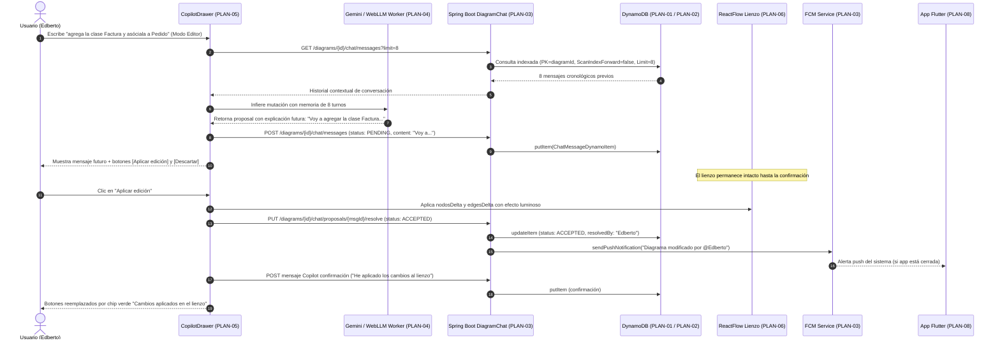
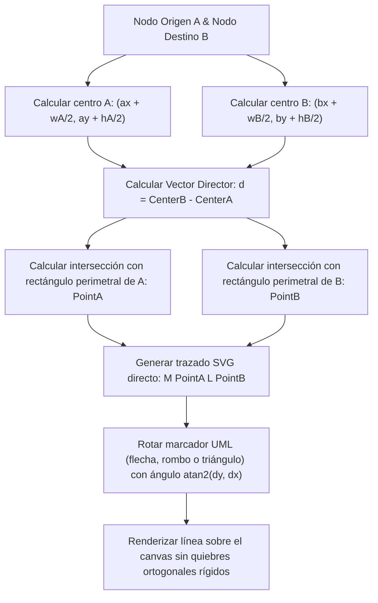

# Plan Técnico: Chat IA con DynamoDB y WebLLM Local, Conexiones Flotantes y Visor Móvil Integral

> **Estado:** APPROVED  
> **Versión:** 1.0.0  
> **Módulo:** `docs/specs/04-chat-ia-dynamodb-webllm-conexiones-flotantes-y-visor-movil/`  
> **Especificación Base:** `docs/specs/04-chat-ia-dynamodb-webllm-conexiones-flotantes-y-visor-movil/spec.md`  
> **Constitución Base:** `docs/constitution.md`  
> **Metodología:** SDD-Planning  

---

## 1. Resumen Arquitectónico y Decisiones de Diseño

### 1.1 Objetivo Técnico
Materializar la especificación funcional unificada mediante:
1. La sustitución completa de MongoDB por **Amazon DynamoDB** (emulado localmente con `amazon/dynamodb-local` en Docker y consumido en Spring Boot mediante AWS SDK v2 `DynamoDbEnhancedClient`).
2. La implementación de un **motor dual de IA** en Next.js con soporte para ejecución 100% en el cliente vía **WebLLM** (`@mlc-ai/web-llm` en Web Worker con aceleración WebGPU) utilizando `Llama-3.2-3B-Instruct` (con fallback a `Llama-3.2-1B-Instruct` o Google Gemini API Cloud), memoria conversacional de 8 mensajes y corrección temporal de las propuestas de edición.
3. El reemplazo de los 4 puertos rígidos de conexión ortogonal por **Floating Edges** matemáticamente adaptativos entre los centros y perímetros de las clases.
4. La evolución del visor móvil Flutter para renderizar la simbología gráfica completa UML 2.5, administrar múltiples lienzos vinculados y soportar notificaciones push en segundo plano mediante **Firebase Cloud Messaging (FCM)**.
5. El establecimiento de límites navegables estrictos de **5000 x 5000 px** en web y móvil.

### 1.2 Decisiones Arquitectónicas Clave Tomadas

* **Persistencia No Relacional e Integridad (DynamoDB):**
  * Se elimina la dependencia de MongoDB (`spring-boot-starter-data-mongodb`) y el contenedor `mongodb` de `docker-compose.yml`.
  * Se incorpora el SDK v2 de AWS (`software.amazon.awssdk:dynamodb-enhanced`).
  * Tabla `DiagramChatMessages`: Partition Key `diagramId` (Number) y Sort Key `createdAt` (String ISO-8601 UTC). Secondary Index en `id` (String UUID).
  * En entorno Docker local, se orquesta `amazon/dynamodb-local:latest` en el puerto 8000 con volumen persistente.
* **Aislamiento de la Inferencia Local (WebLLM en Web Worker):**
  * Para evitar congelamientos en el renderizado del lienzo React Flow a 60 FPS, la inicialización del motor `@mlc-ai/web-llm` y la inferencia de tokens se aíslan en un Web Worker dedicado (`webllm.worker.ts`).
  * Los pesos del modelo se almacenan en la caché persistente del navegador (`Cache Storage` / `IndexedDB`) mediante la API de WebLLM.
* **Geometría Adaptativa de Aristas (Floating Edges en React Flow):**
  * Se abandona `getSmoothStepPath` rígido con puertos `top-source`, `bottom-target`, etc.
  * Se implementa la proyección geométrica vectorial entre los centros de las clases delimitadas por sus rectángulos exteriores (`getNodeIntersection`), trazando una línea directa limpia con marcadores UML orientados en el punto de incidencia perimetral.
* **Resiliencia de Notificaciones Push (FCM en Spring Boot + Flutter):**
  * En Spring Boot, `FirebaseMessagingService` se inicializa condicionalmente: si existe `firebase-service-account.json`, se activa el cliente; si no existe, opera en modo de degradación elegante con advertencia en logs sin romper el guardado de diagramas.
  * En Flutter, se integran `firebase_core` y `firebase_messaging` para suscribirse al tópico `diagram_{diagramId}` al vincular el lienzo.

---

### 1.3 Matriz de Componentes Técnicos (`PLAN-XX`)

| ID Componente | Nombre / Artefacto Técnico | Capa Arquitectónica | Responsabilidad Técnica | Requisitos que Cubre |
| :--- | :--- | :--- | :--- | :--- |
| **`PLAN-01`** | `DynamoDbInfrastructure & DockerCompose` | Infraestructura Backend | Contenedor local `dynamodb-local`, configuración de cliente AWS SDK v2, creación automática de tabla e índices | `HU-03`, `RF-03.1`, `RF-03.2`, `RB-04` |
| **`PLAN-02`** | `ChatMessageDynamoDocument & Repository` | Dominio / Datos Backend | Entidad anotada `@DynamoDbBean`, mapeadores DTO y repositorio `ChatMessageDynamoRepository` | `HU-03`, `RF-03.1`, `RB-04` |
| **`PLAN-03`** | `DiagramChatService & FCMNotificationService` | Aplicación Backend | Lógica de consulta de los últimos 8 mensajes, guardado atómico, resolución de propuestas y emisión push vía FCM | `HU-01`, `HU-02`, `HU-06`, `RF-01.3`, `RF-02.1`, `RF-06.3`, `RB-03`, `RB-09` |
| **`PLAN-04`** | `WebLlmService & WorkerBridge` | Frontend (IA Local) | Orquestación de WebLLM en Web Worker, descarga progresiva de Llama 3.2 3B/1B, caché IndexedDB y fallback a Gemini | `HU-04`, `RF-04.1`, `RF-04.2`, `RF-04.3`, `RB-05` |
| **`PLAN-05`** | `CopilotDrawer & EditorProposalActions` | Presentación Frontend | Redacción en tiempo futuro (*"Voy a..."*), botones `Aplicar edición` / `Descartar`, confirmación post-aplicación y panel ⚙️ | `HU-01`, `HU-02`, `RF-01.1`, `RF-01.2`, `RF-01.3`, `RF-01.4`, `RB-01`, `RB-02` |
| **`PLAN-06`** | `UmlFloatingEdge & NodeIntersection` | Presentación Frontend | Cálculo perimetral dinámico centro-a-borde de clases, eliminación de 4 handles ortogonales rígidos y límites de 5000x5000 px | `HU-05`, `RF-05.1`, `RF-05.2`, `RF-06.4`, `RB-06`, `RB-10` |
| **`PLAN-07`** | `FlutterMobileCanvasPainter & UmlMarkers` | Frontend Móvil (Flutter) | Dibujo vectorial de flechas abiertas, triángulos de herencia, rombos huecos/llenos, multiplicidades y límites de 5000x5000 px | `HU-06`, `RF-06.1`, `RF-06.4`, `RB-07`, `RB-10` |
| **`PLAN-08`** | `FlutterMultiCanvasManager & FCMReceiver` | Frontend Móvil (Flutter) | Lista persistente de lienzos vinculados en SharedPreferences, desvinculación manual y recepción de push en background | `HU-06`, `RF-06.2`, `RF-06.3`, `RB-08`, `RB-09` |

---

## 2. Estructura Física de Archivos del Proyecto / Módulo

```text
SW1-P1-DiagramadorClases-2026-2/
├── docker-compose.yml                                                                # [MODIFY] (PLAN-01: Reemplazar mongodb por dynamodb-local)
├── back_diagramador/
│   ├── pom.xml                                                                       # [MODIFY] (PLAN-01: Quitar spring-data-mongodb, añadir aws-sdk-dynamodb-enhanced y firebase-admin)
│   ├── src/main/resources/application.properties                                     # [MODIFY] (PLAN-01: Configuración de endpoint DynamoDB y credenciales AWS/FCM)
│   └── src/main/java/com/example/back_diagramador/
│       ├── config/
│       │   ├── DynamoDbConfig.java                                                   # [CREATE] (PLAN-01: Inicialización de DynamoDbClient y DynamoDbEnhancedClient)
│       │   └── FirebaseConfig.java                                                   # [CREATE] (PLAN-03: Inicialización segura y opcional de FirebaseAdmin SDK)
│       ├── document/
│       │   ├── ChatMessageDocument.java                                              # [DELETE] (Obsoleto: Entidad MongoDB eliminada)
│       │   └── ChatMessageDynamoItem.java                                            # [CREATE] (PLAN-02: Entidad @DynamoDbBean para DynamoDB)
│       ├── repository/
│       │   ├── mongo/
│       │   │   └── ChatMessageMongoRepository.java                                   # [DELETE] (Obsoleto: Repositorio Mongo eliminado)
│       │   └── dynamo/
│       │       └── ChatMessageDynamoRepository.java                                  # [CREATE] (PLAN-02: Consultas por diagramId, inserciones atómicas e índices)
│       ├── service/
│       │   ├── DiagramChatService.java                                               # [MODIFY] (PLAN-03: Adaptación a DynamoDB, retención de 8 mensajes y confirmaciones)
│       │   └── FcmPushNotificationService.java                                       # [CREATE] (PLAN-03: Emisión de alertas push ante eventos de edición)
│       └── controller/
│           └── DiagramChatController.java                                            # [MODIFY] (PLAN-03: Endpoint para registro de tokens push de móvil)
│
├── front_diag_clases/
│   ├── package.json                                                                  # [MODIFY] (PLAN-04: Añadir @mlc-ai/web-llm)
│   ├── types/
│   │   └── index.ts                                                                  # [MODIFY] (PLAN-04/PLAN-05: Tipos de motor AiEngineConfig, ProposalStatus y FloatingEdge)
│   ├── services/
│   │   ├── geminiDiagramService.ts                                                   # [MODIFY] (PLAN-05: Inyección de 8 mensajes de contexto, prompt futuro "Voy a...")
│   │   ├── webLlmDiagramService.ts                                                   # [CREATE] (PLAN-04: Inicializador y wrapper de inferencia local con Llama 3.2)
│   │   └── diagramChatService.ts                                                     # [MODIFY] (PLAN-05: Cliente REST actualizado para DynamoDB y endpoints de confirmación)
│   ├── workers/
│   │   └── webllm.worker.ts                                                          # [CREATE] (PLAN-04: Web Worker para descarga en background e inferencia WebGPU)
│   ├── components/canvas/
│   │   ├── CanvasCopilotDrawer.tsx                                                   # [MODIFY] (PLAN-05: Botón ⚙️ configuración, botones "Aplicar edición"/"Descartar", barra descarga)
│   │   ├── AiEngineSettingsModal.tsx                                                 # [CREATE] (PLAN-05: Modal/Panel de configuración Gemini vs WebLLM y selección 1B/3B)
│   │   ├── UmlClassNode.tsx                                                          # [MODIFY] (PLAN-06: Remover 4 handles ortogonales rígidos fijos; sustituir por anclaje flotante dinámico)
│   │   ├── UmlFloatingEdge.tsx                                                       # [CREATE] (PLAN-06: Arista adaptativa con cálculo de intersección centro-a-perímetro)
│   │   ├── utils/
│   │   │   └── floatingEdgeUtils.ts                                                  # [CREATE] (PLAN-06: Cálculo trigonométrico de intersección caja-rectángulo)
│   │   └── CustomCanvasControls.tsx                                                  # [MODIFY] (PLAN-06: Marco perimetral visual del límite de 5000x5000 px)
│   └── app/(dashboard)/diagrams/[id]/page.tsx                                        # [MODIFY] (PLAN-05/PLAN-06: Integración del motor WebLLM, ReactFlow translateExtent 5000x5000)
│
├── flutter_viewer/
│   ├── pubspec.yaml                                                                  # [MODIFY] (PLAN-07/PLAN-08: Añadir firebase_core y firebase_messaging)
│   ├── lib/
│   │   ├── main.dart                                                                 # [MODIFY] (PLAN-08: Inicialización de Firebase.initializeApp y background handler)
│   │   ├── models/
│   │   │   └── linked_diagram.dart                                                   # [CREATE] (PLAN-08: Modelo de diagrama vinculado persistente)
│   │   ├── services/
│   │   │   ├── local_storage_service.dart                                            # [MODIFY] (PLAN-08: Gestión multi-lienzo en SharedPreferences: listar, agregar, eliminar)
│   │   │   └── fcm_notification_service.dart                                         # [CREATE] (PLAN-08: Suscripción a tópicos FCM y recepción de notificaciones en foreground/background)
│   │   ├── screens/
│   │   │   ├── link_entry_screen.dart                                                # [MODIFY] (PLAN-08: Vista principal con lista de tarjetas de diagramas vinculados y diálogo desvincular)
│   │   │   └── canvas_viewer_screen.dart                                             # [MODIFY] (PLAN-07: Canvas con InteractiveViewer restringido a 5000x5000 px)
│   │   └── widgets/
│   │       ├── mobile_canvas_painter.dart                                            # [MODIFY] (PLAN-07: Dibujo vectorial de flechas abiertas, triángulos, rombos y multiplicidades)
│   │       └── uml_marker_painter_utils.dart                                         # [CREATE] (PLAN-07: Rutinas matemáticas de dibujo de polígonos UML según vector director)
│
└── tests/
    ├── back_diagramador/
    │   └── src/test/java/com/example/back_diagramador/service/
    │       ├── DiagramChatServiceDynamoTest.java                                     # [CREATE] (Test Unitario/Integración DynamoDB)
    │       └── FcmPushNotificationServiceTest.java                                   # [CREATE] (Test Unitario FCM)
    ├── front_diag_clases/tests/
    │   ├── unit/
    │   │   ├── floatingEdgeUtils.test.ts                                             # [CREATE] (Test Unitario de intersección geométrica)
    │   │   └── editorProposalGrammar.test.ts                                         # [CREATE] (Test Unitario de gramática verbal futura "Voy a...")
    │   └── e2e/
    │       └── copilotEditorFlow.spec.ts                                             # [CREATE] (Test E2E de aceptación/descarte de propuesta)
    └── flutter_viewer/test/
        ├── multi_canvas_storage_test.dart                                            # [CREATE] (Test Unitario de lista de diagramas vinculados)
        └── uml_marker_painter_test.dart                                              # [CREATE] (Test Unitario de cálculo de vértices de marcadores UML)
```

---

## 3. Modelo Físico de Persistencia y Esquema de Datos

### 3.1 Definición de Tablas / Colecciones / Esquemas (`PLAN-01`, `PLAN-02`)

#### Tabla DynamoDB: `DiagramChatMessages`
* **Tipo**: Tabla NoSQL en Amazon DynamoDB.
* **Billing Mode**: `PAY_PER_REQUEST` (On-Demand en producción AWS / Ilimitado en DynamoDB Local).
* **Clave Primaria Compuesta**:
  * **Partition Key (PK)**: `diagramId` (Number - `N`).
  * **Sort Key (SK)**: `createdAt` (String - `S`, formato ISO-8601 UTC `YYYY-MM-DDTHH:mm:ss.sssZ`).
* **Índices Secundarios Globales (GSI)**:
  * **Nombre**: `MessageIdIndex`.
  * **GSI PK**: `id` (String - `S`, UUID v4).
  * **Projection**: `ALL_ATTRIBUTES`. Permite resolver propuestas por `messageId` sin conocer `diagramId` o fecha exacta.

| Atributo DynamoDB | Tipo Físico | Clave / Índice | Restricción / Formato | Regla Funcional Asociada |
| :--- | :--- | :--- | :--- | :--- |
| `diagramId` | `N` (Number/Long) | **Partition Key (PK)** | Requerido (> 0) | `HU-03`, `RB-04` |
| `createdAt` | `S` (String ISO-8601) | **Sort Key (SK)** | Requerido, orden cronológico | `HU-02`, `RB-03` |
| `id` | `S` (String UUID) | **GSI 1 Partition Key** | Requerido, UUID v4 único | `RB-04` |
| `senderType` | `S` (String) | Atributo | `"USER"`, `"COPILOT"`, `"SYSTEM"` | `HU-01` |
| `userId` | `N` (Number/Long) | Atributo | `0` para IA/Sistema | `HU-01` |
| `userName` | `S` (String) | Atributo | Longitud máxima 100 caracteres | `HU-01` |
| `mode` | `S` (String) | Atributo | `"CHAT"`, `"EDITOR"` | `HU-01`, `RB-01` |
| `messageType` | `S` (String) | Atributo | `"CHAT_MESSAGE"`, `"EDITOR_PROPOSAL"`, `"PROACTIVE_SUGGESTION"` | `RB-01`, `RB-02` |
| `content` | `S` (String) | Atributo | Texto en Markdown estructurado | `RB-01` |
| `taggedUserName` | `S` (String) | Atributo Opcional | Etiqueta de usuario para sugerencias proactivas | `spec.md` |
| `proposalJson` | `S` (String JSON) | Atributo Opcional | Objeto serializado con `summary`, `nodesDelta`, `edgesDelta` | `RB-01`, `RB-02` |
| `proposalStatus` | `S` (String) | Atributo Opcional | `"PENDING"`, `"ACCEPTED"`, `"IGNORED"` | `RB-02` |
| `aiEngine` | `S` (String) | Atributo | `"GEMINI_CLOUD"`, `"WEBLLM_LOCAL"` | `HU-04`, `RB-05` |
| `resolvedByUserId` | `N` (Number/Long) | Atributo Opcional | ID del usuario resolutor | `RB-02` |
| `resolvedByUserName` | `S` (String) | Atributo Opcional | Nombre del usuario resolutor | `RB-02` |
| `resolvedAt` | `S` (String ISO-8601) | Atributo Opcional | Timestamp de resolución | `RB-02` |

### 3.2 Configuración Docker Compose para DynamoDB Local (`docker-compose.yml`)

```yaml
  # ==========================================================
  # 1.1 Base de Datos NoSQL Documental: DynamoDB Local
  # Reemplaza a mongodb:7-jammy
  # ==========================================================
  dynamodb:
    image: amazon/dynamodb-local:latest
    container_name: diag_dynamodb
    restart: always
    command: "-jar DynamoDBLocal.jar -sharedDb -dbPath /data"
    ports:
      - "8000:8000"
    volumes:
      - dynamodb_data:/data
    networks:
      - diag_network

volumes:
  postgres_data:
  dynamodb_data: # Persistencia de DynamoDB en disco
```

---

## 4. Contratos de Código, Interfaces Tipadas y Jerarquía de Errores

### 4.1 Entidades y Clases de Dominio Backend (Java 17 / DynamoDB Enhanced) (`PLAN-02`)

```java
package com.example.back_diagramador.document;

import software.amazon.awssdk.enhanced.dynamodb.mapper.annotations.*;
import java.time.Instant;

@DynamoDbBean
public class ChatMessageDynamoItem {

    private Long diagramId;
    private String createdAt;
    private String id;
    private String senderType;
    private Long userId;
    private String userName;
    private String mode;
    private String messageType;
    private String content;
    private String taggedUserName;
    private String proposalJson;
    private String proposalStatus;
    private String aiEngine;
    private Long resolvedByUserId;
    private String resolvedByUserName;
    private String resolvedAt;

    @DynamoDbPartitionKey
    @DynamoDbAttribute("diagramId")
    public Long getDiagramId() { return diagramId; }
    public void setDiagramId(Long diagramId) { this.diagramId = diagramId; }

    @DynamoDbSortKey
    @DynamoDbAttribute("createdAt")
    public String getCreatedAt() { return createdAt; }
    public void setCreatedAt(String createdAt) { this.createdAt = createdAt; }

    @DynamoDbSecondaryPartitionKey(indexNames = "MessageIdIndex")
    @DynamoDbAttribute("id")
    public String getId() { return id; }
    public void setId(String id) { this.id = id; }

    @DynamoDbAttribute("senderType")
    public String getSenderType() { return senderType; }
    public void setSenderType(String senderType) { this.senderType = senderType; }

    @DynamoDbAttribute("userId")
    public Long getUserId() { return userId; }
    public void setUserId(Long userId) { this.userId = userId; }

    @DynamoDbAttribute("userName")
    public String getUserName() { return userName; }
    public void setUserName(String userName) { this.userName = userName; }

    @DynamoDbAttribute("mode")
    public String getMode() { return mode; }
    public void setMode(String mode) { this.mode = mode; }

    @DynamoDbAttribute("messageType")
    public String getMessageType() { return messageType; }
    public void setMessageType(String messageType) { this.messageType = messageType; }

    @DynamoDbAttribute("content")
    public String getContent() { return content; }
    public void setContent(String content) { this.content = content; }

    @DynamoDbAttribute("proposalJson")
    public String getProposalJson() { return proposalJson; }
    public void setProposalJson(String proposalJson) { this.proposalJson = proposalJson; }

    @DynamoDbAttribute("proposalStatus")
    public String getProposalStatus() { return proposalStatus; }
    public void setProposalStatus(String proposalStatus) { this.proposalStatus = proposalStatus; }

    @DynamoDbAttribute("aiEngine")
    public String getAiEngine() { return aiEngine; }
    public void setAiEngine(String aiEngine) { this.aiEngine = aiEngine; }

    // Getters y setters de campos restantes (taggedUserName, resolvedByUserId, resolvedByUserName, resolvedAt)...
}
```

### 4.2 Repositorio de DynamoDB (`ChatMessageDynamoRepository.java`) (`PLAN-02`)

```java
package com.example.back_diagramador.repository.dynamo;

import com.example.back_diagramador.document.ChatMessageDynamoItem;
import software.amazon.awssdk.enhanced.dynamodb.*;
import software.amazon.awssdk.enhanced.dynamodb.model.*;
import org.springframework.stereotype.Repository;

import java.util.List;
import java.util.Optional;

@Repository
public class ChatMessageDynamoRepository {

    private final DynamoDbTable<ChatMessageDynamoItem> chatTable;

    public ChatMessageDynamoRepository(DynamoDbEnhancedClient enhancedClient) {
        this.chatTable = enhancedClient.table("DiagramChatMessages", TableSchema.fromBean(ChatMessageDynamoItem.class));
    }

    public void save(ChatMessageDynamoItem item) {
        chatTable.putItem(item);
    }

    public List<ChatMessageDynamoItem> findLastMessagesByDiagramId(Long diagramId, int limit) {
        QueryConditional query = QueryConditional.keyEqualTo(Key.builder().partitionValue(diagramId).build());
        return chatTable.query(r -> r.queryConditional(query).scanIndexForward(false).limit(limit))
                .items().stream().toList();
    }

    public Optional<ChatMessageDynamoItem> findById(String messageId) {
        DynamoDbIndex<ChatMessageDynamoItem> index = chatTable.index("MessageIdIndex");
        QueryConditional query = QueryConditional.keyEqualTo(Key.builder().partitionValue(messageId).build());
        return index.query(r -> r.queryConditional(query).limit(1)).items().stream().findFirst();
    }
}
```

### 4.3 Contratos TypeScript para Frontend (WebLLM y Geometría) (`PLAN-04`, `PLAN-05`, `PLAN-06`)

```typescript
// types/index.ts

export type AiProvider = "GEMINI_CLOUD" | "WEBLLM_LOCAL";
export type LocalModelChoice = "Llama-3.2-3B-Instruct-q4f16_1-MLC" | "Llama-3.2-1B-Instruct-q4f16_1-MLC";
export type LocalModelStatus = "NOT_DOWNLOADED" | "DOWNLOADING" | "READY" | "ERROR";

export interface AiEngineConfig {
  provider: AiProvider;
  localModelId: LocalModelChoice;
  status: LocalModelStatus;
  progressPercent: number;
  vramUsedMb?: number;
  webGpuSupported: boolean;
  errorMessage?: string;
}

export interface FloatingEdgeParams {
  sourceX: number;
  sourceY: number;
  targetX: number;
  targetY: number;
  sourcePosition: string;
  targetPosition: string;
}

export interface ChatMessageContextItem {
  role: "user" | "model" | "assistant";
  content: string;
  summary?: string;
}
```

### 4.4 Contratos Dart para Flutter (Multi-Lienzo y FCM) (`PLAN-07`, `PLAN-08`)

```dart
// lib/models/linked_diagram.dart

class LinkedDiagram {
  final int diagramId;
  final String name;
  final String hostUrl;
  final DateTime linkedAt;
  final DateTime lastAccessedAt;

  LinkedDiagram({
    required this.diagramId,
    required this.name,
    required this.hostUrl,
    required this.linkedAt,
    required this.lastAccessedAt,
  });

  Map<String, dynamic> toJson() => {
    'diagramId': diagramId,
    'name': name,
    'hostUrl': hostUrl,
    'linkedAt': linkedAt.toIso8601String(),
    'lastAccessedAt': lastAccessedAt.toIso8601String(),
  };

  factory LinkedDiagram.fromJson(Map<String, dynamic> json) => LinkedDiagram(
    diagramId: json['diagramId'] as int,
    name: json['name'] as String? ?? 'Diagrama',
    hostUrl: json['hostUrl'] as String? ?? 'http://10.0.2.2:8080',
    linkedAt: DateTime.parse(json['linkedAt'] as String),
    lastAccessedAt: DateTime.parse(json['lastAccessedAt'] as String),
  );
}
```

---

## 5. Diagramas Técnicos de Secuencia y Estados

### 5.1 Flujo Integral de Propuesta IA en Modo Editor y Confirmación Dual



### 5.2 Algoritmo de Trazado de Conexión Flotante (*Floating Edge*)



---

## 6. Garantías de Runtime, Relaciones y Ciclo de Vida Operativo

1. **Gestión de Memoria en WebLLM (Cliente):**
   * El modelo Llama 3.2 3B se carga en la VRAM de la GPU del navegador mediante un Web Worker. Si la pestaña se cierra o el usuario pulsa `Liberar memoria`, se invoca `engine.unload()` para destruir los shaders y liberar los buffers de WebGPU de inmediato.
   * Si la asignación de memoria falla por límite del navegador (OutOfMemory en WebGPU), se captura el error y se ejecuta un fallback a Gemini Cloud sin recargar la página.
2. **Resiliencia ante Fallos de DynamoDB:**
   * En caso de pérdida de conexión temporal con `dynamodb-local` o AWS DynamoDB, el cliente Spring Boot cuenta con reintento automático con *exponential backoff* (3 intentos, factor 1.5x) provisto nativamente por `ClientOverrideConfiguration` del SDK v2 de AWS.
3. **Desacoplamiento de Firebase Cloud Messaging:**
   * La emisión de notificaciones push se ejecuta de forma asíncrona mediante `@Async` en Spring Boot. Un fallo o indisponibilidad en la red de Firebase jamás bloqueará la respuesta HTTP al usuario ni retrasará el guardado del lienzo en PostgreSQL.
4. **Delimitación Espacial 5000 x 5000 px:**
   * En Next.js: React Flow configura `translateExtent={[[-2500, -2500], [2500, 2500]]}`, impidiendo que el panning se desplace más allá del área delimitada. Se dibuja una cuadrícula envolvente con borde perimetral suave `border-dashed`.
   * En Flutter: `InteractiveViewer` restringe `minScale: 0.15`, `maxScale: 2.5` con un `Container` base de 5000 x 5000 px centrado.

---

## 7. Arquitectura de Vertical Slices (Hoja de Ruta para `/sdd-task`)

* **Vertical Slice 0: Infraestructura y Setup de Persistencia (`Slice 0 - DynamoDB Foundation`)**:
  * Tareas:
    * Reemplazar MongoDB por `amazon/dynamodb-local` en `docker-compose.yml` (`PLAN-01`).
    * Configurar dependencias Maven (`aws-sdk-dynamodb-enhanced`, `firebase-admin`) en `pom.xml` (`PLAN-01`).
    * Crear `DynamoDbConfig.java`, tabla `DiagramChatMessages` e índice secundario `MessageIdIndex` (`PLAN-01`).
    * Implementar `ChatMessageDynamoItem.java` y `ChatMessageDynamoRepository.java` (`PLAN-02`).
  * Entregable: Backend inicia y persiste/consulta mensajes en DynamoDB local verificable con tests unitarios.

* **Vertical Slice 1: Chat IA en Modo Editor con Tiempo Futuro y Memoria (`Slice 1 - Copilot Memory & Editor UX`)**:
  * Tareas:
    * Adaptar `DiagramChatService.java` para inyectar los últimos 8 mensajes del diagrama en cada consulta (`PLAN-03`).
    * Ajustar prompt del sistema en `geminiDiagramService.ts` para obligar redacción futura (*"Voy a..."*) en Modo Editor (`PLAN-05`).
    * Actualizar `CanvasCopilotDrawer.tsx` con botones `Aplicar edición` y `Descartar`, confirmación post-aplicación y chip de estado (`PLAN-05`).
  * Entregable: Peticiones de edición redactadas en futuro; confirmación y aplicación de deltas al lienzo verificadas de punta a punta.

* **Vertical Slice 2: Motor Dual e Inferencia Local en Navegador (`Slice 2 - WebLLM Client Engine`)**:
  * Tareas:
    * Instalar `@mlc-ai/web-llm` en `front_diag_clases` (`PLAN-04`).
    * Crear `webllm.worker.ts` y servicio de comunicación `webLlmDiagramService.ts` (`PLAN-04`).
    * Crear `AiEngineSettingsModal.tsx` con selector Gemini/WebLLM, barra de progreso de descarga y fallback ante falta de WebGPU (`PLAN-05`).
  * Entregable: Usuario puede descargar Llama 3.2 3B en su navegador y ejecutar directivas de chat/edición 100% en local.

* **Vertical Slice 3: Conexiones Flotantes Adaptativas y Límites de Lienzo (`Slice 3 - Floating Edges & Bounds`)**:
  * Tareas:
    * Crear algoritmo geométrico de intersección perimetral `floatingEdgeUtils.ts` (`PLAN-06`).
    * Crear componente `UmlFloatingEdge.tsx` y registrarlo en React Flow (`PLAN-06`).
    * Modificar `UmlClassNode.tsx` para eliminar los 4 handles fijos ortogonales a 90 grados (`PLAN-06`).
    * Configurar `translateExtent` y marco perimetral de 5000 x 5000 px en `page.tsx` (`PLAN-06`).
  * Entregable: Aristas se conectan fluidamente según la posición de las clases como en Enterprise Architect, dentro de límites de 5000x5000 px.

* **Vertical Slice 4: Fidelidad Gráfica UML, Multi-Lienzo y Push en Flutter (`Slice 4 - Flutter Mobile Fidelity & FCM`)**:
  * Tareas:
    * Implementar `uml_marker_painter_utils.dart` para trazado vectorial de flechas abiertas, triángulos, rombos y multiplicidades (`PLAN-07`).
    * Actualizar `mobile_canvas_painter.dart` y restringir el canvas a 5000 x 5000 px en `canvas_viewer_screen.dart` (`PLAN-07`).
    * Crear `linked_diagram.dart` y actualizar `local_storage_service.dart` para soportar lista permanente de lienzos vinculados (`PLAN-08`).
    * Actualizar `link_entry_screen.dart` con tarjetas de lienzos y botón de desvincular con confirmación (`PLAN-08`).
    * Integrar FCM en Spring Boot (`FcmPushNotificationService.java`) y en Flutter (`fcm_notification_service.dart`) (`PLAN-03`, `PLAN-08`).
  * Entregable: Aplicación móvil con simbología completa UML, lista de múltiples lienzos y recepción de alertas push al editarse el diagrama.

---

## 8. Estrategia de Testing y Verificación Técnica

| Nivel de Prueba | Tipo | Archivo Físico de Test | Qué Valida Exactamente | Componente Asociado |
| :--- | :--- | :--- | :--- | :--- |
| **Integración DB** | Persistencia | `DiagramChatServiceDynamoTest.java` | Inserción y consulta en DynamoDB local, orden por `createdAt` y límite de 8 mensajes | `PLAN-01`, `PLAN-02`, `PLAN-03` |
| **Unitario Frontend** | Geometría | `floatingEdgeUtils.test.ts` | Cálculo de intersección entre centro de nodo y borde rectangular en 360 grados | `PLAN-06` |
| **Unitario Frontend** | Gramática IA | `editorProposalGrammar.test.ts` | Validación de que las respuestas de edición contengan el tiempo verbal futuro (*"Voy a..."*) | `PLAN-05` |
| **E2E Frontend** | Flujo Dual | `copilotEditorFlow.spec.ts` | Petición en Modo Editor, visualización de botones y aplicación de cambios con confirmación | `PLAN-05`, `PLAN-06` |
| **Unitario Móvil** | Almacenamiento | `multi_canvas_storage_test.dart` | Persistencia de lista de diagramas vinculados en SharedPreferences y desvinculación | `PLAN-08` |
| **Unitario Móvil** | Renderizado | `uml_marker_painter_test.dart` | Cálculo de polígonos vectoriales para triángulos de herencia y rombos de composición | `PLAN-07` |

### Comandos de Verificación Técnica

* **Backend Spring Boot**:
  * Windows: `cd back_diagramador && .\mvnw.cmd test`
  * Linux/Mac: `cd back_diagramador && ./mvnw test`
* **Frontend Next.js**:
  * Type-Check: `cd front_diag_clases && npx tsc --noEmit`
  * Linter: `cd front_diag_clases && npm run lint`
  * Pruebas Unitarias: `cd front_diag_clases && npm run test`
* **Móvil Flutter**:
  * Análisis estático: `cd flutter_viewer && flutter analyze`
  * Pruebas: `cd flutter_viewer && flutter test`

---

## 9. Matriz de Trazabilidad Técnica (`Spec` ↔ `Plan`)

| Requisito / Regla / Escenario (`spec.md`) | Componente del Plan | Archivo Físico Principal | Prueba que lo Verifica |
| :--- | :--- | :--- | :--- |
| `HU-01` / `RF-01.1`, `RF-01.2`, `RF-01.3`, `RF-01.4` | `PLAN-05` | `CanvasCopilotDrawer.tsx`, `geminiDiagramService.ts` | `editorProposalGrammar.test.ts`, `copilotEditorFlow.spec.ts` |
| `RB-01`, `RB-02` / `Escenario 1`, `Escenario 2` | `PLAN-05` | `CanvasCopilotDrawer.tsx` | `copilotEditorFlow.spec.ts` |
| `HU-02` / `RF-02.1`, `RF-02.2` / `Escenario 3` | `PLAN-02`, `PLAN-03` | `DiagramChatService.java`, `geminiDiagramService.ts` | `DiagramChatServiceDynamoTest.java` |
| `HU-03` / `RF-03.1`, `RF-03.2`, `RB-04` | `PLAN-01`, `PLAN-02` | `docker-compose.yml`, `ChatMessageDynamoRepository.java` | `DiagramChatServiceDynamoTest.java` |
| `HU-04` / `RF-04.1`, `RF-04.2`, `RF-04.3` / `Escenario 4`, `Escenario 5` | `PLAN-04`, `PLAN-05` | `webLlmDiagramService.ts`, `AiEngineSettingsModal.tsx` | Verificación en navegador con WebGPU |
| `HU-05` / `RF-05.1`, `RF-05.2`, `RB-06` / `Escenario 6` | `PLAN-06` | `UmlFloatingEdge.tsx`, `floatingEdgeUtils.ts` | `floatingEdgeUtils.test.ts` |
| `HU-06` / `RF-06.1`, `RB-07` / `Escenario 7` | `PLAN-07` | `mobile_canvas_painter.dart`, `uml_marker_painter_utils.dart`| `uml_marker_painter_test.dart` |
| `HU-06` / `RF-06.2`, `RB-08` / `Escenario 7` | `PLAN-08` | `link_entry_screen.dart`, `local_storage_service.dart` | `multi_canvas_storage_test.dart` |
| `HU-06` / `RF-06.3`, `RB-09` / `Escenario 8` | `PLAN-03`, `PLAN-08` | `FcmPushNotificationService.java`, `fcm_notification_service.dart`| `FcmPushNotificationServiceTest.java` |
| `RF-06.4`, `RB-10` | `PLAN-06`, `PLAN-07` | `page.tsx`, `canvas_viewer_screen.dart` | Verificación visual de área de 5000x5000 px |
