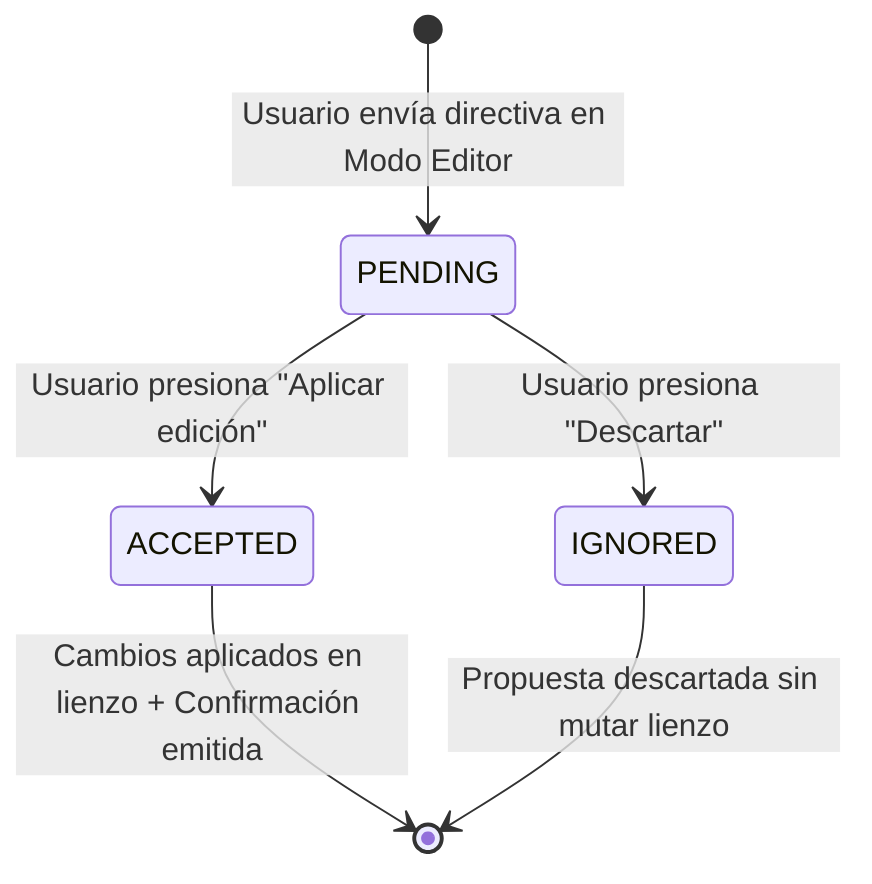
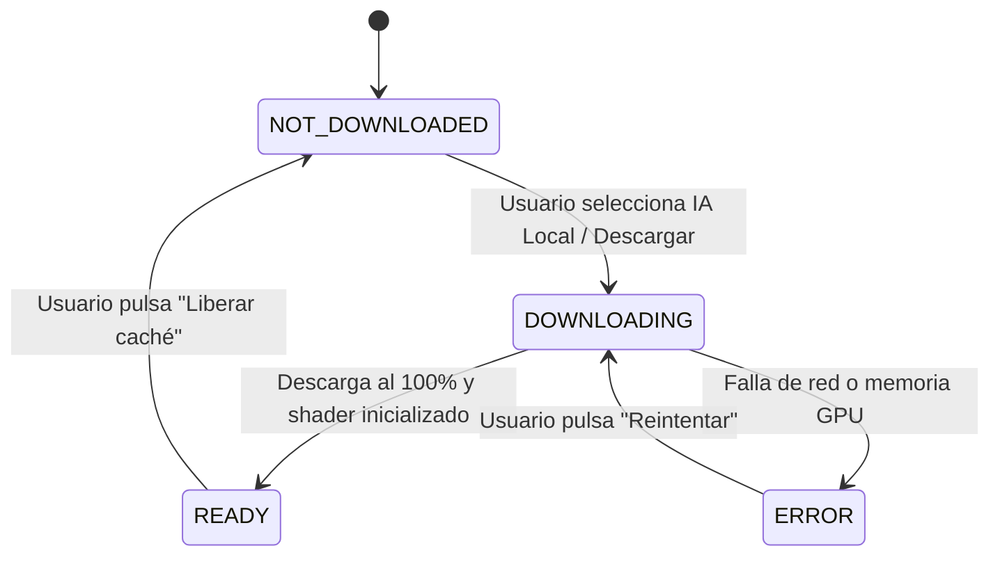

# Specification: Chat IA con DynamoDB y WebLLM Local, Conexiones Flotantes y Visor Móvil Integral

> **Estado:** APPROVED  
> **Módulo:** 04-chat-ia-dynamodb-webllm-conexiones-flotantes-y-visor-movil  
> **Metodología:** SDD-Spec-Assisted  

---

## 1. Objetivo y Alcance

### 1.1 Objetivo de Negocio
Optimizar la experiencia del modelado visual colaborativo y la asistencia inteligente del sistema, transformando el motor de asistencia conversacional en un sistema híbrido resiliente con opción de ejecución 100% local en el cliente (sin costes de API externa ni saturación de cuota), modernizando la persistencia no relacional hacia Amazon DynamoDB, implementando un enrutamiento de líneas flotantes adaptativo de nivel profesional inspirado en Enterprise Architect, y dotando a la aplicación móvil Flutter de fidelidad gráfica UML 2.5 completa, soporte multi-lienzo y arquitectura de notificaciones push en segundo plano.

### 1.2 In-Scope
1. **Chat IA en Modo Editor (Corrección Temporal y Flujo de Confirmación):**
   - Redacción contextual en tiempo futuro/propuesta (*"Voy a realizar los siguientes cambios: ..."* o *"He preparado la siguiente propuesta de edición: ..."*) previa a la aplicación de mutaciones sobre el lienzo.
   - Botones de acción interactiva diferenciados: `Aplicar edición` (para ejecutar el delta sobre el lienzo) y `Descartar` (para cancelar la propuesta).
   - Emisión explícita de mensaje de confirmación post-aplicación (*"He aplicado los cambios al lienzo"*).
2. **Memoria y Contexto Conversacional del Chat IA:**
   - Inyección de una ventana deslizante de los últimos 8 mensajes del chat (turnos del usuario y respuestas del asistente) con síntesis técnica de propuestas pasadas para contextualizar peticiones secuenciales (*"agrega otro atributo a esa clase"*, *"cámbiale el nombre al que te dije"*).
3. **Persistencia No Relacional en Amazon DynamoDB:**
   - Reemplazo integral de MongoDB por Amazon DynamoDB para el almacenamiento de mensajes, propuestas y sugerencias del chat (`DiagramChatMessages`).
   - Soporte para emulación local mediante contenedor oficial `amazon/dynamodb-local` en entornos Docker/desarrollo y compatibilidad nativa con AWS DynamoDB para despliegue en nube.
4. **Motor Dual de Inteligencia Artificial (Gemini Cloud vs WebLLM Local):**
   - Selector configurable en la interfaz del chat mediante botón de ajustes (engranaje ⚙️) para alternar entre:
     - *Google Gemini API (Cloud)*: Modelo en la nube mediante API Key.
     - *IA Local en Navegador (WebLLM / WebGPU)*: Inferencia 100% en el cliente con los modelos ligeros Llama 3.2 3B Instruct (predeterminado) o Llama 3.2 1B Instruct (ultra ligero).
   - Gestor visual de descarga en el navegador con barra de progreso, porcentaje y almacenamiento en caché local (Cache Storage / IndexedDB).
   - Detección de capacidades WebGPU en el hardware del cliente con fallback automático y transparente a Gemini Cloud si WebGPU no está disponible.
5. **Conexiones Flotantes Adaptativas estilo Enterprise Architect:**
   - Eliminación de los 4 puertos rígidos fijos ortogonales por nodo que forzaban esquinas cuadradas a 90 grados.
   - Cálculo dinámico de intersección perimetral directa (*Floating Edge*): la relación se proyecta entre los bordes perimetrales más cercanos de las clases origen y destino según su posición relativa continua, adaptándose fluidamente cuando cualquiera de las clases es desplazada en el lienzo.
6. **Representación Gráfica UML 2.5 Completa en Flutter:**
   - Incorporación de todos los marcadores UML en el lienzo móvil:
     - Flecha abierta: Asociación dirigida (`DIRECTED_ASSOCIATION`) y Dependencia (`DEPENDENCY`, con línea punteada).
     - Triángulo cerrado hueco: Generalización (`GENERALIZATION`) y Realización (`REALIZATION`, con línea punteada).
     - Rombo hueco: Agregación (`AGGREGATION`).
     - Rombo relleno: Composición (`COMPOSITION`).
     - Textos de multiplicidades (`sourceMultiplicity` y `targetMultiplicity`) posicionados en los extremos perimetrales de la relación.
7. **Límites Fijos del Lienzo y Espacio de Trabajo Delimitado:**
   - Espacio de trabajo amplio delimitado a 5000 x 5000 px tanto en la aplicación web (`ReactFlow`) como en el visor móvil Flutter (`InteractiveViewer`).
   - Marco perimetral visual sutil (borde punteado y coordenadas) que impida desorientación espacial durante desplazamientos y zoom.
8. **Gestión Multi-Lienzo y Notificaciones Push en App Móvil:**
   - Pantalla principal en Flutter con lista persistente de tarjetas de todos los lienzos vinculados históricamente (con nombre, ID, host y fecha).
   - Acciones por tarjeta: abrir/reconectar directamente al lienzo o desvincular manualmente mediante diálogo de confirmación.
   - Arquitectura de notificaciones push en segundo plano mediante Firebase Cloud Messaging (FCM) gratuito para alertar al dispositivo vinculado cuando el diagrama sea editado en la web mientras la app móvil no esté activa.

### 1.3 Out-of-Scope
- Descarga de modelos de IA locales dentro del contenedor backend en el servidor (la ejecución local se realiza en el cliente vía WebLLM en el navegador).
- Soporte para WebGPU en navegadores sin compatibilidad de aceleración por hardware (en dichos entornos se fuerza el uso de Gemini Cloud).
- Migración de la base de datos relacional de usuarios y diagramas (PostgreSQL se mantiene inmutable como fuente de verdad transaccional de usuarios, diagramas y colaboraciones).
- Servicios de pago de notificaciones push (se utiliza estrictamente el plan gratuito de Firebase Cloud Messaging).

---

## 2. Actores y Autorización

- **👑 Creador / Propietario (`CREADOR`)**:
  - Puede interactuar con el Copilot IA en modo Chat o Editor.
  - Puede configurar el motor de IA (Gemini Cloud vs WebLLM Local) para su propia sesión de navegador.
  - Puede aplicar o descartar propuestas de edición estructural sobre el lienzo.
  - Puede vincular múltiples dispositivos móviles y desvincularlos cuando lo requiera.
- **👥 Colaborador (`COLABORADOR`)**:
  - Puede interactuar con el Copilot IA en modo Chat o Editor en tiempo real.
  - Puede aplicar o descartar propuestas generadas en el chat compartido.
  - Puede alternar su propio motor de IA local en su cliente web sin afectar la configuración del resto de usuarios.
  - Puede vincular el diagrama a su propia aplicación móvil complementaria.
- **📱 Usuario del Visor Móvil (`VIEWER_MOBILE`)**:
  - Puede consultar la lista histórica de todos los lienzos vinculados en su dispositivo.
  - Puede desvincular cualquier lienzo manualmente en cualquier momento.
  - Puede recibir notificaciones push en segundo plano cuando colaboradores modifiquen los lienzos a los que está suscrito.
  - Puede explorar visualmente el diagrama con marcadores UML completos y límites delimitados de 5000 x 5000 px.

---

## 3. Modelo Funcional de Datos y Reglas de Negocio Específicas

### 3.1 Entidades y Estructuras Funcionales

#### 3.1.1 Mensaje de Chat en DynamoDB (`DiagramChatMessages`)
- **Clave de Partición (Hash Key)**: `diagramId` (Número entero positivo, obligatorio).
- **Clave de Ordenación (Sort Key)**: `createdAt` (Texto ISO-8601 UTC o Timestamp numérico en milisegundos, obligatorio).
- **Índice Secundario Global (GSI)**: `id` (Identificador único de mensaje, obligatorio).
- **Atributos**:
  - `senderType`: Texto (`"USER"`, `"COPILOT"`, `"SYSTEM"`).
  - `userId`: Número identificador del usuario emisor (0 para el sistema/IA).
  - `userName`: Nombre del emisor.
  - `mode`: Modo de emisión (`"CHAT"` o `"EDITOR"`).
  - `messageType`: Tipo de mensaje (`"CHAT_MESSAGE"`, `"EDITOR_PROPOSAL"`, `"PROACTIVE_SUGGESTION"`).
  - `content`: Texto del mensaje.
  - `proposal`: Objeto con `summary` (instrucción técnica en tiempo futuro), `nodesDelta` (lista de nodos), `edgesDelta` (lista de aristas) y `status` (`"PENDING"`, `"ACCEPTED"`, `"IGNORED"`).
  - `aiEngine`: Identificador del motor que generó el mensaje (`"GEMINI_CLOUD"` o `"WEBLLM_LOCAL"`).
  - `resolvedByUserName`: Nombre del usuario que aceptó o descartó la propuesta.
  - `resolvedAt`: Marca temporal de resolución.

#### 3.1.2 Configuración del Motor de IA en Cliente (`AiEngineConfig`)
- `provider`: `"GEMINI_CLOUD"` | `"WEBLLM_LOCAL"`.
- `localModelId`: `"Llama-3.2-3B-Instruct-q4f16_1-MLC"` | `"Llama-3.2-1B-Instruct-q4f16_1-MLC"`.
- `downloadStatus`: `"NOT_DOWNLOADED"` | `"DOWNLOADING"` | `"READY"` | `"ERROR"`.
- `downloadProgress`: Porcentaje numérico (0 a 100).
- `webGpuSupported`: Booleano indicando compatibilidad de hardware.

#### 3.1.3 Registro de Lienzo Vinculado en Móvil (`LinkedDiagramItem`)
- `diagramId`: Número identificador del diagrama.
- `name`: Nombre descriptivo del lienzo.
- `hostUrl`: URL base del servidor de sincronización.
- `linkedAt`: Marca temporal de vinculación inicial.
- `lastAccessedAt`: Marca temporal del último acceso.
- `fcmTopicOrToken`: Identificador del canal o token de notificación push registrado.

### 3.2 Reglas de Negocio (RB)

- **`RB-01` (Incoherencia Temporal de Propuestas):** Cuando la IA responde a una petición en Modo Editor con cambios estructurales para el lienzo, el texto descriptivo DEBE expresarse obligatoriamente en tiempo futuro (*"Voy a agregar la clase Factura y relacionarla con Pedido..."*). Queda estrictamente prohibido redactar el texto como si los cambios ya hubiesen sido aplicados antes de que el usuario pulse el botón de confirmación.
- **`RB-02` (Flujo de Confirmación en Modo Editor):** Toda propuesta de edición en Modo Editor debe exhibir exclusivamente dos opciones interactivas: `Aplicar edición` y `Descartar`. Al presionar `Aplicar edición`, se inyectan los deltas al lienzo y el sistema emite automáticamente un mensaje de confirmación en el chat: *"He aplicado los cambios al lienzo"*.
- **`RB-03` (Memoria Conversacional Acotada):** La llamada a la IA (sea Gemini o WebLLM) debe incluir como contexto conversacional exactamente los últimos 8 mensajes de la sesión del diagrama actual. Para evitar saturar tokens o memoria, las propuestas complejas previas deben sintetizarse a su campo `summary` antes de inyectarse al prompt.
- **`RB-04` (Persistencia Atómica en DynamoDB):** Toda operación de guardado o cambio de estado de una propuesta debe ejecutarse de forma atómica en la tabla DynamoDB utilizando el SDK v2 de AWS, garantizando consistencia idéntica tanto contra el contenedor `dynamodb-local` en desarrollo como contra AWS DynamoDB en producción.
- **`RB-05` (Inferencia Local en Navegador y Fallback):** Si el usuario activa el motor `WEBLLM_LOCAL`, la inferencia debe ejecutarse íntegramente en el navegador mediante WebGPU sin enviar el contenido a servidores externos. Si el navegador no soporta WebGPU o falla la asignación de memoria, el sistema debe notificar al usuario y realizar un fallback automático al motor `GEMINI_CLOUD`.
- **`RB-06` (Conexiones Flotantes sin Puertos Fijos):** Las relaciones UML entre clases deben calcular el punto de contacto perimetral mediante la intersección del vector director entre los centros de las clases y sus cajas delimitadoras. Queda prohibido forzar la conexión a 4 puntos fijos (`top`, `bottom`, `left`, `right`) o dibujar quiebres ortogonales a 90 grados encuadrados.
- **`RB-07` (Fidelidad Simbólica UML en Móvil):** El lienzo móvil debe renderizar con exactitud geométrica los marcadores de punta de flecha abierta, triángulo cerrado hueco, rombo hueco, rombo lleno y trazos punteados en el perímetro exterior de las tarjetas de clase, garantizando que nunca queden ocultos debajo de la tarjeta.
- **`RB-08` (Persistencia Permanente Multi-Lienzo en Móvil):** La aplicación móvil debe mantener en almacenamiento local seguro la lista completa de todos los lienzos a los que el usuario se ha vinculado. Un lienzo solo puede desaparecer de la lista si el usuario ejecuta explícitamente la acción `Desvincular`.
- **`RB-09` (Notificaciones Push Desacopladas):** Cuando se guarde o confirme una edición en el lienzo web, el backend debe enviar una notificación push vía FCM a los dispositivos suscritos al diagrama, activando la notificación en la bandeja del sistema si la aplicación móvil está cerrada o en segundo plano.
- **`RB-10` (Delimitación Espacial 5000 x 5000 px):** Tanto el lienzo web como el visor móvil deben restringir el área navegable y editable a un marco delimitado de 5000 x 5000 px centrado, con guías perimetrales visibles para evitar la pérdida de contexto espacial.

---

## 4. Máquina de Estados

### 4.1 Ciclo de Vida de una Propuesta de Edición IA (`ProposalStatus`)
- **`PENDING`**: La IA emite el mensaje con texto en tiempo futuro (*"Voy a..."*) y presenta los botones `Aplicar edición` y `Descartar`.
- **`ACCEPTED`**: El usuario pulsa `Aplicar edición`. Los nodos y aristas se mutan en el lienzo, se persiste en PostgreSQL, se actualiza el estado en DynamoDB y se emite el mensaje de confirmación de Copilot.
- **`IGNORED`**: El usuario pulsa `Descartar`. La propuesta se marca como descartada en DynamoDB y los botones interactivos desaparecen sin alterar el lienzo.



### 4.2 Ciclo de Vida del Modelo de IA Local WebLLM (`LocalModelStatus`)
- **`NOT_DOWNLOADED`**: El modelo no está presente en la caché del navegador.
- **`DOWNLOADING`**: Se descargan los pesos y parámetros del modelo mostrando barra de progreso (0% a 100%).
- **`READY`**: Modelo cargado en memoria GPU del navegador, listo para inferencia local instantánea.
- **`ERROR`**: Fallo de red o memoria insuficiente; se ofrece reintento o fallback a Gemini Cloud.



---

## 5. Requerimientos Funcionales (Patrón EARS)

### 5.1 Chat IA y Modo Editor
- `HU-01`: Como modelador de software, quiero que el asistente exprese con precisión lo que va a editar antes de tocar mi diagrama, para tener control absoluto sobre las modificaciones.
  - `RF-01.1` (Event-Driven): Cuando el usuario envíe una solicitud de edición en Modo Editor, el sistema deberá generar un mensaje descriptivo redactado en tiempo futuro indicando las clases, atributos y relaciones que planea crear o modificar.
  - `RF-01.2` (Event-Driven): Cuando el mensaje de propuesta sea mostrado, el sistema deberá renderizar los botones `Aplicar edición` y `Descartar`.
  - `RF-01.3` (Event-Driven): Cuando el usuario presione `Aplicar edición`, el sistema deberá inyectar los cambios al lienzo, persistir la versión del diagrama, difundir el evento WebSocket a los colaboradores y emitir un mensaje de confirmación del Copilot: *"He aplicado los cambios al lienzo"*.
  - `RF-01.4` (Unwanted Behavior): Si el usuario presiona `Descartar`, el sistema deberá impedir cualquier modificación sobre el lienzo, ocultar los controles interactivos y marcar la propuesta como ignorada.

### 5.2 Memoria Conversacional del Chat
- `HU-02`: Como usuario del chat, quiero que la IA recuerde el contexto de los mensajes anteriores, para poder dar órdenes sucesivas e incrementales.
  - `RF-02.1` (Ubiquitous): El sistema deberá consultar los últimos 8 mensajes del diagrama en DynamoDB e inyectarlos como contexto conversacional estructurado en cada consulta a la IA (Gemini o WebLLM).
  - `RF-02.2` (Ubiquitous): Las propuestas de edición pasadas incluidas en el historial deberán resumirse a su síntesis técnica textual para no desbordar la memoria de contexto del modelo.

### 5.3 Persistencia con Amazon DynamoDB
- `HU-03`: Como arquitecto de software, quiero que el historial del chat se almacene en Amazon DynamoDB, para alinearse con los estándares cloud de AWS y permitir emulación local sin dependencias de MongoDB.
  - `RF-03.1` (Ubiquitous): El backend Spring Boot deberá persistir y consultar todos los mensajes del chat en una tabla de Amazon DynamoDB utilizando el SDK v2 (`DynamoDbEnhancedClient`).
  - `RF-03.2` (Ubiquitous): El entorno local de desarrollo deberá orquestar el contenedor `amazon/dynamodb-local` en el archivo `docker-compose.yml` garantizando persistencia en volumen.

### 5.4 Motor Dual de IA (Gemini Cloud vs WebLLM Local)
- `HU-04`: Como usuario con restricciones de conectividad o privacidad, quiero poder ejecutar la IA directamente en mi navegador mediante WebLLM, para operar sin depender de cuotas de API externa.
  - `RF-04.1` (Event-Driven): Cuando el usuario abra el panel de configuración del chat (engranaje ⚙️), el sistema deberá mostrar un selector de proveedor entre `Google Gemini API (Cloud)` e `IA Local en Navegador (WebLLM)`.
  - `RF-04.2` (Event-Driven): Cuando se seleccione IA Local por primera vez, el sistema deberá presentar las opciones de modelo Llama 3.2 3B (Recomendado) y Llama 3.2 1B (Ligero), mostrando una barra de progreso interactiva durante la descarga de pesos a la caché del navegador.
  - `RF-04.3` (Unwanted Behavior): Si el navegador del usuario no tiene soporte para WebGPU, el sistema deberá deshabilitar la opción local, comunicar el motivo al usuario y mantener activo el motor Gemini Cloud.

### 5.5 Conexiones Flotantes Adaptativas
- `HU-05`: Como diseñador visual, quiero que las líneas entre clases se conecten de forma directa y adaptativa sin forzar ángulos rígidos encuadrados, para obtener diagramas limpios al estilo Enterprise Architect.
  - `RF-05.1` (Ubiquitous): El lienzo web deberá calcular los puntos de anclaje de cada arista determinando la intersección continua del segmento directo entre los centros de las clases con los bordes de sus respectivas tarjetas rectangulares.
  - `RF-05.2` (Event-Driven): Cuando una clase sea arrastrada a cualquier posición, las aristas conectadas deberán recalcular su ángulo y punto de contacto en tiempo real sin deformar los marcadores UML.

### 5.6 Visor Móvil: Simbología UML, Multi-Lienzo y Notificaciones Push
- `HU-06`: Como usuario móvil, quiero ver el diagrama con fidelidad UML completa, gestionar mis múltiples lienzos vinculados y recibir avisos push si hay cambios mientras la app está cerrada.
  - `RF-06.1` (Ubiquitous): El pintor gráfico de Flutter deberá renderizar los marcadores estándar UML 2.5 (flechas abiertas, triángulos de herencia, rombos de agregación y composición, y multiplicidades) en los puntos de contacto perimetrales de las clases.
  - `RF-06.2` (Ubiquitous): La pantalla principal de Flutter deberá listar todas las tarjetas de diagramas vinculados, permitiendo acceder a cualquiera de ellos o desvincularlos individualmente con confirmación explícita.
  - `RF-06.3` (Event-Driven): Cuando ocurra una modificación en el lienzo web y la app móvil vinculada esté cerrada o en segundo plano, el sistema deberá emitir una notificación push mediante Firebase Cloud Messaging informando el cambio y el autor.
  - `RF-06.4` (Ubiquitous): El lienzo web y el visor móvil deberán delimitar su área de navegación a un tamaño máximo de 5000 x 5000 px, mostrando un marco perimetral visual sutil.

---

## 6. Comportamiento Observable y Criterios de Aceptación (Gherkin)

### Escenario 1: Flujo de Propuesta de Edición en Modo Editor (Happy Path)
```gherkin
Given que el usuario "Edberto" está en el lienzo del diagrama "SistemaCine" con el Copilot en "Modo Editor"
When envía el mensaje "agrega la clase Boleto con id: int y precio: double, y asóciala a Funcion"
Then la IA responde con un mensaje redactado en tiempo futuro: "Voy a agregar la clase Boleto con atributos id y precio, y estableceré una relación de asociación con Funcion"
And el mensaje muestra los botones interactivos "Aplicar edición" y "Descartar"
And el lienzo permanece sin modificaciones previas a la pulsación
When el usuario hace clic en "Aplicar edición"
Then la clase Boleto y su relación aparecen en el lienzo con efecto luminoso temporal
And se persiste la nueva versión del lienzo en el servidor
And el Copilot emite un mensaje de confirmación: "He aplicado los cambios al lienzo"
And los botones interactivos desaparecen mostrando la etiqueta "Cambios aplicados en el lienzo"
```

### Escenario 2: Descarte de Propuesta de Edición
```gherkin
Given que la IA ha respondido con una propuesta de edición en estado "PENDING"
When el usuario hace clic en el botón "Descartar"
Then el lienzo no sufre ninguna alteración
And la propuesta cambia a estado "Propuesta cancelada" en el historial de DynamoDB
And los botones "Aplicar edición" y "Descartar" son removidos de la vista
```

### Escenario 3: Continuidad Contextual en el Chat (Memoria de 8 Mensajes)
```gherkin
Given que el usuario consultó previamente "¿Qué atributos tiene la clase Factura?" y la IA respondió con su estructura
When el usuario envía como siguiente mensaje "agrega un método para calcular el total con descuento"
Then la IA analiza los últimos 8 mensajes del historial recuperados de DynamoDB
And deduce que "agrega un método" se refiere a la clase "Factura" discutida en el turno inmediato anterior
And genera la propuesta o explicación técnica enfocada específicamente en la clase "Factura"
```

### Escenario 4: Conmutación a IA Local en Navegador con WebLLM
```gherkin
Given que el usuario abre el panel de configuración de IA dentro del Copilot Drawer
And su navegador cuenta con soporte activo de WebGPU
When selecciona el proveedor "IA Local en Navegador (WebLLM)" y el modelo "Llama 3.2 3B"
Then el sistema muestra la barra de progreso indicando la descarga y carga de los pesos del modelo
When la barra alcanza el 100% y el estado cambia a "Listo en memoria"
And el usuario envía una instrucción en el chat
Then la respuesta es generada localmente por el motor WebLLM en su GPU sin realizar llamadas externas a la API de Google Gemini
```

### Escenario 5: Fallback Elegante ante Ausencia de WebGPU
```gherkin
Given que el usuario utiliza un navegador o dispositivo sin soporte para WebGPU
When abre el panel de configuración de IA del Copilot
Then la opción "IA Local en Navegador (WebLLM)" se muestra inhabilitada con el mensaje "Tu navegador no tiene aceleración WebGPU disponible"
And el sistema mantiene como motor predeterminado activo "Google Gemini API (Cloud)"
```

### Escenario 6: Desplazamiento de Clases con Conexión Flotante Adaptativa
```gherkin
Given dos clases "Usuario" y "Perfil" conectadas mediante una relación de asociación directa
When el usuario arrastra la clase "Perfil" desde la posición inferior hacia el cuadrante superior derecho
Then la arista recalcula su punto de contacto en tiempo real siguiendo el vector director entre los centros
And la línea se ancla al borde perimetral superior/derecho de la tarjeta sin formar esquinas ortogonales cuadradas a 90 grados
And el marcador de relación y las etiquetas de multiplicidad se reposicionan fluidamente sobre el nuevo borde de contacto
```

### Escenario 7: Visualización de Marcadores UML y Multi-Lienzo en Móvil
```gherkin
Given que el usuario abre la aplicación móvil Flutter
Then visualiza la pantalla principal con la lista de todos sus lienzos vinculados previamente con sus nombres y fechas
When selecciona un lienzo que contiene una herencia ("GENERALIZATION") y una composición ("COMPOSITION")
Then el visor renderiza las tarjetas de clase dentro de los límites de 5000 x 5000 px
And la relación de herencia muestra un triángulo cerrado hueco apuntando a la clase padre en el borde exterior de la tarjeta
And la relación de composición muestra un rombo relleno tocando el borde exterior de la clase contenedora
And los extremos de las líneas muestran sus textos de multiplicidad respectivos
```

### Escenario 8: Notificación Push al Móvil en Segundo Plano
```gherkin
Given que el usuario vinculó el diagrama "SistemaCine" en su aplicación móvil Flutter
And la aplicación móvil se encuentra minimizada o cerrada en el dispositivo
When un colaborador en la web aplica cambios al diagrama "SistemaCine"
Then el backend Spring Boot emite un mensaje push mediante Firebase Cloud Messaging
And el dispositivo móvil despliega una notificación del sistema: "El diagrama 'SistemaCine' ha sido modificado por @Colaborador"
```

---

## 7. Efectos Secundarios e Integraciones

### 7.1 Dependencias e Integraciones Funcionales
* **Spring Boot y Amazon DynamoDB:**
  * Reemplazo de dependencias Maven de MongoDB por `software.amazon.awssdk:dynamodb-enhanced`.
  * Configuración de endpoint local en `application.properties`: `amazon.dynamodb.endpoint=${DYNAMODB_ENDPOINT:http://localhost:8000}`.
  * Inclusión del servicio `dynamodb-local` en `docker-compose.yml` con volumen montado `./dynamodb_data:/home/dynamodblocal/data`.
* **Frontend Next.js y WebLLM:**
  * Incorporación de la librería `@mlc-ai/web-llm` en el frontend.
  * Inicialización condicional de WebGPU mediante `navigator.gpu`.
  * Almacenamiento local del catálogo de modelos en IndexedDB / Cache API del navegador.
* **Firebase Cloud Messaging (FCM):**
  * Integración de `firebase-admin` en Spring Boot para publicación en tópicos de diagrama (`/topics/diagram_{id}`).
  * Integración de `firebase_core` y `firebase_messaging` en Flutter para recepción en background.
* **React Flow y Floating Edges:**
  * Integración de hook/función de proyección matemática de intersección caja-línea en `UmlEdge.tsx`.
* **Visor Flutter y CustomPainter:**
  * Extensión del método `paint` en `UmlEdgesPainter` para trazado vectorial de polígonos (triángulos, rombos y flechas orientadas según el vector director).

### 7.2 Efectos Secundarios en el Negocio
* **Ahorro de Costes y Cero Saturación de API:** Los usuarios con equipos compatibles pueden alternar a IA Local eliminando por completo el consumo de tokens y los errores 429 de saturación en Google Gemini.
* **Independencia de Infraestructura Cloud:** La migración a DynamoDB permite que el proyecto se ejecute idénticamente en local con Docker y se despliegue directamente en AWS sin requerir instancias de MongoDB gestionadas.
