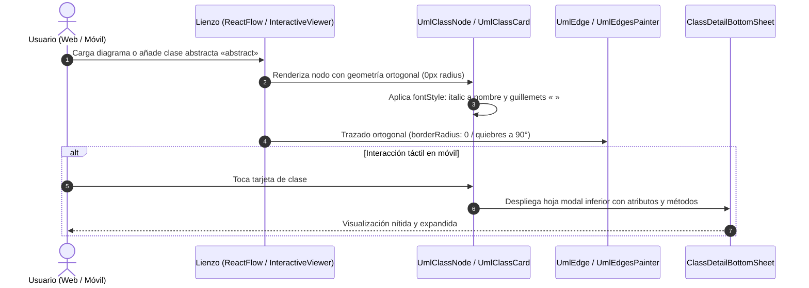

# Plan Técnico: Rediseño Visual del Lienzo estilo Enterprise Architect y Conformidad UML 2.5 (Web y App Móvil)

> **Estado:** APPROVED  
> **Versión:** 1.0.0  
> **Módulo:** `docs/specs/06-redisenio-lienzo-enterprise-architect/`  
> **Especificación Base:** `docs/specs/06-redisenio-lienzo-enterprise-architect/spec.md`  
> **Constitución Base:** `docs/constitution.md`  
> **Metodología:** SDD-Planning  

---

## 1. Resumen Arquitectónico y Decisiones de Diseño

- **Objetivo Técnico**: Homologar visualmente los clasificadores, notas y aristas en Next.js (`ReactFlow`) y Flutter (`InteractiveViewer` / `CustomPainter`) bajo la estética formal de Enterprise Architect y la especificación UML 2.5: esquinas vivas ortogonales de 90° (`rounded-none` / `BorderRadius.zero`), separación nítida de compartimentos por líneas continuas de 1px, renderizado tipográfico en cursiva (*italic*) para clases abstractas, notas con pliegue superior derecho (*dog-ear*), y aristas ortogonales con curvatura de radio cero (`borderRadius: 0`).
- **Estilo y Patrón Arquitectónico**: *Component-Driven Presentation & Custom Painting* desacoplado del modelo de persistencia; compatibilidad 100% retroactiva con el esquema `Canvas JSON` sin tocar la base de datos relacional.
- **Decisiones Arquitectónicas Clave Tomadas**:
  - **Persistencia e Integridad**: Inmutable. El campo `lienzo` (`TEXT`) en `diagrams` mantiene el mismo contrato de nodos y aristas.
  - **Renderizado Web (`front_diag_clases`)**: Modificación modular de `UmlClassNode.tsx`, `UmlNoteNode.tsx`, `UmlEdge.tsx` y `UmlFloatingEdge.tsx` usando utilidades estándar de Tailwind CSS v4 y `@xyflow/react`.
  - **Renderizado Móvil (`flutter_viewer`)**: Actualización de `DiagramCanvasData.fromJson` para soportar colecciones polimórficas de nodos (`UmlClassNode` y `UmlNoteNode`), rediseño de `UmlClassCard` a esquinas ortogonales, implementación de `UmlNoteCard` con pliegue técnico y componente `ClassDetailBottomSheet` para inspección táctil.

### 1.1 Matriz de Componentes Técnicos (`PLAN-XX`)

| ID Componente | Nombre / Artefacto Técnico | Capa Arquitectónica | Responsabilidad Técnica | Requisitos que Cubre (`RF` / `RB` / `SC`) |
| :--- | :--- | :--- | :--- | :--- |
| **`PLAN-06.1`** | `UmlClassNode.tsx` | Web / Presentación | Clasificadores ortogonales de 90°, líneas continuas de compartimentos, clases abstractas en cursiva y estereotipos en guillemets `« »`. | `RF-06.1.1`, `RF-06.1.2`, `RF-06.1.3`, `RB-06.1`, `RB-06.2`, `RB-06.3`, `SC-1`, `SC-2` |
| **`PLAN-06.2`** | `UmlNoteNode.tsx` | Web / Presentación | Nota UML técnica con esquina doblada (*dog-ear* fold) y fondo amarillo suave. | `RF-06.3.1`, `RB-06.6` |
| **`PLAN-06.3`** | `UmlEdge.tsx` & `UmlFloatingEdge.tsx` | Web / Presentación | Aristas ortogonales con quiebres en ángulo recto y radio de curvatura cero (`borderRadius: 0`). | `RF-06.2.1`, `RF-06.2.2`, `RB-06.5`, `SC-3` |
| **`PLAN-06.4`** | `diagram_model.dart` | Flutter / Dominio & Modelo | Modelo de datos polimórfico con soporte para clases abstractas y notas explicativas (`umlNote`). | `RF-06.4.2`, `RF-06.5.1`, `RB-06.7`, `SC-4` |
| **`PLAN-06.5`** | `mobile_canvas_painter.dart` & `UmlClassCard` | Flutter / Presentación | Tarjeta de clase ortogonal en Flutter (`BorderRadius.zero`) con líneas divisorias y detección táctil. | `RF-06.4.1`, `RF-06.6.1`, `RB-06.1`, `SC-2` |
| **`PLAN-06.6`** | `UmlNoteCard` (`uml_note_card.dart`) | Flutter / Presentación | Widget de nota UML con pliegue dog-ear y renderizado de texto. | `RF-06.5.1`, `RB-06.6`, `SC-4` |
| **`PLAN-06.7`** | `ClassDetailBottomSheet` (`class_detail_bottom_sheet.dart`) | Flutter / Presentación | Hoja modal inferior para inspeccionar atributos, métodos y multiplicidades en pantalla táctil. | `RF-06.6.1`, `RB-06.8`, `SC-5` |

---

## 2. Estructura Física de Archivos del Proyecto / Módulo

```text
SW1-P1-DiagramadorClases-2026-2/
├── front_diag_clases/
│   └── components/canvas/
│       ├── [MODIFY] UmlClassNode.tsx                         # (PLAN-06.1) Esquinas cuadradas, cursiva y compartimentos EA
│       ├── [MODIFY] UmlNoteNode.tsx                          # (PLAN-06.2) Nota con pliegue técnico dog-ear
│       ├── [MODIFY] UmlEdge.tsx                              # (PLAN-06.3) getSmoothStepPath con borderRadius: 0
│       └── [MODIFY] UmlFloatingEdge.tsx                      # (PLAN-06.3) Trazado ortogonal y perimetral limpio
└── flutter_viewer/
    └── lib/
        ├── models/
        │   └── [MODIFY] diagram_model.dart                   # (PLAN-06.4) Discriminación de umlNote vs umlClass y abstracto
        └── widgets/
            ├── [MODIFY] mobile_canvas_painter.dart           # (PLAN-06.5) UmlClassCard ortogonal y renderizado de notas
            ├── [CREATE] uml_note_card.dart                   # (PLAN-06.6) Widget de nota técnica con pliegue
            └── [CREATE] class_detail_bottom_sheet.dart       # (PLAN-06.7) Hoja modal de inspección táctil
```

---

## 3. Modelo Físico de Persistencia y Esquema de Datos

* **Invariante Constitucional**: No se requieren migraciones de base de datos ni modificaciones de tablas.
* El campo `lienzo` almacena estructuras JSON compatibles:
  - Nodos de clase: `{ "id": "...", "type": "umlClass", "data": { "name": "...", "stereotype": "...", "attributes": [...], "methods": [...] } }`
  - Nodos de nota: `{ "id": "...", "type": "umlNote", "data": { "content": "..." } }`

---

## 4. Contratos de Código, Interfaces Tipadas y Componentes

### 4.1 Definición Tipada en Frontend Web (`UmlClassNode.tsx`)
```typescript
// Convención visual de Enterprise Architect
const isAbstract = 
  classData.stereotype?.toLowerCase().includes("abstract") || 
  Boolean((classData as any).isAbstract);

// Normalización de estereotipos a guillemets tipográficos
const formatStereotype = (st?: string): string => {
  if (!st) return "";
  const cleaned = st.replace(/^<<|>>$/g, "").replace(/^«|»$/g, "").trim();
  return `«${cleaned}»`;
};
```

### 4.2 Modelo Dart en App Móvil (`diagram_model.dart`)
```dart
abstract class UmlCanvasNode {
  final String id;
  final double x;
  final double y;
  final String type;

  UmlCanvasNode({required this.id, required this.x, required this.y, required this.type});
}

class UmlClassNode extends UmlCanvasNode {
  final String name;
  final String stereotype;
  final bool isAbstract;
  final List<String> attributes;
  final List<String> methods;

  UmlClassNode({
    required super.id,
    required super.x,
    required super.y,
    super.type = 'umlClass',
    required this.name,
    this.stereotype = '',
    this.isAbstract = false,
    required this.attributes,
    required this.methods,
  });
}

class UmlNoteNode extends UmlCanvasNode {
  final String content;

  UmlNoteNode({
    required super.id,
    required super.x,
    required super.y,
    super.type = 'umlNote',
    required this.content,
  });
}
```

---

## 5. Diagrama Técnico de Secuencia e Interacción



---

## 6. Garantías de Runtime y Ciclo de Vida Operativo

1. **Rendimiento de Renderizado**:
   - Web: El uso de clases Tailwind estáticas (`rounded-none`, `border-slate-300`, etc.) previene re-cálculos de layout innecesarios.
   - Móvil: `CustomPainter` utiliza rutas en caché y `RepaintBoundary` para evitar repintados durante el scroll/pan en `InteractiveViewer`.
2. **Resiliencia ante Nodos Desconocidos**:
   - Si en el lienzo móvil se encuentra un nodo con tipo no clasificado, se degrada elegantemente a un clasificador básico sin provocar crash en Flutter.

---

## 7. Arquitectura de Vertical Slices (Hoja de Ruta para `/sdd-task`)

* **Slice 1: Rediseño Geométrico y UML 2.5 en Plataforma Web** (`PLAN-06.1`, `PLAN-06.2`, `PLAN-06.3`):
  - Clases rectangulares ortogonales `rounded-none`, cursiva para abstractas, notas dog-ear y aristas sin curvas.
  - Escenarios cubiertos: `SC-1`, `SC-2`, `SC-3`.
* **Slice 2: Rediseño Geométrico y Soporte Polimórfico en App Móvil Flutter** (`PLAN-06.4`, `PLAN-06.5`, `PLAN-06.6`):
  - Modelo polimórfico, `UmlClassCard` ortogonal, `UmlNoteCard` con pliegue dog-ear.
  - Escenarios cubiertos: `SC-2`, `SC-4`.
* **Slice 3: Inspección Táctil Móvil y Soporte Clase-Asociación** (`PLAN-06.7`):
  - Despliegue de `ClassDetailBottomSheet` y validación de aristas punteadas.
  - Escenarios cubiertos: `SC-5`.
* **Fase Final: Verificación Consolidada y Cierre**:
  - `npx tsc --noEmit`, `npm run lint` y análisis estático móvil.

---

## 8. Estrategia de Testing y Verificación Técnica

| Nivel de Prueba | Tipo | Archivo / Comando de Verificación | Qué Valida Exactamente | Reglas / Escenarios |
| :--- | :--- | :--- | :--- | :--- |
| **1. Verificación Web** | Type-Check & Linter | `cd front_diag_clases; npx tsc --noEmit; npm run lint` | Tipado estricto de componentes y ausencia de regresiones sintácticas | `RF-06.1.1` a `RF-06.3.1` |
| **2. Verificación Móvil** | Static Analysis | `cd flutter_viewer; flutter analyze` (o verificación sintáctica de modelos) | Parsing polimórfico de nodos y clases Dart | `RF-06.4.1` a `RF-06.7.1` |

---

## 9. Matriz de Trazabilidad Técnica (`Spec` ↔ `Plan`)

| Requisito / Regla / Escenario (`spec.md`) | Componente(s) del Plan (`PLAN-XX`) | Archivo Físico Principal | Verificación |
| :--- | :--- | :--- | :--- |
| `HU-06.1`, `RF-06.1.1`..`3`, `RB-06.1`..`3`, `SC-1`, `SC-2` | `PLAN-06.1` | `front_diag_clases/.../UmlClassNode.tsx` | Compilación TS / Render web |
| `HU-06.2`, `RF-06.2.1`..`2`, `RB-06.5`, `SC-3` | `PLAN-06.3` | `front_diag_clases/.../UmlEdge.tsx` | Inspección de aristas a 90° |
| `HU-06.3`, `RF-06.3.1`, `RB-06.6` | `PLAN-06.2` | `front_diag_clases/.../UmlNoteNode.tsx` | Inspección de pliegue dog-ear |
| `HU-06.4`, `HU-06.5`, `RF-06.4.1`, `RF-06.5.1`, `SC-4` | `PLAN-06.4`, `PLAN-06.5`, `PLAN-06.6` | `flutter_viewer/.../mobile_canvas_painter.dart` | Render móvil Flutter |
| `HU-06.6`, `RF-06.6.1`, `RB-06.8`, `SC-5` | `PLAN-06.7` | `flutter_viewer/.../class_detail_bottom_sheet.dart` | Toque táctil y modal sheet |

