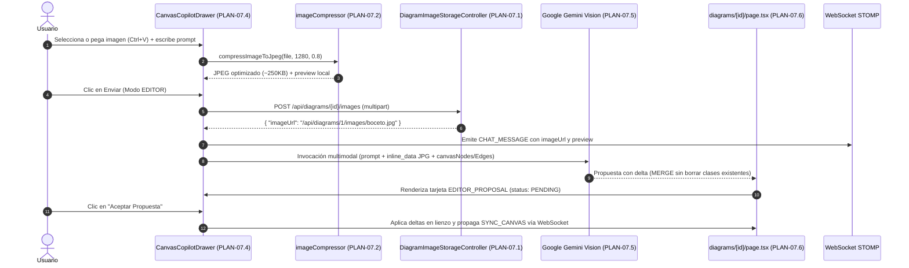

# Plan Técnico: Chat IA con Edición Multimodal de Diagramas e Inserción de Imágenes

> **Estado:** APPROVED  
> **Versión:** 1.0.0  
> **Módulo:** `docs/specs/07-chat-ia-edicion-multimodal-imagenes/`  
> **Especificación Base:** `docs/specs/07-chat-ia-edicion-multimodal-imagenes/spec.md`  
> **Constitución Base:** `docs/constitution.md`  
> **Metodología:** SDD-Planning  

---

## 1. Resumen Arquitectónico y Decisiones de Diseño

- **Objetivo Técnico**: Extender la arquitectura del Copilot IA para soportar entradas multimodales (texto + imagen de diagrama o boceto) tanto en Modo CHAT como en Modo EDITOR, incorporando compresión obligatoria en el cliente a formato JPG ligero (máx. 1280px), almacenamiento de imágenes asociadas al diagrama en el servidor backend (`/uploads/diagrams/{id}/`), visualización colaborativa mediante miniaturas interactivas en el chat con visor lightbox, y procesamiento en Google Gemini Vision bajo la directiva de fusión contextual (*MERGE por defecto*) para no eliminar el trabajo previo del lienzo.
- **Estilo y Patrón Arquitectónico**: *Client-Side Preprocessing & Multimodal Orchestration*. Flujo híbrido que desacopla la optimización de medios (navegador) del almacenamiento físico (Spring Boot Controller) y la inferencia generativa (Google Gemini API).
- **Decisiones Arquitectónicas Clave Tomadas**:
  - **Compresión Previa**: Procesamiento en el navegador mediante HTML5 Canvas API que restringe la dimensión mayor a 1280px y codifica a JPEG con factor de compresión 0.8 (~150KB a 350KB), mitigando congestión en la red.
  - **Almacenamiento de Activos en el Proyecto**: Controlador Spring Boot `POST /api/diagrams/{id}/images` que guarda el archivo JPG en el directorio `uploads/diagrams/{id}/` y expone el recurso estático vía `GET /api/diagrams/{id}/images/{filename}`.
  - **Persistencia en DynamoDB**: El modelo `ChatMessage` añade los campos `imageUrl?: string` y `attachmentThumbnail?: string` sin alterar la estructura histórica de la tabla `DiagramChatMessages`.
  - **Fusión Contextual en Modo EDITOR**: La invocación a Gemini Vision incluye el estado serializado del lienzo actual (`nodes` y `edges`) y un system prompt de ingeniería estricto que prohíbe eliminar entidades preexistentes, posicionando los nuevos clasificadores con desplazamiento relativo.

### 1.1 Matriz de Componentes Técnicos (`PLAN-XX`)

| ID Componente | Nombre / Artefacto Técnico | Capa Arquitectónica | Responsabilidad Técnica | Requisitos que Cubre (`RF` / `RB` / `SC`) |
| :--- | :--- | :--- | :--- | :--- |
| **`PLAN-07.1`** | `DiagramImageStorageController.java` & Configuración MVC | Backend / Infraestructura | Endpoint multipart para almacenar JPGs en el proyecto y servir imágenes estáticas asociadas al diagrama. | `RF-07.1.3`, `RB-07.3` |
| **`PLAN-07.2`** | `imageCompressor.ts` | Frontend / Utilidades | Compresión y redimensionamiento en cliente vía Canvas API a formato JPG optimizado. | `RF-07.1.2`, `RB-07.1`, `RB-07.2`, `SC-1` |
| **`PLAN-07.3`** | `types/index.ts` (Extensión `ChatMessage`) | Frontend / Contratos | Tipado de mensajes con soporte de `imageUrl`, `attachmentMimeType` y metadatos de propuesta. | `RF-07.1.1`, `RB-07.3` |
| **`PLAN-07.4`** | `CanvasCopilotDrawer.tsx` & `ImageLightboxModal.tsx` | Frontend / Presentación | Botón de adjuntar, soporte para pegado `Ctrl+V`, chip de preview con descarte y visor modal de imágenes. | `RF-07.1.1`, `RF-07.1.2`, `SC-1`, `SC-4` |
| **`PLAN-07.5`** | `geminiDiagramService.ts` (`chatWithCopilotMultimodal`) | Frontend / Integración IA | Inferencia multimodal en Gemini Vision con lógica de fusión contextual MERGE y cálculo de posiciones libres. | `RF-07.2.1`, `RF-07.2.2`, `RF-07.3.1`, `RB-07.4`, `RB-07.5`, `SC-1`, `SC-3` |
| **`PLAN-07.6`** | `page.tsx` (`diagrams/[id]`) | Frontend / Orquestación | Orquestación del flujo de subida, difusión por WebSocket STOMP y aplicación atómica de la mutación. | `RF-07.2.3`, `RB-07.6`, `SC-2` |

---

## 2. Estructura Física de Archivos del Proyecto / Módulo

```text
SW1-P1-DiagramadorClases-2026-2/
├── back_diagramador/
│   └── src/main/java/com/example/back_diagramador/
│       ├── config/
│       │   └── [MODIFY] WebMvcConfig.java                    # (PLAN-07.1) Mapeo estático de /uploads/diagrams/**
│       └── controller/
│           └── [CREATE] DiagramImageStorageController.java   # (PLAN-07.1) POST y GET de imágenes de diagrama
└── front_diag_clases/
    ├── types/
    │   └── [MODIFY] index.ts                                 # (PLAN-07.3) Extensiones de ChatMessage con imageUrl
    ├── utils/
    │   └── [CREATE] imageCompressor.ts                       # (PLAN-07.2) Utilidad de compresión Canvas a JPG
    ├── components/canvas/
    │   ├── [MODIFY] CanvasCopilotDrawer.tsx                  # (PLAN-07.4) Botón adjunto, Ctrl+V, miniatura interactiva
    │   └── [CREATE] ImageLightboxModal.tsx                   # (PLAN-07.4) Modal de ampliación en alta resolución
    ├── services/
    │   └── [MODIFY] geminiDiagramService.ts                  # (PLAN-07.5) Inferencia multimodal con fusión MERGE
    └── app/(dashboard)/diagrams/[id]/
        └── [MODIFY] page.tsx                                 # (PLAN-07.6) Subida de archivo, difusión y aceptación
```

---

## 3. Modelo Físico de Persistencia y Esquema de Datos

### 3.1 Directorio de Almacenamiento Local de Activos (`PLAN-07.1`)
- **Directorio Raíz**: `uploads/diagrams/{diagramId}/`
- **Convención de Nombres**: `{timestamp}_{uuid_corto}.jpg`
- **Ruta de Acceso Público**: `/api/diagrams/{diagramId}/images/{filename}`
- **Tipo de Archivo**: `image/jpeg` (JPEG estándar).

### 3.2 Tabla DynamoDB `DiagramChatMessages` (`PLAN-07.3`)
Se añaden atributos opcionales a los elementos serializados en la tabla:
| Atributo | Tipo DynamoDB | Nulabilidad | Descripción |
| :--- | :--- | :--- | :--- |
| `imageUrl` | `S` (String) | Opcional | URL accesible del recurso JPG guardado en el servidor |
| `attachmentMimeType` | `S` (String) | Opcional | Tipo MIME del adjunto (`image/jpeg`) |
| `sourceImageId` | `S` (String) | Opcional | Referencia interna en propuestas de edición |

---

## 4. Contratos de Código, Interfaces Tipadas y Errores

### 4.1 Contratos TypeScript en Frontend (`types/index.ts`)
```typescript
export interface ChatMessage {
  id?: string;
  diagramId: number;
  senderType: ChatSenderType;
  userId?: number | null;
  userName: string;
  mode: CopilotMode;
  messageType: ChatMessageType;
  content: string;
  imageUrl?: string | null;            // URL de la imagen JPG guardada en el proyecto
  attachmentThumbnail?: string | null; // DataURL optimizada para preview en chat
  attachmentMimeType?: string | null;  // image/jpeg
  taggedUserName?: string | null;
  proposalJson?: string | null;
  proposal?: ChatProposalPayload | null;
  proposalStatus?: ProposalStatus;
  resolvedByUserId?: number | null;
  resolvedByUserName?: string | null;
  resolvedAt?: string | null;
  isError?: boolean;
  errorMessage?: string | null;
  createdAt?: string;
}
```

### 4.2 Utilidad de Compresión en Cliente (`imageCompressor.ts`)
```typescript
export interface CompressedImageResult {
  file: File;
  base64Data: string;
  dataUrl: string;
  mimeType: "image/jpeg";
  width: number;
  height: number;
  sizeBytes: number;
}

export async function compressImageToJpeg(
  source: File | Blob,
  maxDimension = 1280,
  quality = 0.8
): Promise<CompressedImageResult>;
```

### 4.3 Controlador Backend (`DiagramImageStorageController.java`)
```java
@RestController
@RequestMapping("/api/diagrams/{diagramId}/images")
@RequiredArgsConstructor
public class DiagramImageStorageController {

    @PostMapping(consumes = MediaType.MULTIPART_FORM_DATA_VALUE)
    public ResponseEntity<Map<String, String>> uploadDiagramImage(
            @PathVariable Long diagramId,
            @RequestParam("file") MultipartFile file) { ... }

    @GetMapping("/{filename:.+}")
    public ResponseEntity<Resource> serveDiagramImage(
            @PathVariable Long diagramId,
            @PathVariable String filename) { ... }
}
```

---

## 5. Diagrama Técnico de Secuencia e Interacción Multimodal



---

## 6. Garantías de Runtime, Resiliencia y Manejo de Errores

1. **Gestión de Cuota y Fallback de IA**:
   - Si Gemini Vision responde con código 429 (*Rate Limit*), el sistema captura la excepción y muestra el aviso amigable configurado: `"IA saturada, vuelve a escribir"`.
2. **Validación de Archivos no Soportados**:
   - Todo archivo que no coincida con el tipo MIME `image/*` es rechazado de inmediato en el cliente antes de invocar la compresión o el backend.
3. **Persistencia Segura en Directorio de Activos**:
   - Los nombres de archivo se sanitizan mediante identificadores aleatorios UUIDv4 para prevenir ataques de *Path Traversal*.

---

## 7. Arquitectura de Vertical Slices (Hoja de Ruta para `/sdd-task`)

* **Slice 1: Almacenamiento de Activos en Backend y Compresión en Frontend** (`PLAN-07.1`, `PLAN-07.2`, `PLAN-07.3`):
  - Creación del endpoint en Spring Boot para archivar JPGs y utilidad de compresión HTML5 Canvas en Next.js.
  - Escenarios cubiertos: `SC-1`, `SC-4`.
* **Slice 2: UI Conversacional Multimodal e Inspección Lightbox** (`PLAN-07.4`):
  - Botón de cámara/imagen, soporte para portapapeles, chip de previsualización y componente `ImageLightboxModal`.
  - Escenarios cubiertos: `SC-1`, `SC-4`.
* **Slice 3: Inferencia Multimodal en Gemini (Modo CHAT y Modo EDITOR con Fusión MERGE)** (`PLAN-07.5`, `PLAN-07.6`):
  - Integración multimodal con Gemini Vision, preservación de clases existentes en propuestas de mutación y aceptación colaborativa.
  - Escenarios cubiertos: `SC-1`, `SC-2`, `SC-3`.
* **Fase Final: Verificación Consolidada y Cierre**:
  - Compilación backend (`mvnw compile`) y type-check frontend (`npx tsc --noEmit`).

---

## 8. Estrategia de Testing y Verificación Técnica

| Nivel de Prueba | Tipo | Archivo / Comando de Verificación | Qué Valida Exactamente | Reglas / Escenarios |
| :--- | :--- | :--- | :--- | :--- |
| **1. Backend API** | Unit & Integration | `cd back_diagramador; .\mvnw.cmd test` o `compile` | Subida y servicio de archivos estáticos JPEG | `RF-07.1.3`, `RB-07.3` |
| **2. Frontend Types & UI** | Type-Check & Linter | `cd front_diag_clases; npx tsc --noEmit; npm run lint` | Tipado de `ChatMessage`, compresión y componentes UI | `RF-07.1.1`, `RF-07.2.1` |

---

## 9. Matriz de Trazabilidad Técnica (`Spec` ↔ `Plan`)

| Requisito / Regla / Escenario (`spec.md`) | Componente(s) del Plan (`PLAN-XX`) | Archivo Físico Principal | Verificación |
| :--- | :--- | :--- | :--- |
| `HU-07.1`, `RF-07.1.1`..`3`, `RB-07.1`..`3`, `SC-1` | `PLAN-07.1`, `PLAN-07.2`, `PLAN-07.4` | `imageCompressor.ts`, `DiagramImageStorageController.java` | Compresión cliente y upload |
| `HU-07.2`, `RF-07.2.1`..`3`, `RB-07.4`..`6`, `SC-2` | `PLAN-07.5`, `PLAN-07.6` | `geminiDiagramService.ts`, `page.tsx` | Propuesta MERGE y aceptación |
| `HU-07.3`, `RF-07.3.1`, `SC-3` | `PLAN-07.5` | `geminiDiagramService.ts` | Inferencia conversacional CHAT |
| `SC-4` (Error / Validación) | `PLAN-07.2`, `PLAN-07.4` | `CanvasCopilotDrawer.tsx` | Rechazo de tipos de archivo inválidos |

