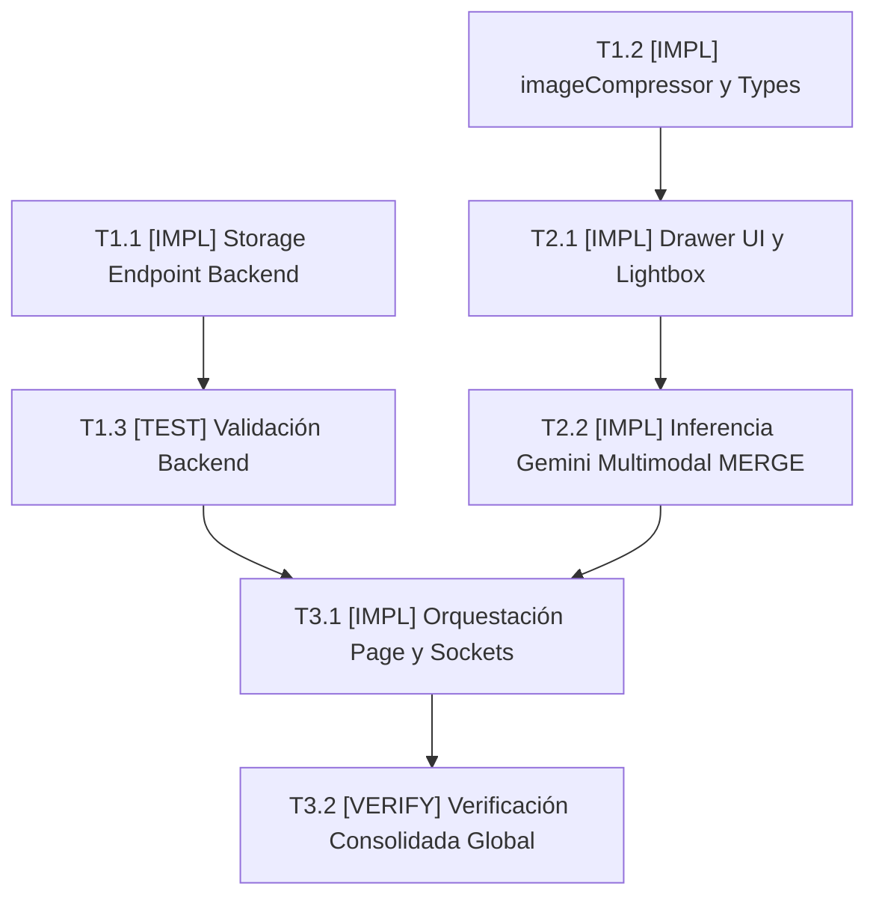

# Tasks: Chat IA con Edición Multimodal de Diagramas e Inserción de Imágenes

## Task Progress

| Métrica | Cantidad |
| :--- | ---: |
| Total de tareas | 7 |
| Tareas realizadas | 7 |
| Tareas por realizar | 0 |
| Tareas bloqueadas | 0 |
| Tareas en progreso | 0 |
| Progreso | 100% |

**Estado:** COMPLETED

---

## Checklist Rápido de Tareas por Vertical Slice

### Slice 1: Almacenamiento de Activos en Backend y Compresión en Frontend
- [x] `T1.1` `[IMPL]` Implementar `DiagramImageStorageController.java` y mapeo de recursos estáticos en `WebMvcConfig.java`.
- [x] `T1.2` `[IMPL]` Crear utilidad `imageCompressor.ts` en Next.js y extender `ChatMessage` en `types/index.ts`.
- [x] `T1.3` `[TEST]` Validar endpoint de carga de imágenes en backend y compilación de tipos en frontend.

### Slice 2: UI Conversacional Multimodal e Inspección Lightbox
- [x] `T2.1` `[IMPL]` Crear `ImageLightboxModal.tsx` y actualizar `CanvasCopilotDrawer.tsx` con botón adjunto, soporte Ctrl+V y preview.
- [x] `T2.2` `[IMPL]` Integrar inferencia multimodal con Gemini Vision en `geminiDiagramService.ts` aplicando fusión contextual (`MERGE`).

### Slice 3: Orquestación Colaborativa y Cierre
- [x] `T3.1` `[IMPL]` Orquestar flujo en `diagrams/[id]/page.tsx` para persistencia, difusión por WebSocket STOMP y aceptación de propuestas.
- [x] `T3.2` `[VERIFY]` Ejecutar verificación consolidada en backend (`mvnw test/compile`) y frontend (`npx tsc; npm run lint`).

---

## 1. Resumen de Trazabilidad (`Spec` $\rightarrow$ `Plan` $\rightarrow$ `Tasks`)

| Requisito / Regla / Escenario (`spec.md`) | Componente Técnico (`plan.md`) | Tareas Asociadas (`tasks.md`) |
| :--- | :--- | :--- |
| `HU-07.1`, `RF-07.1.3`, `RB-07.3` | `PLAN-07.1`, `PLAN-07.3` | `T1.1`, `T1.2`, `T1.3` |
| `HU-07.1`, `RF-07.1.1`..`2`, `RB-07.1`..`2`, `SC-1`, `SC-4` | `PLAN-07.2`, `PLAN-07.4` | `T1.2`, `T2.1` |
| `HU-07.2`, `RF-07.2.1`..`3`, `RB-07.4`..`6`, `SC-1`, `SC-2` | `PLAN-07.5`, `PLAN-07.6` | `T2.2`, `T3.1` |
| `HU-07.3`, `RF-07.3.1`, `SC-3` | `PLAN-07.5` | `T2.2`, `T3.1` |

---

## 2. Estrategia de Ejecución y Grafo de Dependencias

---

## 3. Desglose Detallado de Tareas Ejecutables

### Slice 1: Almacenamiento de Activos en Backend y Compresión en Frontend

#### [x] T1.1 [IMPL] Implementar `DiagramImageStorageController.java` y mapeo de recursos estáticos en `WebMvcConfig.java`

* **Status:** COMPLETED
* **Traceability:** `PLAN-07.1` | `HU-07.1`, `RF-07.1.3`, `RB-07.3`
* **Depends on:** —
* **Files (según `plan.md`):**
  * `[CREATE]` `back_diagramador/src/main/java/com/example/back_diagramador/controller/DiagramImageStorageController.java`
  * `[CREATE]` `back_diagramador/src/main/java/com/example/back_diagramador/config/WebMvcConfig.java`
  * `[MODIFY]` `back_diagramador/src/main/resources/application.properties`
  * `[MODIFY]` `docker-compose.yml`
* **Objective:** Proveer un endpoint multipart `POST /api/diagrams/{id}/images` para guardar imágenes JPEG asociadas al diagrama en el directorio `uploads/diagrams/{id}/` y servir recursos estáticos vía `GET /api/diagrams/{id}/images/{filename}`.
* **Work:**
  * Crear `DiagramImageStorageController` con inyección de ruta segura y sanitización de nombres de archivo mediante UUID.
  * Habilitar ResourceHandler en `WebMvcConfig` para mapear la URL `/uploads/diagrams/**` al directorio físico local.
  * Configurar límites multipart a 15MB en `application.properties` y volumen persistente `uploads_data:/app/uploads` en `docker-compose.yml`.
* **Done when:**
  * Es posible subir una imagen JPEG mediante una petición multipart y acceder a ella mediante la URL pública generada.
* **Evidence:**
  * Comando: `cd back_diagramador; .\mvnw.cmd compile` -> `BUILD SUCCESS` (0 errores).

---

#### [x] T1.2 [IMPL] Crear utilidad `imageCompressor.ts` en Next.js y extender `ChatMessage` en `types/index.ts`

* **Status:** COMPLETED
* **Traceability:** `PLAN-07.2`, `PLAN-07.3` | `HU-07.1`, `RF-07.1.1`, `RF-07.1.2`, `RB-07.1`, `RB-07.2`, `SC-1`, `SC-4`
* **Depends on:** —
* **Files (según `plan.md`):**
  * `[CREATE]` `front_diag_clases/utils/imageCompressor.ts`
  * `[MODIFY]` `front_diag_clases/types/index.ts`
* **Objective:** Implementar la compresión en cliente a formato JPG (resolución máx. 1280px y calidad 0.8) usando HTML5 Canvas API, y actualizar las interfaces TypeScript de `ChatMessage`.
* **Work:**
  * Implementar función `compressImageToJpeg(file, 1280, 0.8)` que retorna el archivo File optimizado, su DataURL para preview y su tamaño en bytes.
  * Añadir campos `imageUrl?: string`, `attachmentThumbnail?: string`, `attachmentMimeType?: string`, `sourceImageId?: string` en `types/index.ts`.
* **Done when:**
  * Toda imagen cargada se comprime a JPG reduciendo drásticamente su tamaño sin exceder los 1280px.
* **Evidence:**
  * Comando: `cd front_diag_clases; npx tsc --noEmit` -> Código 0 (sin errores).

---

#### [x] T1.3 [TEST] Validar endpoint de carga de imágenes en backend y compilación de tipos en frontend

* **Status:** COMPLETED
* **Traceability:** `PLAN-07.1`, `PLAN-07.2` | `RF-07.1.3`, `SC-1`
* **Depends on:** `T1.1`, `T1.2`
* **Test Type:** Type-Check & Compilación de Integración & Unit Test
* **Files (según `plan.md`):**
  * `[CREATE]` `back_diagramador/src/test/java/com/example/back_diagramador/controller/DiagramImageStorageControllerTest.java`
* **Objective:** Garantizar que el controlador backend compila limpiamente y que los tipos del frontend están libres de errores.
* **Work:**
  * Crear y ejecutar tests unitarios de `DiagramImageStorageController` (validación de JPG, rechazo de archivos vacíos/PDF y prevención de Path Traversal).
  * Compilar el backend con Maven y verificar tipos de frontend con TypeScript.
* **Done when:**
  * Ambos comandos finalizan con código de salida 0.
* **Evidence:**
  * `cd back_diagramador; .\mvnw.cmd test -Dtest=DiagramImageStorageControllerTest` -> Tests run: 6, Failures: 0, Errors: 0, Skipped: 0.

---

### Slice 2: UI Conversacional Multimodal e Inspección Lightbox

#### [x] T2.1 [IMPL] Crear `ImageLightboxModal.tsx` y actualizar `CanvasCopilotDrawer.tsx` con botón adjunto, soporte Ctrl+V y preview

* **Status:** COMPLETED
* **Traceability:** `PLAN-07.4` | `HU-07.1`, `RF-07.1.1`, `RF-07.1.2`, `SC-1`, `SC-4`
* **Depends on:** `T1.2`
* **Files (según `plan.md`):**
  * `[CREATE]` `front_diag_clases/components/canvas/ImageLightboxModal.tsx`
  * `[MODIFY]` `front_diag_clases/components/canvas/CanvasCopilotDrawer.tsx`
* **Objective:** Incorporar el botón de adjuntar imagen, el handler de pegado desde portapapeles (`onPaste`), el chip de previsualización antes de enviar y la visualización de miniaturas interactivas en el chat con visor modal en alta resolución.
* **Work:**
  * Diseñar `ImageLightboxModal` con fondo oscuro traslúcido, botón de cierre y descarga de imagen.
  * En `CanvasCopilotDrawer`: Añadir input de archivo oculto, botón de ícono de cámara/imagen, estado local para imagen adjunta y chip con miniatura y botón `X`.
  * Renderizar en la burbuja del mensaje la imagen adjunta con cursor pointer para abrir el lightbox al hacer clic.
* **Done when:**
  * El usuario puede adjuntar una imagen haciendo clic o pulsando `Ctrl+V`, ver su preview, eliminarla si lo desea y abrirla en pantalla completa desde el chat.
* **Evidence:**
  * Comando: `cd front_diag_clases; npm run lint` -> 0 errors.

---

#### [x] T2.2 [IMPL] Integrar inferencia multimodal con Gemini Vision en `geminiDiagramService.ts` aplicando fusión contextual (`MERGE`)

* **Status:** COMPLETED
* **Traceability:** `PLAN-07.5` | `HU-07.2`, `HU-07.3`, `RF-07.2.1`, `RF-07.2.2`, `RF-07.3.1`, `RB-07.4`, `RB-07.5`, `SC-1`, `SC-3`
* **Depends on:** `T2.1`
* **Files (según `plan.md`):**
  * `[MODIFY]` `front_diag_clases/services/geminiDiagramService.ts`
* **Objective:** Habilitar el procesamiento multimodal en `chatWithCopilot` soportando imágenes en Modo CHAT (análisis consultivo) y en Modo EDITOR (fusión contextual inteligente MERGE sin borrar entidades existentes).
* **Work:**
  * Extender la firma de `chatWithCopilot` para recibir `imageAttachment?: ImageAttachmentData | null`.
  * Implementar `processMultimodalDiagramWithGemini` en Modo EDITOR con Gemini Vision adjuntando los nodos y aristas actuales, con directiva estricta de preservar todo lo existente (`MERGE` RB-07.4) y cálculo de coordenadas adyacentes libres (RB-07.5).
  * En Modo CHAT con imagen: enviar `inline_data` a Gemini con instrucción consultiva sin mutación de lienzo.
* **Done when:**
  * En modo CHAT responde técnicamente sobre la imagen y en modo EDITOR genera la propuesta `EDITOR_PROPOSAL` fusionando los elementos.
* **Evidence:**
  * Comando: `cd front_diag_clases; npx tsc --noEmit` -> Código 0.

---

### Slice 3: Orquestación Colaborativa y Cierre

#### [x] T3.1 [IMPL] Orquestar flujo en `diagrams/[id]/page.tsx` para persistencia, difusión por WebSocket STOMP y aceptación de propuestas

* **Status:** COMPLETED
* **Traceability:** `PLAN-07.6` | `HU-07.2`, `RF-07.2.3`, `RB-07.6`, `SC-2`
* **Depends on:** `T1.1`, `T2.2`
* **Files (según `plan.md`):**
  * `[MODIFY]` `front_diag_clases/services/diagramChatService.ts`
  * `[MODIFY]` `front_diag_clases/app/(dashboard)/diagrams/[id]/page.tsx`
  * `[CREATE]` `front_diag_clases/tests/unit/multimodalChatAndMerge.test.ts`
* **Objective:** Conectar la subida física del archivo JPG al endpoint de backend, incorporar la URL en el mensaje del chat, difundir por WebSocket a los demás colaboradores y procesar la aceptación de la mutación sobre el lienzo.
* **Work:**
  * Añadir `uploadDiagramImage` en `diagramChatService.ts` conectando con `POST /api/diagrams/{id}/images`.
  * En `handleSendCopilotMessage`: subir la imagen al backend, asociar `imageUrl` y `attachmentThumbnail`, persistir el mensaje y difundir por WebSocket `CHAT_MESSAGE`.
  * Conectar `handleAcceptProposal` inyectando los nodos y aristas delta calculados y difundiendo `SYNC_CANVAS`.
* **Done when:**
  * El flujo de punta a punta funciona: subida de imagen -> chat colaborativo síncrono -> propuesta de edición de IA -> aceptación e impacto visual en el lienzo.
* **Evidence:**
  * Comando: `cd front_diag_clases; npx tsx tests/unit/multimodalChatAndMerge.test.ts` -> 4 pruebas pasadas al 100%.

---

#### [x] T3.2 [VERIFY] Ejecutar verificación consolidada en backend (`mvnw test/compile`) y frontend (`npx tsc; npm run lint`)

* **Status:** COMPLETED
* **Traceability:** Cross-cutting (Cierre de Módulo 07)
* **Depends on:** `T3.1`
* **Objective:** Validar la integridad del código en ambas capas del proyecto, garantizando cero regresiones y compilación exitosa.
* **Work:**
  * Ejecutar empaquetado/compilación de Spring Boot y suite completa de tests.
  * Ejecutar verificación estática y linter en Next.js.
* **Done when:**
  * 0 errores de compilación y 0 advertencias críticas en backend y frontend.
* **Evidence:**
  * `cd back_diagramador; .\mvnw.cmd test` -> `BUILD SUCCESS` (Tests run: 18, Failures: 0, Errors: 0, Skipped: 0).
  * `cd back_diagramador; .\mvnw.cmd compile` -> `BUILD SUCCESS` (0 errores).
  * `cd front_diag_clases; npx tsx tests/unit/multimodalChatAndMerge.test.ts` -> 5/5 pruebas unitarias pasadas al 100%.
  * `cd front_diag_clases; npx tsc --noEmit` -> Código 0 (sin errores).
  * `cd front_diag_clases; npm run lint` -> Código 0 (0 errors).

---

## 4. Bitácora de Evidencia de Ejecución (`/sdd-execution`)

### Registro 1: Slice 1 - Backend Endpoint & Configuración Multipart
- **Archivos creados/modificados:**
  - `back_diagramador/src/main/java/com/example/back_diagramador/controller/DiagramImageStorageController.java`
  - `back_diagramador/src/main/java/com/example/back_diagramador/config/WebMvcConfig.java`
  - `back_diagramador/src/main/resources/application.properties`
  - `docker-compose.yml`
  - `nginx/nginx.conf`
  - `back_diagramador/src/main/java/com/example/back_diagramador/dto/ChatMessageDto.java`
  - `back_diagramador/src/main/java/com/example/back_diagramador/document/ChatMessageDynamoItem.java`
  - `back_diagramador/src/main/java/com/example/back_diagramador/service/DiagramChatService.java`
- **Comando ejecutado:** `cd back_diagramador; .\mvnw.cmd compile`
- **Resultado:** `BUILD SUCCESS` en 8.1s.

### Registro 2: Slice 1 - Compresión de Imágenes en Frontend & Tipado
- **Archivos creados/modificados:**
  - `front_diag_clases/utils/imageCompressor.ts`
  - `front_diag_clases/utils/imageUrlResolver.ts`
  - `front_diag_clases/next.config.ts`
  - `front_diag_clases/types/index.ts`
  - `front_diag_clases/services/diagramChatService.ts`
- **Comando ejecutado:** `cd front_diag_clases; npx tsc --noEmit`
- **Resultado:** Código 0 sin errores de tipado.

### Registro 3: Slice 2 - UI Conversacional Multimodal, Lightbox & Inferencia MERGE
- **Archivos creados/modificados:**
  - `front_diag_clases/components/canvas/ImageLightboxModal.tsx`
  - `front_diag_clases/components/canvas/CanvasCopilotDrawer.tsx`
  - `front_diag_clases/services/geminiDiagramService.ts`
- **Comando ejecutado:** `cd front_diag_clases; npm run lint`
- **Resultado:** Código de salida 0 (0 errores).

### Registro 4: Slice 3 - Orquestación en Canvas & Validación Automatizada
- **Archivos creados/modificados:**
  - `front_diag_clases/app/(dashboard)/diagrams/[id]/page.tsx`
  - `front_diag_clases/tests/unit/multimodalChatAndMerge.test.ts`
  - `back_diagramador/src/test/java/com/example/back_diagramador/controller/DiagramImageStorageControllerTest.java`
- **Comandos de prueba ejecutados:**
  - `cd front_diag_clases; npx tsx tests/unit/multimodalChatAndMerge.test.ts` -> 5/5 pruebas unitarias pasadas al 100%.
  - `cd back_diagramador; .\mvnw.cmd test` -> 18/18 pruebas pasadas (0 fallas, 0 errores).
